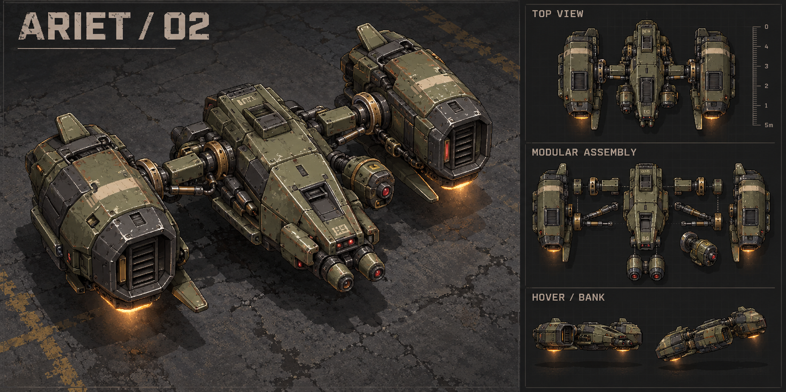

# Ariet — modular gunship workshop plan

**28 October 2026 · Proposal for review · Identity concept prepared; no Ariet runtime artwork or gameplay implemented**

Ariet is the working name for the low-flying industrial gunship discussed as
“Harrier.” This document develops that concept using the
[mechanical workshop process](MECHANICAL_BOSS_WORKSHOP.md). Walker remains an
unfinished Training candidate; this plan neither replaces it nor declares its
motion, difficulty, sound or performance accepted.

## First identity reference

First identity study, generated 28 October 2026. The twin articulated pods, short
structural connections, compact central hull and worn olive/iron/brass materials
set the proposed direction. Review the silhouette and assembly before producing
isolated runtime parts. The drawn ruler is illustrative; gameplay scale, camera,
weapon mechanisms, exact sockets and directional consistency require validation
in the workshop. [Generation notes and prompt](../art/source/bosses/ariet/README.md).

## 1. The fight we want

A large, compact gunship with two articulated engine pods, short stabilizers,
a nose gun assembly and a separately traversing heavy cannon. It banks into a
committed firing pass, settles into a broadside, then exposes itself while its
weapons and engines recover. It should feel like a pilot making decisions.

Its pressure comes from choosing angles and committing to passes. The player
reads the preparation, leaves the threatened route, then uses the recovery to
attack. The encounter must support movement, aiming, firing and reload timing
with the current player build. Damage output alone is not the difficulty dial.

| Identity | Walker, current direction | Ariet, proposed direction |
|---|---|---|
| Movement | Articulated ground pursuit and thruster ram | Low hover, lateral repositioning and committed flight passes |
| Threat | Burst-to-sustained escalation, cannon, pursuit rockets | Twin-gun strafing run, broadside cannon, local engine blast |
| Independent motion | Chassis, legs and gun mounts | Ground root, hull heading, bank, engine pods and cannon |
| Opportunity | Recovery after heavy attacks | Clear settling/cooling period after each committed attack |
| Mechanical character | Planted weight and braced acceleration | Controlled thrust, inertial braking and stable hover |

First version has these three attacks only. Homing missiles, minefields,
destructible engines, reinforcement waves and multiple simultaneous bosses are
not part of this workshop candidate.

## 2. Visual construction before combat

The silhouette must read at the real landscape phone camera with the HUD visible.
Use Regun's weathered iron, muted olive, worn brass, restrained red optics and
warm mechanical exhaust. Readable wear belongs at joints, intake lips, muzzle
and exhaust; evenly noisy detail will become a jumble at phone size.

Build a matched modular asset set:

| Part | Motion or purpose |
|---|---|
| Central armored hull | Stable mass, cockpit/optic and distinct front/rear |
| Short stabilizers and pod pylons | Clear connected structure; no floating engines |
| Left/right engine pods | Separate pivots, nozzles, intake and bounded thrust-vector rotation |
| Pod bearings and linkage | Show how each engine attaches and turns |
| Twin nose guns | Separate barrels, receivers, recoil travel and muzzle sockets |
| Belly/side cannon | Independent yaw bearing, receiver, sliding barrel and solved muzzle |
| Cooling shutters | Visible preparation/recovery mechanism |
| Ground shadow | Root position and visual height cue, independent of paint tilt |
| Failure parts and wreck | Later controlled loss of power, landing and inert remains |

Produce one identity sheet first: top view, three-quarter explanation, component
breakdown, engine articulation, gun arcs and a survivor scale reference. Then
produce compatible isolated parts with one camera/perspective, neutral lighting,
transparent edges and documented source resolution. The identity sheet is not a
sprite atlas to cut up automatically.

A part manifest records rectangles, pivots, attachment sockets, physical sizes,
near/far layering, recoil axis and exhaust direction. Test eight headings on
Breach and Foundry before accepting the assembly. If a painted view cannot rotate
credibly, author the needed directional parts. Do not shrink the boss to hide
low-resolution art or reuse Walker's hull as Ariet's body.

## 3. Motion: one authoritative root, several visible mechanisms

Separate these values explicitly:

- **Ground root and velocity:** actual occupancy/cover-resolved position.
- **Hull heading:** bounded shortest-route turns with a committed navigation aim.
- **Visual hover height and bank:** presentation only; never move damage coordinates.
- **Pod angles/thrust:** follow acceleration and braking intent through bounded joints.
- **Gun heading and recoil:** independent of hull navigation and pod motion.
- **Shadow:** follows the ground root and authored height, with no flickering pulse.

Start with stable hover, accelerate, coast, brake, strafe, reverse and turn. Hover
must look supported: restrained exhaust and a steady shadow, without constant
sine-wave wobble. Banking eases into a change of travel direction and settles
when motion settles. Engine pods lead an acceleration/braking decision, then hold;
they must not twitch on every tiny change in player position.

Body turns are deliberate. In range, the cannon can track while the hull holds
its heading. Outside the useful firing sector, Ariet first brakes/repositions,
then acquires. When the player escapes, choose an intercept position or a valid
strafe route. Do not rotate the whole hull continuously just to aim its gun.

First candidate remains a low-hover actor using normal arena bounds and solid
avoidance. It cannot fly through cover to create unanswerable shots. Apparent
height grants neither invulnerability nor immunity to the player's ground effects.
Reduced Motion keeps real positions, aiming and warnings, but removes decorative
bank/hover motion and softens exhaust/dust. Pause freezes every mechanism.

## 4. What can be hit

This needs an explicit implementation step. Current player bullets use
`game.projectileTargets` and circle-based `enemyRadius` sweeps; a wide gunship
cannot simply assume that compound hull geometry already exists.

Design a compact hull with readable gaps. Hull and engine pod hits share one HP
pool in version one. Visible solid machinery should accept shots; empty gaps
between a pod and hull should not act as invisible armor. Wings and exhaust must
not become oversized hidden collision regions.

Propose an opt-in `ArietHull` narrow-phase contract: an oriented hull capsule plus
small pod regions, behind a cheap enclosing broad phase. Audit primary bullets,
rays/streams, piercing/bounce, chains, ground patches, mines and grenades so they
agree about this target and do not apply duplicate damage to overlapping regions.
The ground navigation footprint is a separate conservative shape. Scope the new
narrow phase to Ariet; keep existing actors' collision behavior intact.

Gate the first gun trial on this hit test. If the shared weapon paths cannot
support it cleanly, simplify the silhouette/target regions before adding attacks.
No breakable part HP, engine destruction rewards or new damage multipliers yet.

## 5. Three complete attack mechanisms

Every attack owns acquire → prepare → commit → release → recovery. A miss and a
blocked release must complete cleanly. Numbers below are workshop starting
values, not accepted production balance.

| Attack | Preparation and commitment | Release | Player response and opening |
|---|---|---|---|
| **Strafing run** | Pick a clear finite approach/run/exit inside the arena. Show pod alignment and a readable route cue for about 1.0s. Commit travel heading before accelerating. | Twin guns fire a finite, alternating sequence during a 1.8–2.4s pass. They cover a narrow forward corridor with bounded recoil/spread. No late steering onto a dodge. | Leave the corridor sideways. Ariet visibly brakes and settles for 1.1–1.4s before another attack can prepare. |
| **Broadside cannon** | Move to a useful angle, slow down, rotate the independent mount and show its clipped sight. About 0.9s initial preparation. | Four heavy shots, roughly 0.35s apart. Each follow-up has an acquisition interval and a final short aim commitment; once emitted it flies straight. | Keep moving across the cannon's aim. The hull stays relatively steady and hittable during the volley, then cools for 1.2–1.5s. |
| **Engine blast** | Available when the player lingers close to the pods. Shutters/nozzles prepare and two local ground patches are marked for about 1.0s. Commit those patches before release. | One short pressure/exhaust burst per pod, resolved as one attack against the player. No expanding full-arena disk or lingering fire field. | Step outside the marked pod regions; the forward/rear gaps remain usable. Thrust drops and the hull settles into a 1.2–1.5s opening. |

Strafe does not also carry a second hidden ram attack. Version one has no passive
player contact damage during normal hover or a pass. Physical occupancy still
applies; a blocked pass brakes/aborts into recovery instead of teleporting through
the player, a wall or another body. Add a damaging ram only as a separately
reviewed mechanic if later requested.

Gun rounds start with 1HP hits; cannon and engine blast start at 2HP. One strafe
run can damage a given player at most once. One engine blast can damage them at
most once even if both patches overlap. Cannon is at most one hit per projectile,
with existing player protection/cooldowns preserved. This makes openings and
escape routes assessable before increasing attack density.

Candidate scale: about 300 world units across the complete craft, with final
hit/occupancy regions measured from the approved assembly. Start the combat
study at 160 shared HP. Choose thrust acceleration, top speed, bullet speed and
blast footprint from the rendered phone proof; do not silently inherit Walker's
numbers. Expose those candidate controls in the workshop, alongside readouts of
actual volley count, active rounds and recovery duration.

## 6. Aggression with decisions and room to retaliate

Use a small tactical director, not a fixed three-attack carousel or unconstrained
random selection. Separate navigation decisions from attack decisions.

1. Evaluate distance, sight, valid flight corridors, cover, current velocity,
   recent attacks and active hostile effects at an attack boundary.
2. At medium range, weight broadside or a repositioning pass. At long range,
   favor a clear intercept/pass rather than repeated inaccurate long shots.
   Close proximity can enable engine blast only when its warning is actionable.
3. Keep a chosen target/position long enough to act. Use distance/angle hysteresis
   so a moving player cannot make the hull/pods jitter between states.
4. Avoid immediate repeats; vary eligible choices and bounded recovery timing.
   Do not force an attack merely because it has not appeared recently if it is
   unsafe or spatially invalid.
5. Once committed, follow the announced geometry. Cover can suppress a shot;
   reacquisition must not turn into a silently redirected strike.
6. Recovery is real active time: Ariet stays hittable and cannot start another
   wind-up. Leftover shots may finish their flight, but the director must not
   routinely consume the entire opening with overlapping hazards.
7. No valid attack: reposition or settle. An intelligible pause is preferable to
   stacking effects or firing through a wall.

Half-health escalation follows the same grammar. Start by making repositioning
more decisive and eligible choices less repetitive. Trial a modest extra cannon
shot or longer strafe only after normal pressure has passed review. Preserve at
least a one-second recovery opportunity; do not increase damage, speed, volley
length and tracking precision together.

Wear/smoke may show that one pod has been damaged at half health, but this is
shared-HP phase presentation, not a separately destructible engine or a reason
for uncontrolled wobble. It must retain deliberate steering and readable stops.

## 7. Recoil, warnings, VFX and sound are part of each module

One release event consumes ammunition, samples bounded recoil, solves the actual
muzzle, emits the projectile/flash and plays its launch sound. Barrel travel and
small yaw/lateral variation produce a tight natural stream. An emitted bullet
never bends to match the recovering barrel. Own-body and muzzle-to-cover sweeps
apply at every heading, including recoiled positions.

Use Regun's shared material VFX with appropriate grading and floor priority.
Strafe preparation belongs to engines, posture and a restrained committed route
cue; cannon preparation belongs to its actual gun sight; engine blast warning
belongs to the actual two ground patches. Shared warning and hit geometry must
agree. No generic bright arc, detached laser or floor stamp substituting for a
mechanism. Cues must remain visible on both floors and with Reduced Motion.

Separate engine idle/thrust, bank/brake, gun release, cannon mechanism, blast
impact and failure sounds. Launch must not sound like impact. Expiry/retirement
is silent unless explicitly designed as a warned destructive event. Prewarm only
owned cues, preserve music/mute/lifecycle settings and cap simultaneous voices.
No new permanent music layer or full-screen camera shake.

## 8. Arrival, failure and lifecycle

Arrival: distant engine cue and shadow, approach into a reserved clear area,
controlled descent to low hover, settling pause, then targeting. No damaging
entry before the player can respond; no occult portal or instantaneous spawn
on the player's position.

Fatal transition immediately disables new attacks and retires owned shots and
hazards. Engine power falls, the craft loses height along a committed short path
to a clear nearby landing, impacts with material dust, vents and becomes a wreck.
Keep this first destruction non-damaging so Ariet's identity does not default to
Walker's large death bomb. A damaging crash would require its own later warning,
shared collision contract and review. The wreck fades/cleans up; replay is explicit.

Training integration retains the selected build, health/ammo and visit's Take
damage choice. Death never grants XP, healing, a core, an upgrade picker or normal
profile progress. Player defeat uses existing Training recovery and freezes the
encounter timeline. Restart, boss replacement, backgrounding, pending asset loads
and route disposal must retire the correct owner without reviving old objects.

## 9. Workshop and game integration

Two distinct entry points, matching the existing Walker workflow:

- **Training preparation → Ariet workshop:** isolated rig/module inspection.
  Normal custom pixel buttons, fonts, transitions and mirrored touch conventions.
  Available at phone landscape size without crowded labels or diagnostic overlays
  obscuring the craft. Model/target/joint readouts are opt-in inspection tools.
- **Training → Pause → Boss Practice → Ariet:** the later playable trial, in the
  existing arena and HUD. Preserve Walker and every other practice selection.

Workshop scenes: Hover; Accelerate/brake; Strafe/reverse; Turn/bank; Gun track;
Single volley; Engine blast; Arrival/failure; Integrated fight. Include pause,
single active-time step, restart, floor toggle, actual-phone-scale/close inspection
and optional pivots/hit regions/warning geometry. Each scene uses the same model
and painter as the trial; no polished demonstration hiding a different runtime.

Suggested files, to create incrementally after plan review:

| Proposed source | Responsibility |
|---|---|
| `lib/systems/ariet_rig.dart` | Fixed-step inertial movement, pod/height/bank transforms and sockets |
| `lib/systems/ariet_combat.dart` | Targeting, tactical decisions, finite attacks, recovery and owner cleanup |
| `lib/systems/ariet_hull.dart` | Authoritative compound target geometry and query adapters |
| `lib/presentation/ariet_art.dart` | Asset leases, manifest, assembly, shadow and occlusion |
| `lib/presentation/ariet_battle_art.dart` | Shared warning, shot, exhaust, impact and failure rendering |
| `lib/views/ariet_workshop_view.dart` | Isolated scene controls using the current design system |
| `lib/components/enemies/ariet_boss.dart` | Native Training adapter, shared damage/audio/occupancy integration |
| `art/source/bosses/ariet/` | Identity studies, original part masters and export evidence |
| `assets/art/workshop/` | Only accepted, packed runtime assets |

Keep Ariet outside `BossKind`, survival, the random Boss Rush bag, saved active
runs and hosted play during this candidate. Do not copy Walker's trial flags into
several conflicting booleans: introduce a small exclusive mechanical-trial owner
only when adding the second playable trial requires it. Switching must retire
Walker/Ariet and their asynchronous loads predictably. Avoid a broad boss-engine
rewrite; extract only mechanisms genuinely shared by the two implementations.

All of this runs offline. No startup check, account verification, remote asset
fetch, admin update or balance download can gate entering the workshop or playing.
Do not add Ariet to admin/API catalogs until real admission is separately scoped.

## 10. Deliver in inspectable slices

| Slice | Concrete deliverable | Gate before the next slice |
|---|---|---|
| **A. Identity and assembly** | Matched concept/parts, socket manifest, survivor-scale assembly on both floors | Hull, engines, connections, scale and lighting read clearly at phone size |
| **B. Flight rig only** | Hover/accelerate/brake/strafe/turn scenes with shadow and articulated pods | No jitter, detached pods, abrupt yaw reversal, body skating or endless idle wobble |
| **C. One gun and hittable hull** | Independent aim, one repeating gun, real recoil/muzzle shots, all-player-weapon hit proof | No hidden hull collision, own-shot impacts, false gaps or decorative-only recoil |
| **D. First attack** | Committed strafing run, its full miss/block/recovery cases | Route and escape space readable; real return-fire opportunity |
| **E. Remaining modules** | Broadside, then engine blast, each with isolated scene and actual damage | Consistent warnings, finite volleys, no duplicate hits or hazard saturation |
| **F. Complete trial** | Contextual director, arrival/failure, existing Training menu integration and replay | End-to-end native proof; pending loads/restart/replacement clean; Walker still works |
| **G. Physical review** | Device build after the complete candidate is ready, plus a concise playtest list | Creator assesses art, naturalness, danger, openings, sound and comfort |

The next implementation task is **A and B: the identity/assembly and flight rig**.
Do not build all three weapons while the craft's basic motion is still unconvincing.
No new release number, upload, production deployment or game-roster change is
included in this planning task.

## 11. Verification and evidence

Test only meaningful contracts; retain small visual captures to expose what
numeric tests cannot judge.

- Fixed-clock equivalence at 30/60/120Hz; pause/background freeze; shortest-route
  turns; stable stop and reversal; pod range/sockets and gun/chassis independence.
- Narrow-phase agreement for all current weapon families, blast cover, overlapping
  hull-region deduplication and misses through genuinely empty gaps.
- Per-attack committed warning/release geometry, full moving-target volleys,
  shot-origin/recoil agreement, swept contact, one-hit budgets and bounded retry.
- Tactical choices across seeds, valid options under cover/close range, recovery
  windows, no immediate spam and no invalid forced attack for variety's sake.
- Native selection, player damage with Take damage On/Off, all current weapons,
  Training recovery, arrival/fatal cleanup, replay and Walker/Ariet replacement.
- Inspect the complete assembly at eight headings and short motion clips on both
  floors, with normal HUD and Reduced Motion. Compare against actual player scale.
- Borrow floor textures; lease/release only Ariet's atlases. Keep active decoded
  boss/shared art within the existing 32MiB review envelope, including overlap
  during retirement/pending load. Measure source coverage before choosing decode
  sizes. Start with at most 32 owned rounds, 6 short impacts and 2 blast patches;
  any increase requires measured evidence and a readability reason.
- Run analyzer and appropriate tests per slice; full `make verify` for the complete
  trial. A soak or successful installation is not physical performance proof.

Review questions: Does Ariet read as one assembled machine? Do pods explain its
motion? Can the player identify commitment and leave the threatened space? Can
they land meaningful return fire? Does the next choice feel purposeful without
being the same loop? These answers determine progression to combat and admission.
