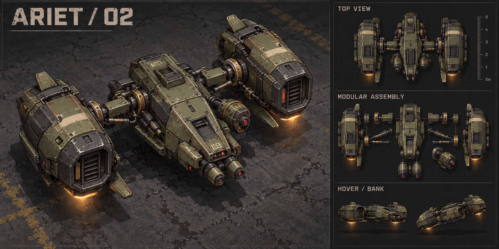

# Ariet — modular gunship workshop plan

**28 October 2026 · Proposal for review · Identity concept prepared; no Ariet runtime artwork or gameplay implemented**

Ariet is the working name for the low-flying industrial gunship discussed as
“Harrier.” This document develops that concept using the
[mechanical workshop process](MECHANICAL_BOSS_WORKSHOP.md). Walker now participates in solo survival, Training and capable online co-op.
Its tester-facing workshop button has been removed. Ariet is still only a
proposal; this plan neither replaces Walker nor declares physical motion,
difficulty, sound or performance acceptance.

## First identity reference

First identity study, generated 28 October 2026. The twin articulated pods, short
structural connections, compact central hull and worn olive/iron/brass materials
set the proposed direction. Review the silhouette and assembly before producing
isolated runtime parts. The drawn ruler is illustrative; gameplay scale, camera,
weapon mechanisms, exact sockets and directional consistency require validation
in the workshop. [Generation notes and prompt](../art/source/bosses/ariet/README.md).

## 1. The fight we want

A large, compact gunship with two articulated engine pods, short stabilizers,
a nose gun assembly and a separately traversing heavy cannon. It banks into a
committed firing pass, settles into a broadside, then exposes itself while its
weapons and engines recover. It should feel like a pilot making decisions.

Its pressure comes from choosing angles and committing to passes. The player
reads the preparation, leaves the threatened route, then uses the recovery to
attack. The encounter must support movement, aiming, firing and reload timing
with the current player build. Damage output alone is not the difficulty dial.

| Identity | Walker, current direction | Ariet, proposed direction |
|---|---|---|
| Movement | Articulated ground pursuit and thruster ram | Low hover, lateral repositioning and committed flight passes |
| Threat | Burst-to-sustained escalation, cannon, pursuit rockets | Twin-gun strafing run, broadside cannon, local engine blast |
| Independent motion | Chassis, legs and gun mounts | Ground root, hull heading, bank, engine pods and cannon |
| Opportunity | Recovery after heavy attacks | Clear settling/cooling period after each committed attack |
| Mechanical character | Planted weight and braced acceleration | Controlled thrust, inertial braking and stable hover |

Ariet keeps three primary attacks, plus the creator-requested optional enraged
strafing variant that deploys two smaller Walker escorts (section13). Homing
missiles on the gunship, minefields, destructible engines, unlimited reinforcement
waves and additional independent full bosses remain outside the candidate.

## 2. Visual construction before combat

The silhouette must read at the real landscape phone camera with the HUD visible.
Use Regun's weathered iron, muted olive, worn brass, restrained red optics and
warm mechanical exhaust. Readable wear belongs at joints, intake lips, muzzle
and exhaust; evenly noisy detail will become a jumble at phone size.

Build a matched modular asset set:

| Part | Motion or purpose |
|---|---|
| Central armored hull | Stable mass, cockpit/optic and distinct front/rear |
| Short stabilizers and pod pylons | Clear connected structure; no floating engines |
| Left/right engine pods | Separate pivots, nozzles, intake and bounded thrust-vector rotation |
| Pod bearings and linkage | Show how each engine attaches and turns |
| Twin nose guns | Separate barrels, receivers, recoil travel and muzzle sockets |
| Belly/side cannon | Independent yaw bearing, receiver, sliding barrel and solved muzzle |
| Cooling shutters | Visible preparation/recovery mechanism |
| Ground shadow | Root position and visual height cue, independent of paint tilt |
| Failure parts and wreck | Later controlled loss of power, landing and inert remains |

Produce one identity sheet first: top view, three-quarter explanation, component
breakdown, engine articulation, gun arcs and a survivor scale reference. Then
produce compatible isolated parts with one camera/perspective, neutral lighting,
transparent edges and documented source resolution. The identity sheet is not a
sprite atlas to cut up automatically.

A part manifest records rectangles, pivots, attachment sockets, physical sizes,
near/far layering, recoil axis and exhaust direction. Test eight headings on
Breach and Foundry before accepting the assembly. If a painted view cannot rotate
credibly, author the needed directional parts. Do not shrink the boss to hide
low-resolution art or reuse Walker's hull as Ariet's body.

## 3. Motion: one authoritative root, several visible mechanisms

Separate these values explicitly:

- **Ground root and velocity:** actual occupancy/cover-resolved position.
- **Hull heading:** bounded shortest-route turns with a committed navigation aim.
- **Visual hover height and bank:** presentation only; never move damage coordinates.
- **Pod angles/thrust:** follow acceleration and braking intent through bounded joints.
- **Gun heading and recoil:** independent of hull navigation and pod motion.
- **Shadow:** follows the ground root and authored height, with no flickering pulse.

Start with stable hover, accelerate, coast, brake, strafe, reverse and turn. Hover
must look supported: restrained exhaust and a steady shadow, without constant
sine-wave wobble. Banking eases into a change of travel direction and settles
when motion settles. Engine pods lead an acceleration/braking decision, then hold;
they must not twitch on every tiny change in player position.

Body turns are deliberate. In range, the cannon can track while the hull holds
its heading. Outside the useful firing sector, Ariet first brakes/repositions,
then acquires. When the player escapes, choose an intercept position or a valid
strafe route. Do not rotate the whole hull continuously just to aim its gun.

First candidate remains a low-hover actor using normal arena bounds and solid
avoidance. In flight it passes over ordinary minions and the player without
body/ram damage, but respects walls and other boss footprints. Minions cannot
stop a firing pass mid-air. It cannot fly through cover to create unanswerable shots. Apparent
height grants neither invulnerability nor immunity to the player's ground effects.
Reduced Motion keeps real positions, aiming and warnings, but removes decorative
bank/hover motion and softens exhaust/dust. Pause freezes every mechanism.

## 4. What can be hit

This needs an explicit implementation step. Current player bullets use
`game.projectileTargets` and circle-based `enemyRadius` sweeps; a wide gunship
cannot simply assume that compound hull geometry already exists.

Design a compact hull with readable gaps. Hull and engine pod hits share one HP
pool in version one. Visible solid machinery should accept shots; empty gaps
between a pod and hull should not act as invisible armor. Wings and exhaust must
not become oversized hidden collision regions.

Propose an opt-in `ArietHull` narrow-phase contract: an oriented hull capsule plus
small pod regions, behind a cheap enclosing broad phase. Audit primary bullets,
rays/streams, piercing/bounce, chains, ground patches, mines and grenades so they
agree about this target and do not apply duplicate damage to overlapping regions.
The ground navigation footprint is a separate conservative shape. Scope the new
narrow phase to Ariet; keep existing actors' collision behavior intact.

Gate the first gun trial on this hit test. If the shared weapon paths cannot
support it cleanly, simplify the silhouette/target regions before adding attacks.
No breakable part HP, engine destruction rewards or new damage multipliers yet.

## 5. Three complete attack mechanisms

Every attack owns acquire → prepare → commit → release → recovery. A miss and a
blocked release must complete cleanly. Numbers below are workshop starting
values, not accepted production balance.

| Attack | Preparation and commitment | Release | Player response and opening |
|---|---|---|---|
| **Strafing run** | Pick a clear finite approach/run/exit inside the arena. Show pod alignment and a readable route cue for about 1.0s. Commit travel heading before accelerating. | Twin guns fire a finite, alternating sequence during a 2.2–2.4s pass. They cover a narrow forward corridor with bounded recoil/spread. No late steering onto a dodge. | Leave the corridor sideways. Ariet visibly brakes and settles for 1.1–1.4s before another attack can prepare. |
| **Broadside cannon** | Move to a useful angle, slow down, rotate the independent mount and show its clipped sight. About 0.9s initial preparation. | Four heavy shots, roughly 0.35s apart. Each follow-up has an acquisition interval and a final short aim commitment; once emitted it flies straight. | Keep moving across the cannon's aim. The hull stays relatively steady and hittable during the volley, then cools for 1.2–1.5s. |
| **Engine blast** | Available when the player lingers close to the pods. Shutters/nozzles prepare and two local ground patches are marked for about 1.0s. Commit those patches before release. | One short pressure/exhaust burst per pod, resolved as one attack against the player. No expanding full-arena disk or lingering fire field. | Step outside the marked pod regions; the forward/rear gaps remain usable. Thrust drops and the hull settles into a 1.2–1.5s opening. |

Strafe does not also carry a second hidden ram attack. Version one has no passive
player contact damage during normal hover or a pass. Ordinary minions and the
player do not block its airborne root. Walls, arena bounds and other bosses do;
a blocked pass brakes/aborts into recovery rather than teleporting through them. Add a damaging ram only as a separately
reviewed mechanic if later requested.

Gun rounds start with 1HP hits; cannon and engine blast start at 2HP. One strafe
run can damage a given player at most once. One engine blast can damage them at
most once even if both patches overlap. Cannon is at most one hit per projectile,
with existing player protection/cooldowns preserved. This makes openings and
escape routes assessable before increasing attack density.

Candidate scale: about 300 world units across the complete craft, with final
hit/occupancy regions measured from the approved assembly. Start the combat
study at 160 shared HP. Choose thrust acceleration, top speed, bullet speed and
blast footprint from the rendered phone proof; do not silently inherit Walker's
numbers. Expose those candidate controls in the workshop, alongside readouts of
actual volley count, active rounds and recovery duration.

## 6. Aggression with decisions and room to retaliate

Use a small tactical director, not a fixed three-attack carousel or unconstrained
random selection. Separate navigation decisions from attack decisions.

1. Evaluate distance, sight, valid flight corridors, cover, current velocity,
   recent attacks and active hostile effects at an attack boundary.
2. At medium range, weight broadside or a repositioning pass. At long range,
   favor a clear intercept/pass rather than repeated inaccurate long shots.
   Close proximity can enable engine blast only when its warning is actionable.
3. Keep a chosen target/position long enough to act. Use distance/angle hysteresis
   so a moving player cannot make the hull/pods jitter between states.
4. Avoid immediate repeats; vary eligible choices and bounded recovery timing.
   Do not force an attack merely because it has not appeared recently if it is
   unsafe or spatially invalid.
5. Once committed, follow the announced geometry. Cover can suppress a shot;
   reacquisition must not turn into a silently redirected strike.
6. Recovery is real active time: Ariet stays hittable and cannot start another
   wind-up. Leftover shots may finish their flight, but the director must not
   routinely consume the entire opening with overlapping hazards.
7. No valid attack: reposition or settle. An intelligible pause is preferable to
   stacking effects or firing through a wall.

Half-health escalation follows the same grammar. Start by making repositioning
more decisive and eligible choices less repetitive. Trial a modest extra cannon
shot or longer strafe only after normal pressure has passed review. Preserve at
least a one-second recovery opportunity; do not increase damage, speed, volley
length and tracking precision together.

Wear/smoke may show that one pod has been damaged at half health, but this is
shared-HP phase presentation, not a separately destructible engine or a reason
for uncontrolled wobble. It must retain deliberate steering and readable stops.

## 7. Recoil, warnings, VFX and sound are part of each module

One release event consumes ammunition, samples bounded recoil, solves the actual
muzzle, emits the projectile/flash and plays its launch sound. Barrel travel and
small yaw/lateral variation produce a tight natural stream. An emitted bullet
never bends to match the recovering barrel. Own-body and muzzle-to-cover sweeps
apply at every heading, including recoiled positions.

Use Regun's shared material VFX with appropriate grading and floor priority.
Strafe preparation belongs to engines, posture and a restrained committed route
cue; cannon preparation belongs to its actual gun sight; engine blast warning
belongs to the actual two ground patches. Shared warning and hit geometry must
agree. No generic bright arc, detached laser or floor stamp substituting for a
mechanism. Cues must remain visible on both floors and with Reduced Motion.

Separate engine idle/thrust, bank/brake, gun release, cannon mechanism, blast
impact and failure sounds. Launch must not sound like impact. Expiry/retirement
is silent unless explicitly designed as a warned destructive event. Prewarm only
owned cues, preserve music/mute/lifecycle settings and cap simultaneous voices.
No new permanent music layer or full-screen camera shake.

## 8. Arrival, failure and lifecycle

Arrival: distant engine cue and shadow, approach into a reserved clear area,
controlled descent to low hover, settling pause, then targeting. No damaging
entry before the player can respond; no occult portal or instantaneous spawn
on the player's position.

Fatal transition immediately disables new attacks and retires owned shots and
hazards. Engine power falls, the craft loses height along a committed short path
to a clear nearby landing, impacts with material dust, vents and becomes a wreck.
Keep this first destruction non-damaging so Ariet's identity does not default to
Walker's large death bomb. A damaging crash would require its own later warning,
shared collision contract and review. The wreck fades/cleans up; replay is explicit.

Training integration retains the selected build, health/ammo and visit's Take
damage choice. Death never grants XP, healing, a core, an upgrade picker or normal
profile progress. Player defeat uses existing Training recovery and freezes the
encounter timeline. Restart, boss replacement, backgrounding, pending asset loads
and route disposal must retire the correct owner without reviving old objects.

## 9. Workshop and game integration

Two distinct stages, reflecting the current tester-menu cleanup:

- **Development-only Ariet workshop:** isolated rig/module inspection, explicitly
  opened for development rather than added to the production loadout menu. Use
  normal custom pixel buttons, fonts, transitions and mirrored touch conventions.
  It must work at phone landscape size without labels/readouts obscuring the craft.
  Model/target/joint readouts are opt-in inspection tools.
- **Training → Pause → Boss Practice → Ariet:** add this later, when the integrated
  trial is ready for review, in the existing arena and HUD. Preserve Walker and
  every other active practice selection; do not restore Mirror Saint.

Workshop scenes: Hover; Accelerate/brake; Strafe/reverse; Turn/bank; Gun track;
Single volley; Engine blast; Arrival/failure; Integrated fight. Include pause,
single active-time step, restart, floor toggle, actual-phone-scale/close inspection
and optional pivots/hit regions/warning geometry. Each scene uses the same model
and painter as the trial; no polished demonstration hiding a different runtime.

Suggested files, to create incrementally after plan review:

| Proposed source | Responsibility |
|---|---|
| `lib/systems/ariet_rig.dart` | Fixed-step inertial movement, pod/height/bank transforms and sockets |
| `lib/systems/ariet_combat.dart` | Targeting, tactical decisions, finite attacks, recovery and owner cleanup |
| `lib/systems/ariet_hull.dart` | Authoritative compound target geometry and query adapters |
| `lib/presentation/ariet_art.dart` | Asset leases, manifest, assembly, shadow and occlusion |
| `lib/presentation/ariet_battle_art.dart` | Shared warning, shot, exhaust, impact and failure rendering |
| `lib/views/ariet_workshop_view.dart` | Isolated scene controls using the current design system |
| `lib/components/enemies/ariet_boss.dart` | Native Training adapter, shared damage/audio/occupancy integration |
| `art/source/bosses/ariet/` | Identity studies, original part masters and export evidence |
| `assets/art/workshop/` | Only accepted, packed runtime assets |

Keep Ariet outside `BossKind`, survival, the random Boss Rush bag, saved active
runs and hosted play during this candidate. Do not copy Walker's trial flags into
several conflicting booleans: introduce a small exclusive mechanical-trial owner
only when adding the second playable trial requires it. Switching must retire
Walker/Ariet and their asynchronous loads predictably. Avoid a broad boss-engine
rewrite; extract only mechanisms genuinely shared by the two implementations.

All of this runs offline. No startup check, account verification, remote asset
fetch, admin update or balance download can gate entering the workshop or playing.
Do not add Ariet to admin/API catalogs until real admission is separately scoped.

## 10. Deliver in inspectable slices

| Slice | Concrete deliverable | Gate before the next slice |
|---|---|---|
| **A. Identity and assembly** | Matched concept/parts, socket manifest, survivor-scale assembly on both floors | Hull, engines, connections, scale and lighting read clearly at phone size |
| **B. Flight rig only** | Hover/accelerate/brake/strafe/turn scenes with shadow and articulated pods | No jitter, detached pods, abrupt yaw reversal, body skating or endless idle wobble |
| **C. One gun and hittable hull** | Independent aim, one repeating gun, real recoil/muzzle shots, all-player-weapon hit proof | No hidden hull collision, own-shot impacts, false gaps or decorative-only recoil |
| **D. First attack** | Committed strafing run, its full miss/block/recovery cases | Route and escape space readable; real return-fire opportunity |
| **E. Remaining modules** | Broadside, then engine blast, each with isolated scene and actual damage | Consistent warnings, finite volleys, no duplicate hits or hazard saturation |
| **F. Complete trial** | Contextual director, arrival/failure, existing Training menu integration and replay | End-to-end native proof; pending loads/restart/replacement clean; Walker still works |
| **G. Physical review** | Device build after the complete candidate is ready, plus a concise playtest list | Creator assesses art, naturalness, danger, openings, sound and comfort |

The next implementation task is **A and B: the identity/assembly and flight rig**.
Do not build all three weapons while the craft's basic motion is still unconvincing.
No new release number, upload, production deployment or game-roster change is
included in this planning task.

## 11. Verification and evidence

Test only meaningful contracts; retain small visual captures to expose what
numeric tests cannot judge.

- Fixed-clock equivalence at 30/60/120Hz; pause/background freeze; shortest-route
  turns; stable stop and reversal; pod range/sockets and gun/chassis independence.
- Narrow-phase agreement for all current weapon families, blast cover, overlapping
  hull-region deduplication and misses through genuinely empty gaps.
- Per-attack committed warning/release geometry, full moving-target volleys,
  shot-origin/recoil agreement, swept contact, one-hit budgets and bounded retry.
- Tactical choices across seeds, valid options under cover/close range, recovery
  windows, no immediate spam and no invalid forced attack for variety's sake.
- Native selection, player damage with Take damage On/Off, all current weapons,
  Training recovery, arrival/fatal cleanup, replay and Walker/Ariet replacement.
- Inspect the complete assembly at eight headings and short motion clips on both
  floors, with normal HUD and Reduced Motion. Compare against actual player scale.
- Borrow floor textures; lease/release only Ariet's atlases. Keep active decoded
  boss/shared art within the existing 32MiB review envelope, including overlap
  during retirement/pending load. Measure source coverage before choosing decode
  sizes. Start with at most 32 owned rounds, 6 short impacts and 2 blast patches;
  any increase requires measured evidence and a readability reason.
- Run analyzer and appropriate tests per slice; full `make verify` for the complete
  trial. A soak or successful installation is not physical performance proof.

Review questions: Does Ariet read as one assembled machine? Do pods explain its
motion? Can the player identify commitment and leave the threatened space? Can
they land meaningful return fire? Does the next choice feel purposeful without
being the same loop? These answers determine progression to combat and admission.

## 12. Review decisions and concrete first tuning pass

These are proposed starting values for the next session, not accepted production
balance. Sections above remain the implementation/verification contracts. Resolve
these values against the real assembled rig before tuning difficulty.

### Identity and intended counterplay

Ariet owns flight angles: nose guns reward a prepared run, the single side cannon
requires presenting its armed side, and engine exhaust discourages camping beside
its pods. It should seek an effective firing position rather than continually yaw
its hull to track the player. Inaccurate or invalid positioning is solved by a
visible navigation decision, never by shooting through the hull/cover.

Keep the compact twin-pod reference silhouette. The important moving parts are
connected pod bearings/nozzles, twin recoiling nose barrels, one independent
cannon bearing and cooling shutters. Include a plausible underside two-unit cargo
cradle and restraint-release mechanism for the requested escort deployment.
Do not add multiple extra turrets, missiles, mines or separate engine-health
systems before this identity is convincing.

### Starting controls

| Control | First workshop value | Contract |
|---|---|---|
| Full craft width / shared HP | About300 units /160HP | Confirm at real camera scale; all solid parts share HP |
| Cruise / pass speed |220 /420 units per second | Accelerate/brake through visible pod decisions; never snap |
| Acceleration / braking |500 /650 units per second squared | Abort endpoints must fit cover and arena bounds |
| Hull turn cap |1.2 radians per second | Brake/reposition before large reversals; mounts track separately |
| Strafe preparation |1.0s, final.25s heading lock | Show the committed corridor before acceleration |
| Strafe release |36 alternating rounds, about.06s apart |18 from each barrel; full release only on a valid clear pass |
| Strafe travel |2.2–2.4s; endpoint chosen before commitment | Allow the complete36-round release; projectiles visibly lead the aircraft |
| Gun round speed / starting damage |850 units per second /1HP | Straight after release; one accepted player hit per whole pass |
| Broadside |.9s initial preparation;4 shots at.35s intervals | First shot/follow-ups lock aim for the final.20–.25s |
| Cannon speed / blast / damage |750 units per second /about70 radius /2HP | Distinct heavy shell, swept flight and cover-tested impact |
| Engine blast |1.0s warning,.20s active,2HP | Two local pod patches; one accepted hit across both |
| Recovery |Strafe1.2s; cannon/blast1.3s | Hittable; no next wind-up; never below1.0s in phase two |

The nose guns have a limited frontal aiming arc, initially about±15degrees. Their
alternating fire must show actual bounded recoil and separate muzzle positions.
They do not pivot through the entire craft to shoot backwards during a pass.

The single side cannon needs an arc supported by the approved mount/assembly,
initially roughly±60degrees around its armed broadside. It tracks within that arc
while the hull holds its deliberate navigation heading. If the player crosses
behind the blocked sector, unreleased shots are withheld and Ariet repositions
after recovery. Test full four-shot volleys against a moving target that remains
in the valid arc; never silently truncate a valid volley or use a phase timer
that ends before all four releases can happen.

Each cannon follow-up may reacquire during its preparation interval, then locks.
The warning must visibly follow that process. Rounds never home after release.
Own-body collision and muzzle clearance can require moving the mount/socket or
altering the allowed arc; they must never be patched by invisible projectile
teleportation through a pod.

The engine warning is two compact, outward/downward exhaust footprints fixed in
world space once committed. Keep the craft planted through warning and release.
Start each patch near90–110 units of effective extent beyond its nozzle, shape
it from the approved exhaust, and preserve usable front/rear escape gaps. It is
not a full circular blast that catches the player despite a correct dodge.

### Short-range weapons and recoveries

Choose flight routes with useful exits, normally settling roughly300–450 units
from the player's position at route planning time with a clear return-fire angle.
Reject a route that only parks the craft offscreen or beyond short-range weapons
on every cycle. If the player moves after commitment, do not cheat by altering
the exit. Reassess on the next navigation decision. Shotgun and slower area weapons
must have practical damage windows; visual height grants no immunity to fields,
mines, grenades or other existing ground effects.

A recovery is genuine: no weapon may begin a new preparation during it. Leftover
rounds may resolve, but their lifetime/route must not routinely occupy the entire
opening. If a close engine blast would immediately erase every post-strafe
opening, that selection is ineligible until the previous recovery is complete.

### Decisions, not a repeated script

Reassess at attack/recovery boundaries, not every frame. Retain a selected target
through a commitment, including in co-op, and use distance/angle hysteresis.

- Long range: favor a valid pass/intercept route that returns to useful range.
- Medium range with the armed side presented: favor broadside, with strafe as an
  alternative when the route and escape space are valid.
- Sustained close presence beside the pods: allow engine blast after a short
  proximity dwell (start at.6s), with full warning. Merely crossing past a pod
  should not trigger an instant defensive attack.
- Player behind the craft or outside the cannon sector: reposition; do not rotate
  the whole hull mid-volley to maintain perfect tracking.
- No safe option: brake, settle or seek another angle. Do not force a repeated
  attack solely because the other choices are invalid.

Avoid immediate attack-family repeats when another useful option exists. One
major attack at a time. A half-health transition is applied at the next attack
boundary: it cannot reset a volley count, prematurely cut off a burst or remove
recovery. Phase two may choose the bounded two-Walker deployment pass described
below, alongside about10% more decisive cruise/repositioning. Do not also raise
damage or tracking precision as part of that escalation. Add a fifth cannon shot only
if the first complete normal encounter proves too mild on device.

Example, not a prescribed loop: the player retreats; Ariet lines up a pass and
locks its route. The player sidesteps, fires into the passing hull, then uses its
braking window to close with a shotgun. Ariet later presents its cannon side and
fires four individually committed shots while the player crosses its aim. If
the player stays beside the pods, it warns two exhaust footprints; the player
moves into the front/rear gap and punishes the cooling hull. If the player instead
runs away or takes cover, Ariet chooses a new flight angle rather than forcing
the exhaust attack.

### Interaction with ordinary minions

Flight passes over them without killing or pushing them. Gun rounds may hit/kill
an intervening ordinary minion. Cannon explosions and committed exhaust patches
kill ordinary minions inside their actual cover-tested regions. These remain
environmental deaths without player XP, procs or kill credit. Other bosses are
not collateral targets. Minion movement cannot redirect a committed airborne run.

### First delivery and later admission

The next implementation session should deliver only identity/assembly and the
flight rig: real-scale modular assembly, eight headings, stable hover, strafe,
acceleration, turn and brake on both floors, with pause and Reduced Motion. Keep
its controls in a development-only workshop. Review a short phone-scale motion
capture before adding guns. Then build the hittable compound hull/one gun, strafe,
broadside, exhaust and complete Training trial in that order.

Keep arrival controlled/non-damaging and the fatal descent/crash non-damaging.
Retire attack ownership before wreck cleanup; Training gives no normal rewards.
The full trial must handle replacement, death/recovery, pause/background, restart
and pending asset loads offline. No account or update request gates play.

After creator approval, separately scope production admission: BossKind/catalogs,
normal director/Boss Rush, once-only completion rewards, active-run checkpoints,
server-authoritative co-op and capability compatibility, shared tuning/admin/API
fields and their descriptions. Keep the chosen timing/geometry/RNG contract
portable during the workshop so admission does not require inventing a different
online boss. No production admission, upload or deployment is authorized by this
planning document alone.

## 13. Enraged deployment pass — creator addition

The creator requests the option to drop two smaller versions of the current
Walker during a strafing run. Treat “workers” here as Walker escorts, using the
existing mechanical identity/rig. This is an addition to the reviewed proposal;
no escort runtime or carrier artwork is implemented yet.

### Recommended initial encounter rules

At or below50% health, Ariet may select a deployment pass at an attack boundary.
It is a choice, not an automatic mid-volley spawn or a mandatory repeated loop.
Start with one pair per encounter and at most two active or pending escorts.
Count reservations/falling payloads toward that cap. Once the pair is spent,
normal attacks continue; no endless replacement/farming. Later admin tuning may
permit another bounded deployment budget, separately reviewed for balance.

Require both legal landing positions and the combined rendering/attack budget
before selecting this variant. If those cannot be reserved, choose an ordinary
attack or reposition. Do not silently drop one escort, spawn inside cover or
teleport a unit beside the player to complete the pair.

The deployment variant trades some nose-gun pressure for its reinforcements:
start with18 alternating cover rounds instead of36, stop firing for the actual
payload releases, and preserve the full pass/recovery. Cargo releases are
staggered by about.3s. Two committed ground shadows/warnings identify the actual
landing sites before touchdown; start with at least.9s readable warning. Folded
Walkers leave visible underside cradles, descend with a short controlled flight,
land, unfold their legs and become active after about.5s deployment recovery.
The drop/landing itself does not damage the player or crush ordinary minions.

Reserve safe, cover-valid space for both footprints with useful separation
(start about220–280 units) and no forced overlap with the player. Commit the
sites visibly; do not home the falling payload onto a dodge. A site made invalid
by dynamic cover must abort/resolve harmlessly rather than silently redirect.
Only Ariet's real cargo sockets may emit the units; no unrelated portal/spawn.

### Smaller Walker profile

Proposed starting size is65–70% of the full Walker, retaining its recognisable
chassis, guns and planted long-leg gait. Trial50–60HP per escort, starting at50HP, so the
player can meaningfully choose to clear them. The full Walker has190 base HP;
two50HP escorts add100HP to the encounter. Raise to60 only after reviewing
the combined fight and the time needed to remove one escort. These numbers are trial values,
not accepted production balance. Keep one Ariet boss bar; escorts are owned
miniboss-like minions with ordinary compact health feedback, not two additional
normal boss encounters/reward tracks.

Reuse the Walker rig, art, muzzle solving, targeting and movement mechanisms,
with an explicit escort profile. First combat profile: short, aimed three-round
bursts and deliberate flanking/pursuit. Do not copy72-round sustained fire,
heavy cannon volleys, homing rockets or the330-radius death bomb into both escorts.
A short warned thruster reposition/lunge may be considered after this first
profile passes review, through the same shared major-attack budget.

Scaling must include chassis/limb dimensions, world-space foot targets, height,
body/target footprint, muzzle clearance and gait reach/speed. Do not just scale
the Flame root or painter while leaving full-size collision and attack sockets.
Parameterise Walker's hard-coded dimensions narrowly, preserving the existing
full Walker's default profile and regressions. Do not turn the escorts into
boss registry actors merely to reuse WalkerBoss: separate shared rig/presentation
from ownership, combat policy, rewards and encounter completion.

### Coordination and player openings

Ariet and its escorts share an encounter attack coordinator. No triple full-power
salvos: begin with at most one escort firing alongside Ariet's ordinary gun run,
and prevent escort bursts from stacking on the cannon/exhaust release window.
During Ariet's guaranteed return-fire recovery, escorts can reposition but must
not fill that whole opening with gunfire. The player must retain a real choice
between attacking the gunship and removing its support units.

Example: Ariet reaches half health, later chooses a deployment pass, gives a
shorter cover burst, opens its belly restraints and drops the two folded units
onto the announced sites. It brakes while they unfold. One escort seeks a side
angle while the other holds a firing lane. The player may kill an escort during
an opening or keep pressure on Ariet. Subsequent attacks depend on those actual
positions rather than always repeating deployment → cannon → blast.

### Art, lifecycle and admission work

The current identity sheet does not prove room for two folded machines. Revise
the underside/cradle design before final carrier parts: show restraint rails,
payload scale, release clearance and pod compensation for the carried load.
Retain the recognizable compact silhouette; do not draw oversized folded units
magically passing through the central hull. Include a side-view deployment study
and a mini-Walker alongside the survivor/full Walker for scale review.

Share one leased Walker atlas set across both escorts; do not decode it per unit.
Measure Ariet+escort+shared decoded art against the existing32MiB envelope, with
bounded combined rounds/effects rather than multiplying every per-boss budget.
Start with32 active hostile rounds total across this encounter and reduce escort
cadence first if that budget or readability cannot support a valid full volley.

Both escorts and pending drops belong to Ariet's encounter owner. No boss cores,
normal boss victories or farmable XP/procs from deployment/shutdown. At Ariet's
fatal transition they cease attacking and power down harmlessly; retire their
shots and pending drops before the main wreck/encounter cleanup completes.
Pause/background freezes falling/unfolding, AI, warnings and attack arbitration.
Restart/replacement/disposal must clean up all owners and pending asset loads.

The complete Training trial includes this variant after the original three
attacks work. Production admission later must checkpoint the once-per-encounter
deployment budget, reserved/falling/unfolding states, escort IDs/rig/HP/AI/rounds
and ownership so Continue cannot duplicate the pair. Co-op owns these decisions
on the server and replicates the same socket/drop/landing states. Admin/API
admission exposes named, bounded escort size/HP/count/budget and timing fields
with descriptions; none requires a startup online check or blocks offline play.

Meaningful tests: two drops or a clean fallback; active+pending cap; no duplicate
pair after resume; correct scaled hit/muzzle/leg geometry; full Walker unchanged;
cover/player-safe landings; no damage while falling/unfolding; shared recovery
windows; no escort rewards; parent-death/restart cleanup; combined asset/effect
budget; native/server agreement when later admitted.
