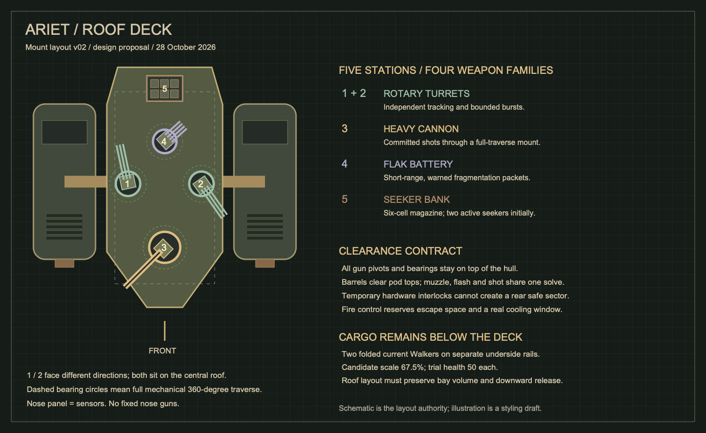

# Ariet gunship: roof deck and combat redesign

28 October 2026. Design revision after the creator's build 1.0.0+29 phone test.
This revision supersedes the fixed nose guns, limited broadside arc and low
sponson weapon layout in the original workshop plan. The creator subsequently
authorized the complete implementation below, with admission to normal play
deferred until Training approval.

The [editable schematic](../art/source/bosses/ariet/roof-layout-v02.svg) is the mount
layout authority. The [generated illustration](../art/source/bosses/ariet/identity-v02-draft.png)
is a styling draft: it mistakenly retains old fixed nose barrels and does not
clearly distinguish both rotary stations. Do not build those errors into assets.

## Problem and retained identity

The phone screenshot IMG_3063.PNG shows the player behind Ariet with little
resistance. Build +29's forward and broadside eligibility sectors can leave that
position permanently safe. Turning the hull faster or adding health would leave
the underlying weapon design unresolved.

Keep the industrial olive/iron/brass twin-pod gunship, articulated machinery,
exhaust attack, compound hull gaps and two folded Walker cargo units. Give the
ship an explicit roof weapon deck with visible bearings. All gun mounts traverse
360 degrees independently of the hull. Rear positioning changes which threat the
player faces; it must not switch off the encounter.

## Five stations, four weapon families

| Station | Role | Mount and proposed local socket |
|---|---|---|
| 1 and 2: rotary turrets | Bounded tracking bursts against circling/retreat | Two independent raised roof bearings, (-5, -52), (-5, +52) |
| 3: heavy cannon | Slow, committed high-threat shots | Raised central forward bearing, (+85, 0) |
| 4: flak battery | Warned close-range pressure | Raised rear roof bearing, (-65, 0) |
| 5: seeker bank | Delayed pursuit with interception | Low six-cell vertical launcher, (-140, 0) |

Coordinates are proposed world units: +X is forward, Y is lateral. The schematic
puts forward downward to expose opposite rotary facings. All four gun bearings
(two rotary, cannon, flak) have full mechanical traverse. The launcher is fixed
vertical hardware; it can acquire targets in every direction without rotating.
Nose hardware is sensors and armour, with no fixed nose guns.

Study a central deck approximately 340 long by 164 wide, pod centres (-8, +/-142),
pods 220 by 88 and overall span about 372. These are packaging proposals, not
approved hit geometry. Do not preserve the old narrow width if it prevents honest
mount/cargo clearance. Revalidate art scale, body occupancy and navigable space.

### Height and clearance contract

Show raised bearing races, supports and barrel trunnions. A first clearance study
places pod tops at relative height 28, low launcher at 24, flak barrels at 44,
cannon at 60 and rotary barrels at 72. These are hypotheses for a swept hardware
study, not proof that every barrel clears every receiver/support at every angle.

Sweep each barrel and its recoil travel around the full circle, including other
receivers, supports, pods and launch cells. Use brief firing interlocks for real
obstructions and reposition if needed. An obstruction must never disable all
rear-capable weapons indefinitely. Barrels above low machinery may visibly fire
over it; shots must still respect external cover. No teleporting projectiles
through hardware or substituting an invisible centre-origin shot.

Runtime bearing, visible barrel, muzzle flash, projectile origin, warning origin
and local recoil must agree. Recoil moves the barrel along its current heading;
the bearing stays attached to the deck. Directional assets must support rear and
side poses without mirrored lighting or barrels baked into the hull.

The dashed cargo envelope is below the roof. Preserve two current Walker rigs at
67.5% scale, 50 HP each, with scaled feet, limb links, muzzle and collision queries.
Clear their entire folded/unfolding sweep; a top view alone cannot establish that.
Do not change the full-sized Walker defaults.

## Attack roles and first tuning candidate

Keep Ariet at 160 HP initially so the redesign can be compared without a health
buff. Values below are proposals to verify in the complete next Training build.

- **Rotaries:** independent shortest-route yaw, including crossing +/-pi. Use
  bounded tracking bursts during committed flight. Flight heading commits
  separately; aiming behind must not force the whole ship to reverse. Retain the
  current burst/damage baseline initially and a shared per-pass damage bound.
- **Heavy cannon:** four deliberate shots, with a readable initial warning and
  the existing final .22-second commitment. Freeze each shot's aim on commitment;
  no late target following. Fire from the actual roof muzzle in every direction.
- **Seekers:** six visible launch cells, initially two rockets per salvo, .3 seconds
  apart and at most two live. Show launch before guidance: both .6 seconds and
  100 units of initial straight travel must pass before bounded homing starts.
  Start at 1.8 rad/s turn rate, 3.5-second life, one-damage/90-radius blast. A player
  shot can intercept each rocket once. Expiry is harmless; no recursive explosions.
- **Flak:** a .9-second warning followed by two committed packets .25 seconds apart,
  initially around 280 units from the ship. Each packet releases three fragments
  with all capacity reserved before launch. One accepted damage point across the
  volley; no lingering minefield, recursive fragments or late retargeting. Warning,
  airburst and fragment travel must share the actual cover-clipped geometry.
- **Exhaust:** retain the planted warning and two bounded floor patches. It is a
  readable defensive action, not an invisible rear damage aura.
- **Cargo:** retain the one pair release around half health. Give deployment a
  quiet interval. Escorts keep their limited rotary bursts; do not add their full
  heavy arsenal or combine the drop with a rocket/flak/cannon stack.

Rockets and flak need distinct physical silhouettes, material warnings, launch,
flight and impact presentation. Reuse shared material VFX where appropriate;
production weapon parts must be supplied as coherent modular art. The schematic
and draft illustration are not runtime sprites.

## Shared fire control

One encounter owner schedules one lead attack at a time. Initially allow only a
narrow support exception: one short rotary burst while a previously warned seeker
salvo is in flight, after verifying an escape route. No overlapping cannon, flak,
exhaust or escort volley. Mounts may track during recovery but must not fire.

Retain at least one second of genuine quiet recovery between major sequences.
Account for lingering escort rounds and rocket lifetime when establishing that
window. A cooldown label is not a recovery window if old ordnance still occupies
all routes. Reduced Motion changes presentation, never warning/damage geometry.

Preserve the 32 combined owned-ordnance cap, six short impacts, two exhaust regions
and 32 MiB encounter art budget. Count rockets and flak fragments as well as bullets.
Reserve whole volleys before staging; wait rather than truncate patterns. Share
one Walker atlas across the pair. Cancel pending attacks, shots, rockets, fragments,
escorts and leases on parent death, replacement, restart and route disposal.
Pause, background, pickers and Training recovery freeze every timer and guidance.

## Implementation and acceptance gates

Deliver the four families, roof rig and fire-control coordination together in the
next complete Training candidate. Internal module tests are useful; another phone
build containing only a rear-arc patch would not meet the requested all-at-once
playtest. Preserve the current Training selector, take-damage option, arrival,
defeat and cleanup flows. Production roster, survival, random Rush, hosted play and
normal checkpoint admission remain separate work.

Required automated checks must exercise actual projectiles/contact and HP loss:

1. At the next eligible attack decision boundary, test stationary players at 16
   azimuths and distances 150, 300 and 650. Every uncovered location, especially
   directly behind, receives a valid threat within four seconds. Existing honest
   warning/recovery commitments finish first. Warning visits or yaw values alone
   do not pass. Use normal health and Training Take damage to confirm real hits.
2. Test slow/fast orbiting, rear crossings, shortest-route angle wrapping, close
   underbody positions and cover. Obstructed mounts reposition or yield to an
   eligible station. Never bypass cover or retarget a committed cannon/flak shot.
3. Verify rendered muzzle/round alignment at every heading, barrel/recoil sweeps,
   visible bearing attachment and cargo clearance. Keep independent flight/aim.
4. Verify guidance delay, bounded turning, interception, expiry and exactly one
   seeker blast. Reuse a narrow shared interception contract if Walker's existing
   rocket-target protocol needs extraction; avoid a second conflicting hit path.
5. Verify whole-flak capacity reservations, fragment cover/contact and volley damage
   bound. Exercise allowed support overlap and quiet windows under both phases.
6. Re-run all 24 player weapon paths against the compound hull, preserving empty
   gaps and one damage/proc owner; verify ordnance, fields, beams and ring queries.
7. Verify deployment, recovery, pause, pending-load disposal, restart, switch-away,
   parent death and escort death. Preserve ordinary rewards/proc exclusions.
8. Measure decoded art/effect budgets and run analyzer/full regression tests, then
   install one complete candidate for physical rear coverage, readability,
   difficulty, audio, comfort and sustained-performance review.

Build +29's 884 passing tests and successful installation establish the previous
candidate's automated baseline. They do not verify or approve this redesign.
That statement described the design-only pass. The implementation below supersedes it.

## Delivered roof-deck implementation — build 1.0.0+30

The full redesigned native encounter is implemented in the existing Training
selector. It retains the same 160 HP, one half-health pair of 67.5%/50HP Walkers,
compound target ownership, protected/unprotected practice, arrival, recovery,
mechanical defeat and replay. All four weapon families are present together.
Normal survival, Boss Rush, hosted play, normal checkpoints and profile rewards
remain gated behind a later admission decision after creator testing.

The central hull now draws at 340x164, with 220x88 pods at (-8,+/-142).
Navigation/arrival clearance is 230; target broad phase remains conservative at
270. The real pod/hull gaps and single HP/proc owner are retained. Both rotary
yaws turn independently at up to 8 rad/s, with no forward arc. Cannon has full
traverse at 8 rad/s and retains each shot's final .22-second commitment. Flak
tracks its two committed launch headings separately at 5 rad/s.

Roof heights are 44 flak, 60 cannon and 80/96 rotaries. Staggering the rotary
heights clears crossing barrels. Runtime firing interlocks use explicit receiver
and support envelopes; tests sweep all bearings through 360 degrees at three hull
headings and three recoil states. These conservative mechanical envelopes are
not a simulation of every source-pixel edge. The raised mounts draw supporting
shafts, pixel iron/brass bearing races and the existing textured modular receivers
and barrels. Pods render below all guns; the obsolete fixed nose guns/sponson are
gone. Physical gun pivots, warning paths, flashes and rounds share the same roof
socket basis, including Reduced Motion.

Seekers launch in pairs .3 seconds apart, delay guidance until both .6 seconds and
100 units travel, turn at most 1.8 rad/s and expire harmlessly after 3.5 seconds.
They move at 320 and have one 90-radius/1HP blast. Real primary projectiles
intercept them through shared ShootableOrdnance targets, outside enemy
rewards/procs/occupancy. Walker uses the same lightweight target base with its
existing behavior unchanged. Rocket silhouettes reuse the leased Walker art.

Flak warns .9 seconds, launches two physical 600-speed shells .25 seconds apart,
then bursts each into three swept 520-speed fragments lasting .65 seconds.
Airburst/fragment damage is bounded to one accepted HP across the volley.
The airburst range can reach 650, rather than the initial 280-unit proposal:
orbit tests showed that the narrow range caused the director to skip this family
while chasing. Warning endpoints commit once and clip against cover before
staging. Eight slots reserve both shells and their eventual fragments; patterns
wait for capacity. There is no recursive ordnance or lingering flak carpet.

The director cycles the four families and inserts contextual exhaust only where
its planted footprint threatens the player. Flight commits independently of gun
aim. Escorts fire only during navigation, one volley at a time; their active
burst/gate finishes before the next main warning. This candidate chooses the
stricter no-support-overlap policy permitted by the design. Recovery counts
1.2/1.3 seconds only after owned rounds and pending cargo have cleared, so an old
rocket or escort stream cannot fill the quiet window.

No new texture sheet or runtime remote dependency is introduced. Main and pair
still own 4,849,664 decoded RGBA bytes, sharing one Walker atlas. Destruction,
restart, replacement and route disposal cancel targets, rounds, pending shells,
fragments, cargo, escorts and layers. Native tests exercise every player weapon
packet and confirm damage from behind with normal health/Take damage enabled.
See [verification and device review](validation/ariet-roof-2026-10-28/README.md).

## Airborne presentation and escort traffic correction — build +31

Creator playtesting rejected the apparent shared ground plane. The battle
painter had cancelled the rig's height and used ordinary ground y ordering.
Build+31 retains160-unit hover before/after cargo release, draws the whole carrier
and mounted cargo above its ground shadow, and sorts its body over ground actors.
Rendered hull, compound weapon target, aim centre and every muzzle share the
raised plane; navigation, exhaust patches and cargo landing stay on the floor.

The ship does not reserve floor space. Escorts gain collision-safe sliding,
cover routing and a consistent right-hand traffic rule; a native head-on test
reproduced and now guards against both choosing the same world detour. The
creator's additional engine request adds dedicated hot jet/grey smoke sprites at
both nozzles, bounded simulation-clock drift and stationary Reduced Motion haze.
The new small sheet increases owned decoded art while retaining the32MiB envelope;
+30's4,849,664-byte total is historical. No audio/camera effect was added.
[Current verification and physical review](validation/ariet-airborne-2026-10-28/README.md).

## Active flight feel and seeker visibility follow-up — release +28

Creator feedback superseded static holding art: a holding craft now visibly
station-keeps and its jet texture continuously advects along the painted nozzle
axis. A mixed-Z axis calculation caused the unwanted flame bend; it is removed.
Reduced Motion keeps a steady body with restrained thermal flow. The actual
rocket sheet was absent from Ariet's old asset lease, leaving only red glow.
That loading bug is fixed; metal nose/body/fins now render at64 units and expiry
has a harmless .4s burnout coast/fade. The creator requested more pursuit rockets:
committed volleys now release four normally/six enraged, .3s apart, within the
existing32-round coordinator. All earlier two-rocket/static-jet statements are
historical. [Current evidence](validation/ariet-live-hover-seekers-2026-10-28/README.md).
Release remains1.0.0+28; numbering changes need explicit creator authorization.

## General jet mobility and charge-counter follow-up — release +28

Creator clarified that the ship must be generally agile. Normal speed is now360,
acceleration1300, braking1800 and hull yaw2.8rad/s. Cannon/seeker phases strafe and
turn while independent12rad/s guns aim; cannon still commits its world point.22s
before release and shells remain straight. Ordinary rotary attack now visibly
spools, charges at820 on a committed clear route, physically brakes, then rapidly
fires36 rounds while the hull turns toward the player. No ram damage and no added
rotary-hit stacking. Cargo remains a slower420 release with its existing quiet
window. [Current agility evidence](validation/ariet-jet-agility-2026-10-28/README.md)
supersedes old slow/fully planted cannon/seeker movement. Keep1.0.0+28.

## Shared Walker escort tactics — release +28

Creator feedback supersedes the independent fixed-world flank offsets. A shared
living-pair planner assigns stable player-relative firing sectors, adapts to
cover/sight and partner occupancy, and uses angular approach waypoints. Shooters
check current/predicted teammate crossings from the real muzzle before each shot
and alternate ready firing turns. Blocked allies reposition/back off instead of
firing through one another. Existing pressure/damage, ground collision, quiet
windows and ownership remain. [Tactical evidence](validation/ariet-escort-coordination-2026-10-28/README.md).
Release stays1.0.0+28 and Ariet remains in Training pending creator acceptance.
