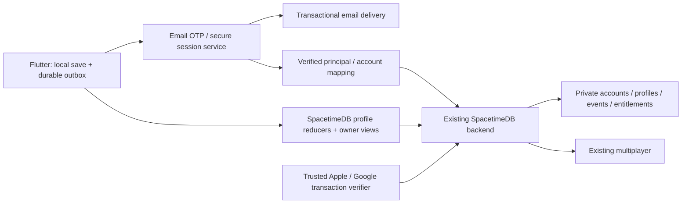

# Regun — email identity and cloud saves

Plan date: 22 October 2026. Status: proposal for implementation; no account,
cloud-sync, billing integration or server deployment is implemented by this plan.
The creator's new requirements supersede the original account-free release scope.

## 1. Product decision

Let people play Solo and Training immediately. Offer **Save progress**, using email
→ emailed numeric code → username. No password, Google sign-in or Apple sign-in.
Returning players use the same email/code flow and keep their existing username.
The session persists securely; ordinary relaunches do not ask for another code.

**Online requires a verified email account with a completed username.** A local
name or saved multiplayer guest token is insufficient. Enforce this in both the
Flutter entry flow and the multiplayer server. Canceling sign-in returns to the
menu; Solo and Training remain usable. A pending cloud backup alone must not block
online admission when identity is valid and server-owned loadout access is known.

Email is the player's private recovery/sign-in address. Internally, use an
immutable account UUID. Username is the public identity. Changing email or username
must never create another inventory, erase progress or detach purchases.

Scope includes earned weapon/survivor/arena unlocks, gear/cosmetics, discoveries,
challenges, progression, selected kit and future verified purchase entitlements.
The phrase “saved gear” means these existing profile concepts plus saved loadout
preferences; this does not introduce a new equipment economy.

## 2. What exists today

| Existing contract | Consequence for this implementation |
| --- | --- |
| `lib/models/player_profile.dart`: schema 3; scrap, counters, records, challenges, discoveries, fusions, cycle completion, settled run IDs, owned cosmetics, equipped cosmetic | Migrate the existing profile; do not replace it with an empty account record. |
| `lib/services/local_preferences.dart`: serialized primary/backup profile writes; separate settings, controls and local online name | Preserve local durability. Add account-scoped profile storage and a durable sync queue. Current preference JSON is not a secure credential store. |
| `lib/services/run_store.dart`: one local run checkpoint with serialized writes/backups/tombstone | Keep Continue local in v1; scope it to its owner before accounts can switch. |
| `lib/views/menu_view.dart`: Home precedes guided Training; `_open()` refreshes Home after routes return | Trigger the invitation on the first eligible return, not in splash or initial Home load. |
| `lib/views/settings_view.dart`, `SettingsSection`, `GameNotice`, `GameNoticeActions`, `ClickButton`, `ControlChoice` | Extend these existing surfaces for every identity state. |
| `SecureOnlineTokens`, `OnlineSession`, `OnlineView`: device-bound guest credentials and editable local name | Add verified account admission and a secure guest-history migration. Local name editing must not bypass the account username. |
| Sibling `regun-server`: private `online_account` / results keyed by authenticated SpacetimeDB identity | Preserve server authority and link records to the durable account. No client-uploaded solo balance becomes multiplayer reward authority. |
| No billing SDK or receipt-validation path in `pubspec.yaml`; current shop spends earned scrap in Collection | Cloud save is implementable now. Real-money restoration is a separate, explicitly verified feature; do not advertise it as working before billing exists. |

## 3. First invitation and Settings

### Invitation timing

Interpret “first menu visit” as the **first return to Home after the player has
experienced or skipped guided Training, or finished their first normal match**.
This resolves the current routing, where Home is visible before Training. Do not
put sign-in in front of first play.

Persist `cloudInvite.v1.shown` per installation, independently of resettable game
progress. Mark it when the invitation actually renders; back, dismissal and Not
now all count. Session guards prevent duplicate presentation if storage fails.
Incomplete Training can still qualify when the player explicitly skips/leaves the
guided visit. A crash before returning does not consume the invitation.

Existing installations with recorded training/progression qualify on their next
safe Home visit. Already connected accounts do not receive it. Required updates
and existing notices take precedence; never stack dialogs or mark an invitation
shown when another notice prevented display. Returning from email, Settings or
background must not create another automatic invitation.

### Copy and steps

Use one notice that advances through the following states, with a visible Back
and close/Not now action. No extra “create account or sign in?” choice.

| State | Proposed copy and action |
| --- | --- |
| Invitation / email | **SAVE YOUR PROGRESS** — “Keep your unlocked weapons, survivors and gear when you change devices.” Label: Email. Primary: **Send code**. Secondary: **Not now**. Footnote: “No password. Just a code sent to your email.” |
| Online entry without identity | **SET UP YOUR ONLINE ID** — “Verify your email and choose a username to play online.” Primary: **Send code**. Secondary: **Back**. Same underlying flow. |
| Verification | **CHECK YOUR EMAIL** — “Enter the 6-digit code sent to {email}.” Primary: **Verify code**. Secondary actions: Change email; Resend code with remaining cooldown. |
| New account username | **CHOOSE YOUR USERNAME** — “This is the name other players will see.” Primary: **Save username**. Prefill a valid existing local name, but reserve it on the server. |
| Existing account | “Welcome back, {username}.” Restore/reconcile before enabling this account's local profile. Do not ask them to choose another username. |
| First successful backup | **PROGRESS SAVED** — “Your progress is backed up. Use this email to bring it to another device.” Primary: **Done**, or **Continue online** when that was the entry intent. |
| Verified but backup pending | “Email verified. Progress is saved on this device; cloud backup is pending.” Do not claim cloud success before acknowledgement. |

If username setup is interrupted after verification, retain the secure session and
show Finish setup in Settings. Online remains unavailable until setup completes.
A repeated verification or completion request must not create duplicate accounts.

Add a **Save progress** Settings section, reachable from Home and existing settings
entry points. Unconnected: “Saved on this device” + Connect email. Connected:
username, private email, latest acknowledged save time and one of Saved to cloud /
Saving / Saved on device · waiting for connection / Sign in again. Actions: Sync
now, Edit username, Change email, Email updates, Sign out, Delete account. Username
editing is available only here, with the remaining monthly changes shown. Show
Restore purchases only once supported by actual store integration.

Account switching/sign-out from a live match is deferred until the match is left
through its existing confirmation flow. Do not mutate identity under a live room.

## 4. Design and interaction contract

Reuse `GameNotice` / its stepped frame, charcoal-plum panels, brass accents,
PressStart2P titles, Orbitron body text, `ClickButton` and adaptive
`GameNoticeActions`. Settings uses `SettingsSection` and existing custom choices.
No default AlertDialog, generic rounded auth sheet, Material switch or new visual
language. The transactional email should use Rook branding and restrained colours,
with its code rendered as selectable readable text.

Create one reusable styled `AccountField` matching existing online text-entry
styling: persistent label, clear focus/error states, adequate contrast and 48px+
touch height. Use one real OTP field with a six-cell visual treatment so paste,
selection, accessibility and one-time-code autofill work naturally. Use email
keyboard/no capitalization, numeric OTP entry and an explicit Verify action.

The landscape keyboard must not conceal the field, error, primary action or exit:
respect view insets, make notice content scroll, retain a practical width, stack
actions at large text. Test phone/tablet, 1.0–2.0 text scaling, screen reader,
keyboard navigation and Reduced Motion. Requests cannot trap the modal open;
dismissal invalidates its callbacks. Do not steal focus on passive sync updates.

Network/error copy stays actionable: “That code is incorrect or has expired. Try
again or request another.” / “Couldn't send the code. Check your connection and
try again.” / “That username is taken. Try another.” Keep email existence private.

## 5. Recommended service architecture

Use **the existing SpacetimeDB backend for persistent account data, cloud profiles,
inventory, entitlements and multiplayer**. Extend the sibling `regun-server`
schema, reducers and owner-scoped views; do not introduce another game database.

Add a narrow trusted **email identity service**, plus a transactional email sender,
for code delivery, verification and secure sessions. Sending email alone does not
create a recoverable SpacetimeDB principal: the verified identity must produce a
supported signed token with a stable issuer/subject. Prove that path in phase 1
before choosing its implementation. The email sender is a delivery dependency,
not another profile store.

The identity service owns code creation, delivery, verification and session
rotation. Proposed settings: six digits, 10-minute expiry, 60-second resend
interval, bounded attempts and escalating server-side throttles. These are target
settings to verify in the service spike. All limits must be enforced at the
service boundary; the app countdown is presentation only. Add IP/email/device
abuse controls and a stepped challenge only when needed. Keep signing keys and
email credentials in server secret storage. Never send credentials, OTPs or
bearer tokens to diagnostics or profile files.

Where the identity flow needs challenge/session records, keep them in private
SpacetimeDB tables accessible only through trusted service operations. Store
short-lived challenges as keyed hashes, never raw codes; consume successful
challenges atomically and enforce expiry/attempt limits. Public clients cannot
read codes, set verification state, issue sessions or invoke service-only writes.
Keep email delivery outside gameplay reducers, through the trusted service and
supported server interfaces. The integration spike must establish the service's
restricted access and token-validation mechanism; no broad backend credential
belongs in Flutter. This is an identity integration to implement, not a claim that
our current guest connection already supports email sign-in.

Use secure native token persistence through the existing Keychain/Keystore
pattern, with a separate account/environment namespace. Override any SDK default
that would put refresh tokens in ordinary preferences. Verify signature, issuer,
audience, expiry and verified-email state in every trusted account endpoint.
Authorize by validated account subject, never caller-supplied email/account ID.

### Online identity is a release requirement

The first implementation milestone must prove the identity service's signed token
and subject work with the **actual deployed SpacetimeDB host and Dart SDK**.
Current documentation describes 2.0; do not assume our host accepts that exact
integration. Validate issuer/JWKS/audience, refresh/reconnect, key rotation and
that private email claims never enter public player rows. Prefer direct supported
OIDC admission. If a trusted token exchange is required, specify and test it before
shipping any identity gate; never replace validation with an app `verified` flag.

A private account mapping binds verified principals/guest aliases to the account
UUID. Migrate old online records only with proof of control of both the guest
principal and new account through a bounded, expiring, one-use server flow. No
claim-by-email/name or uploaded guest identity string; never silently discard the
old guest credential before successful migration. Repeating a claim cannot move a
guest to another account or duplicate rewards. Account migration must preserve
server totals without importing them again as local solo rewards.

Enforce completed identity at create/join room, ready/start/rematch and all shared
member/admission checks. Reconnect and gameplay reducers must require an authorized
account-backed membership, including replacement sockets and revoked sessions.
Audit subscription views too: unauthenticated peers cannot obtain private room or
account data. Use `ctx.sender` and trusted mapping, never a client readiness flag.

`MenuView._openOnline()` checks service availability/policy, then account setup,
then opens `OnlineView`; it must not mount the current guest connection first.
Signed-out/expired sessions get the same OTP flow and return intent. No guest
fallback on an auth outage. Guest credentials remain only for the controlled
legacy-claim path. Deploy a capability/minimum-version gate with the server change
so old clients cannot bypass the new requirement. Keep one authoritative public
username per account; propose 3–16 ASCII letters/digits/underscores, case-insensitive
uniqueness, reserved-name checks and transactional reservation. The following
username policy is required; the proposed character/length limits remain a product
default to validate with real players.

### Username changes and moderation

**Settings is the only player-facing place to change an existing username.**
Initial account setup chooses the first username. Online rooms/lobbies/rosters
show the authoritative account username as read-only: remove the current local
name editor and never let room creation, joining, reconnecting or member updates
override it with a supplied display name. A Settings shortcut may open the same
account Settings flow; it must not introduce a separate room rename control.
Clients cannot bypass this through legacy room arguments or local preferences.
The server owns a dedicated authenticated rename operation; a client claim that
an action originated in Settings is not an authorization mechanism.

**Allow at most two successful username changes per account per calendar month.**
Use server UTC month boundaries consistently across devices; show the next reset
in the player's local date/time. Initial username selection does not consume a
change. Settings shows, for example, “2 changes left this month”, then “1 change
left this month”, and after the second change, “You can change your username again
on {date}.” Show the limit before confirmation. No-op submissions, rejected/taken
names, network failures and retries must not spend quota. Count a committed rename
exactly once using an idempotency key. Canonically equivalent names, including
case-only edits, are no-ops under the proposed case-insensitive naming policy.

Reserve the new unique name, release/reserve the old name according to a documented
anti-impersonation hold, update the account and consume quota in one server
transaction. Concurrent renames from two devices cannot exceed the limit. Do not
use client clocks, editable preferences or a fresh installation to reset it.
Publish the acknowledged name to connected lobby/roster views; do not display an
unacknowledged optimistic name as final. Keep existing match-result snapshots
historical and bind all records to the account ID, not the mutable username.

Maintain a **versioned, server-owned username moderation list**, seeded from a
reviewed configuration in `regun-server` and updated through trusted administration.
The implementation must create and document the list, its update process and
regression fixtures. Do not rely on an undocumented hard-coded check in Flutter.
Keep categories for:

- Reserved staff/system/brand identities and deceptive variants: e.g. `admin`,
  `administrator`, `moderator`, `support`, `regun_official`, `system`.
- Hateful slurs and extremist identifiers, including reviewed obfuscated variants.
- Explicit sexual names, sexual exploitation references and targeted harassment.
- Credible threats, promotion of violence or encouragement of self-harm.
- Scam/phishing identities, deceptive reward/support claims and malicious contact
  or link patterns.

Each rule records an ID, category, match mode, normalized pattern, reason and list
version. Distinguish exact reserved names from token/pattern rules; do not block
all innocent words containing a short banned fragment. Keep a reviewed exception
list and benign-name regression cases to prevent false positives. Evaluate names
through one shared normalization pipeline: trim, normalize Unicode, apply the
allowed-character policy and case-fold; use a separate comparison form for
reviewed separator/leet/confusable evasions. Validate the submitted name itself
as well as comparison forms. Avoid aggressive substitutions that create arbitrary
false matches. Rate-limit availability checks and rename attempts.

Apply the same authoritative checks at initial username creation, legacy-name
migration and every rename. The app can preflight for speed, but only the server
may reserve/approve a name. Check existing names after moderation-list updates:
flag newly disallowed identities for review and use a neutral public placeholder
when necessary. Require a replacement through Settings; a moderation-required
replacement does not use the player's monthly allowance. Staff actions are
restricted and audited. Record rename history privately for abuse investigation
with a defined retention policy; do not expose prior names or moderation patterns
in public player data.

Use concise copy: “That username isn't allowed. Try another.” Do not reveal the
specific triggering pattern. Provide a report/review path for false positives and
missed harmful names. A blocklist reduces abuse but cannot detect every harmful
username; maintain it as a supported moderation feature rather than a one-time
filter.

## 6. Cloud data and ownership

| Sync in v1 | Keep on device in v1 |
| --- | --- |
| Profile schema, earned unlocks/challenges/discoveries/fusions, counters, normal/assisted records | Active Continue checkpoint, live entities, temporary build/upgrade choices and pending run mechanics |
| Earned scrap and cosmetic spend history with idempotent operations | Controls and custom placements, audio, haptics, Reduced Motion and aim assistance |
| Owned/equipped cosmetics; selected survivor/weapon/arena and explicit favorite kits if introduced | Installation invite flag, device diagnostics and connection tokens |
| Verified store entitlement records when billing ships | Unverified local purchase assertions |
| Username and email-update preference | Public exposure of email or purchase receipts |

Selected loadout is not currently a persisted profile field: add a versioned
preference contract using existing enum IDs. Unknown retired IDs fall back safely.
Keep device settings local so an iPad restore cannot move the phone's controls.
Cloud Continue is explicitly deferred: it requires a separate multi-device run
ownership/settlement design. **Do not promise unfinished-run transfer in v1.**

Suggested private tables: `account_profiles`, `profile_snapshots`,
`profile_operations`, `legacy_imports`, `entitlements`, `purchase_transactions`,
`marketing_preferences`, `device_registrations`, `username_reservations`,
`username_change_events`, `username_moderation_rules`, `username_moderation_exceptions`. Snapshots carry schema, revision,
account/reset epoch and server timestamps. Operations carry globally unique IDs,
run/transaction references, account, payload version and server acknowledgement.
Email lives in Auth/private account data; any public username directory exposes
only the minimal safe identity. All of these tables live in SpacetimeDB and stay
private by default. Owner-scoped views expose only the active account's records;
reducers authorize through `ctx.sender` and the trusted account mapping, validate
payloads, and apply profile/event/revision changes in one database transaction.
Service-only reducers additionally verify the trusted service principal. Public
clients never choose an arbitrary account owner. Raw profile updates cannot mint
paid entitlements. Generate the Flutter bindings from the updated server schema.

## 7. Sync and migration rules

1. **Local first:** persist the gameplay outcome and outbox operation atomically
   before showing it as saved. Introduce an account-scoped transactional local
   store for profile/outbox/checkpoint ownership; retain and migrate current
   preference backups. A crash between local reward and outbox write must not
   lose rewards or award them twice.
2. **Bounded background sync:** reconcile on verified sign-in, foreground/Home,
   normal settlement, cosmetic purchase and kit changes. Never write per frame.
   Batch, back off with jitter, retry on connection return and cancel stale
   account-generation callbacks. Background suspension may stop work; recover
   from the durable outbox on relaunch.
3. **First connection:** stage the local save and read cloud before writing. New
   cloud account imports one validated legacy baseline exactly once. Keep an
   untouched local recovery copy until upload and durable acknowledgement finish.
4. **Existing cloud progress:** do not upload an empty install over it. Fresh device
   restores cloud. If both have meaningful unrelated legacy saves, show a shared
   notice with concise progress summaries and explicit **Use cloud progress** /
   **Use this device's progress**. Existing paid entitlements remain separately
   verified. Preserve a recovery snapshot and log an idempotent replacement;
   choosing the device snapshot requires a current server revision and explicit
   confirmation. Never silently sum two legacy scrap balances or lifetime totals.
5. **After migration:** merge unique run-settlement events once, union earned sets,
   and use maximum for best scores/times. Derive additive counters from unique
   operations, not summed profile snapshots. Use server revision comparisons;
   client clocks cannot order conflicting writes. Cosmetic/kit choices use
   explicit versioned last-accepted updates. Surface actual unresolved conflicts.
6. **Currency:** serialize debits and grants on the server. Reject duplicate spends
   and negative balances. Offline earned-scrap spending may remain provisional;
   reconcile deterministically, refund/revert a rejected provisional unlock and
   show the reason. If this cannot be made understandable, require connection for
   account-backed shop spending while keeping gameplay offline. No purchased
   currency spending offline without a separate reservation design.
7. **Trust boundary:** offline solo outcomes are recoverable player progression,
   not cheat-proof proof of play. Imported/client solo rewards never become paid
   currency, ranked authority or proof of online reward entitlement. Existing
   server-simulated online settlements remain authoritative and separately deduped.
8. **Account separation:** never flush account A's outbox into B. On sign-out retain
   A's encrypted/protected local backup and pending queue under A, clear tokens,
   and switch to a separate guest profile. Surface pending backups before sign-out.
   Do not copy A's cloud inventory into a new guest profile for reimport. An active
   local run stays owned by its original profile. Signing in as B preserves rather
   than reassigns A's checkpoint; Continue only reads the active owner's checkpoint.

## 8. Purchases and restoration

The first cloud-save release backs up the existing earned-scrap shop and unlocks.
Prepare separate purchase/entitlement contracts, but do not ship a pretend Restore
purchases button or claim that checking email proves payment.

When billing is implemented, provide a real Settings restore action using the
native store, a trusted receipt/transaction verifier, unique original transaction
IDs, and refund/revocation handling. Read paid entitlements from that ledger;
never accept `owned` or a client boolean as paid proof. Bind transactions to the
account with platform-supported account identifiers and define guest-purchase
claim/conflict handling. Paid items cannot be claimed by two Regun accounts.

A same-store restore uses the relevant Apple/Google store account. Email sign-in
restores Regun's cloud profile; it does not log the user into either store.
Consumables need a server grant/spend ledger, not replaying store restoration.
Cross-platform access to a verified cosmetic may be supported by our entitlement
policy, but is a deliberate product/store-policy decision, not an automatic
Apple-to-Google receipt transfer. Test purchase, restore, refund and duplicate
claims in store sandboxes before enabling the copy or control.

## 9. Email updates, recovery and deletion

Keep “Send me Regun news and offers” as a separate, optional custom Off/On choice,
Off initially. Verification and cloud-save access must work without it. Store the
choice/version/time separately, provide unsubscribe in promotional messages, and
keep OTP/service emails transactional. No promotional campaign is sent by this
implementation. Marketing integration consumes only current eligible opt-ins.

Support verified email change while keeping the account UUID and purchases.
Reauthenticate for sensitive changes/deletion; verify the new address before
replacement. Losing the email inbox can prevent OTP recovery: do not imply a
passwordless account is recoverable without access to its verified address.

Delete account is distinct from Reset progress and Sign out. In-app deletion must
remove the account/profile and marketing membership, revoke sessions, and prevent
stale devices/outboxes from resurrecting it. Use reset/deletion epochs and an
explicit retention policy for necessary transaction/fraud records. Do not retain
a linkable shadow profile indefinitely. Store payment/cancellation obligations
remain separate and are explained in the confirmation. A signed-in Reset progress
must explicitly reset cloud progression too (online confirmation/acknowledgement),
preserve verified paid entitlements, and invalidate stale progress operations;
an offline local reset must not silently wipe a remote account later.

## 10. Implementation sequence and acceptance gates

| Phase | Concrete deliverable | Acceptance before moving on |
| --- | --- | --- |
| 1. Identity proof | Dev/staging email identity service and sender, numeric OTP, secure persisted sessions, deployed-host token/claim prototype | Send/verify/refresh on two devices; wrong/expired/replayed codes, throttles, invalid issuer/audience and key rotation tested; existing guest history can be linked once without duplication. |
| 2. Private data + local migration | Private SpacetimeDB account tables, authorized reducers/owner views, generated bindings, transactional local profile/outbox, versioned legacy import, revisions/epochs | Cross-account reads/writes denied; migration preserves schema-3 data/backups; repeated import/settlement/spend does not duplicate anything; crash recovery passes. |
| 3. Designed account flow | Account fields and shared notices, email/code/username views, Settings states, first-return invitation | Render review in current design system; keyboard/large text/Reduced Motion/accessibility; skip persists; returning accounts bypass username; Settings shows rename allowance/reset; room names are read-only; no notice stacking. |
| 4. Online requirement | Account-backed connection, server admission/membership checks, username authority, capability rollout | Unsigned/guest/incomplete/forged clients cannot join/create/play even via direct reducers; verified player can reconnect; private rows/email stay private. Room-name overrides are rejected; two concurrent devices cannot exceed two monthly renames; retries/no-ops do not consume quota; UTC month rollover works; unsafe/reserved/obfuscated names are rejected while benign exceptions pass. Canceling auth preserves offline play. |
| 5. Device recovery | Two-device restore, event reconciliation, conflict UI, owner-scoped checkpoints/sign-out, reset/delete/email controls | New phone restores earned kit/records; concurrent offline runs dedupe; spend conflicts resolve; A/B switching and stale callbacks cannot cross saves; deleted/reset progress cannot return. |
| 6. Purchase integration | Real platform billing + verifier/ledger + Restore purchases, when real-money products exist | Sandbox purchase/restore/refund, repeat receipts, account binding and consumable nonduplication pass; only then expose purchase-restoration copy. |
| 7. Release | Staging→limited rollout, monitored health, backup restore drill, docs/store disclosures | Physical keyboard/OTP email delivery and foregrounding checks; service outage preserves offline play; no secrets in logs; ability to disable invite/sync writes without deleting accounts or reopening anonymous online play. |

Phases 1–5 plus privacy/deletion/release checks are the first usable cloud-identity
release. Phase 6 can follow independently if paid products are not launching yet.
There must be no public interval where the UI says identity is required but the
server still accepts guest play. Plan server/client rollout together, drain active
legacy matches gracefully, and require supported clients for new admission.

Use `make verify` for Flutter changes, targeted server policy/reducer tests and a
staging two-device end-to-end suite. No headless test substitutes for inbox delivery,
phone keyboard comfort or native store-restoration proof.

## 11. External setup needed during implementation

Extend our dev/staging/production SpacetimeDB environments. Provision the email
identity service and sending domain/API or SMTP credentials, SPF/DKIM/DMARC,
environment-scoped issuer/audience/JWKS configuration, secret-store managed signing
and service credentials, app privacy/account-deletion pages and support contact. Set operational
spend limits, alert on auth delivery failures/sync backlogs, redact identifiers in
logs, and test restoration from server backups. Confirm hosting region and data
retention before production. These are concrete setup dependencies, not reasons
to leave the UI or migrations as placeholders.

## 12. Primary references checked on 22 October 2026

- [SpacetimeDB authentication](https://spacetimedb.com/docs/core-concepts/authentication/) and [identity derivation](https://spacetimedb.com/docs/intro/key-architecture/)
- [Apple account deletion guidance](https://developer.apple.com/help/app-review/guideline-reference/5-1-1-account-deletion)
- [Apple purchase restoration sample](https://developer.apple.com/documentation/storekit/offering-completing-and-restoring-in-app-purchases)
- [Apple consumable/restorable purchase distinction](https://support.apple.com/en-ie/108096)
- [Google Play purchase processing and recovery](https://developer.android.com/google/play/billing/integrate)

SpacetimeDB and platform capability claims above follow these sources. Architecture, rollout order,
proposed limits, copy and scope are recommendations for Regun, not vendor defaults.
