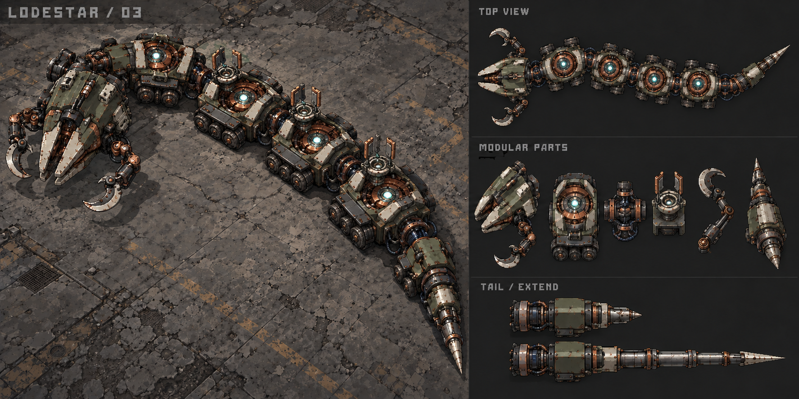

# Lodestar /03 — articulated war-serpent workshop

**Revised29 October2026 · Creator discussion incorporated · Proposal, not implemented content**

Lodestar is a purpose-built, continuously moving war serpent. Six connected sections carry boring jaws, direct-fire shards, heavy siege artillery, an artillery feeder, tactical proximity mines and a physical tail sweep. Each section can be damaged and permanently disabled. The structural spine keeps damaged sections connected; target choice changes the remaining fight.

**This revision supersedes the original shared-health / harmless-body / electrical-anchor / saw-disc / swivelling-tail-lance proposal.** It also corrects the proposed rear boring unit: actual excavation machinery is at the head. Current release identity remains **1.0.0+28**. Lodestar remains planning material, with isolated workshop → complete Training candidate → later roster admission as the implementation path.

The existing board supports the six-part silhouette and connected industrial machinery. Its pole equipment and telescoping lance are superseded. It is not revised production art and must not be used as the new weapon specification or cut up as an atlas. Retain its original generation provenance; commission matching updated parts after this direction is reviewed.

## 1. The six sections, properly allocated

| # | Section | Mechanism and purpose | Consequence of destruction |
|---|---|---|---|
| 1 | Boring head | Armored jaws close around rotating cutting teeth for excavation; open for a warned bite | No new burrow, eruption or bite attacks |
| 2 | Shard accelerator | Swivelling feed/induction assembly fires visible metal flechettes on committed paths | Stops direct-fire volleys |
| 3 | Twin siege mortars | Independent cradle tracks a moving player; tubes elevate, recoil and bombard a predicted route | Stops bombardment |
| 4 | Ammunition feeder | Armored magazine, indexing conveyor and loading arms physically supply the adjacent mortars | Reduces mortar volleys from three shells to one; no invisible full-magazine supply |
| 5 | Tactical mine projector | Aiming cradle launches physical proximity devices into selected crossing/retreat routes | Stops new mine deployment |
| 6 | Armored tail | Final sections curl, load and swing a connected cutting tail through a warned arc | Stops tail sweeps |

There are **five offensive sections and one auxiliary feeder**, not six unrelated gun types. The feeder/mortar relationship is intentional: attack the feeder to reduce pressure quickly, or spend more fire to destroy the mortar outright. Boring equipment cannot be on the rear carriage. Power can be distributed, but the head physically cuts the tunnel.

Live armored bodies have visible cutting/raking edges and damage on real contact. Ruined sections lose both their equipment attack and contact damage. Shooting a section must show local damage, stopped machinery and a durable wrecked silhouette; removing a weapon is not merely reducing an invisible shared bar.

## 2. Segment health and dismantling

One encounter owner, six stable section IDs, six local integrity values. Initial test allocation: head40, accelerator30, mortars40, feeder25, mines30, tail35:200 total. Values are provisional, not approved balance. One boss bar aggregates section integrity; the targeted section gets a compact local damage indication. Avoid six permanent competing HUD bars.

- Damage lands on the actual struck section. Breaking the head alone does not instantly kill the rest; redundant local controllers keep surviving modules and locomotion operating.
- Destroy the housing and machinery, retaining load-bearing spine/couplings. No independent split snakes, detached active tail or growing replacement segments in the first candidate.
- Destruction immediately cancels that section's unreleased attacks. Emitted rounds and planted mines already exist physically and finish their finite warned lifetimes; destroying the whole boss disarms all remaining hazards. Feeder destruction trims any unreleased extra mortar shells; shells already in flight retain their committed landing warnings.
- Killing every offensive section ends the fight; any surviving auxiliary feeder shuts down with the spine. Never require an otherwise harmless ammunition carriage as a final health sponge. Remaining auxiliary integrity clears as part of that single completion.
- Destroyed sections do not absorb player ammunition or generate XP/procs repeatedly. Their damaged art exposes the remaining spine so shots passing through collapsed armor remain visually credible. They retain only their actual structural occupancy.
- No healing, weapon regrowth or instant replacement attack. Limited phase-two mobility changes must not erase the player's successful dismantling.

### Player-weapon accounting

Separate section integrity does not permit accidental sixfold damage. Default primary projectiles apply once to their first swept **living** section; distinct shotgun pellets are separate shots. Piercing/bounce retain a boss-owner hit ledger so crossing six sections cannot duplicate the same primary damage or procs. Cumulative-distance ballistics use the muzzle-to-first-contact travel as usual. Arc chains do not acquire another section as a separate enemy.

One blast has one total boss-damage budget. Distribute that budget among exposed live sections actually intersecting the blast, respecting cover, rather than applying full damage six times. A blast touching one section applies its full boss budget there. Killing two weakened sections with a blast is possible, but total damage cannot multiply. These rules need native grenade/mine/pierce/bounce/chain tests before combat admission.

## 3. Physical construction and motion

Exactly six main bodies and five constrained couplings. Initial overall envelope around610 ×150 world units at the existing1500 ×700 camera; measure actual HUD/native-DPR coverage before final art. Head144 ×128, carriage approximately108 ×116, tail120 ×100, with real coupling space and roughly100–108 center spacing. These are rig candidates, not authoritative production dimensions.

Separate art parts: armor shells, roller bogies, coupled bearings, copper bus/hose connections, rotary head teeth, jaws and brake pads; accelerator cradle/feed fingers; two mortar tubes/elevation trunnions/recoil slides; feeder magazine/conveyor/loading arms; mine cradle/door and folded/deployed mine; tail cutting edge and reinforced joint hardware; local break/damage and inert wreck states. Mortar and feeder must visibly connect. No telescopic lance or electrical-pole hardware in the revised production set.

Manifest every source rectangle, pivot, world size, coupling endpoint, release socket, recoil axis, tool edge, height, turn/reach limit and draw order. Neutral overhead light and Regun's iron/olive/copper materials must work at every heading on Breach and Foundry. Original concept art is reference only; make compatible isolated parts.

**Locomotion:** accepted head path sampled by travelled arc length; followers occupy fixed distances along it. Solve individual body transforms and constrained real couplers, initially±28° with minimum turn radius around220. Rollers follow actual signed travel; iris/loader/cutter motion shows mechanical work through cooling and deliberate holds. No sine-wave rubber spine, skating, disconnected hoses or teleporting followers.

**Full-body collision:** reserve/sweep six ground footprints plus the physical spine under one actor before committing a pose. Use actor-based occupancy and cover constraints; validating only the head is insufficient. No giant enclosing circle over visible empty bends. Other living enemies yield; pending spawn reservations remain separate. Reject self-crossing/tight closure and preserve an open walking corridor initially220 units wide. Reverse along a validated prior path or widen the route when cover prevents a legal bend.

Target260 ordinary speed,300 in phase two, acceleration900; tune against full-body motion rather than just head pursuit. Surface combat should move at least85% of eligible active time above40 units/s. Cooling travels around180. Deliberate loading/bracing is brief and visible; no incidental parking beyond.5s. Burrow entry/exit and destruction have separate measured timelines. Do not increase speed to hide ineffective navigation.

## 4. Head, contact and rear melee

**Head bite:** jaws open, cutter load changes, a fixed bite route is warned for initially.8s, then teeth close through the actual short swept reach. Direction commits before release. No filled damage disk outside the jaws.

**Live body contact:** use actual swept surfaces of each living armored section, including fast crossings. All sections share one contact acceptance cooldown, initially the existing.5s minimum: touching three sections is not three instant hits. Player protection/dash rules remain authoritative. No contact from buried, entering-protected, wrecked or defeated sections. Contact does not secretly enlarge collision beyond the visible cutting armor.

**Tail sweep:** the last two sections visibly bend to load the swing, with joint limits propagated through the body. Warn the combined future tail/body sweep for initially.85s, commit, then execute an approximately.5s physical sweep and recover while travelling. Actual swept tail-edge geometry damages once per attack. It cannot independently swivel360°, pass through the serpent or snap into a pose the spine cannot reach. Invalid cover/pose aborts damage; it never teleports the tail.

Contact and active melee from the same crossing share acceptance so a bite/sweep cannot stack an immediate extra body hit. Preserve walking escape space; dash can improve an opening but is not the only legal response.

## 5. Ranged weapon mechanisms

### Shard accelerator

A distinct swivelling bearing aims independently; feed fingers present real metal ammunition, induction rings load and release short fast volleys from solved lips. Initial candidate:.9s preparation, final.25s committed heading, two five-flechette fans separated.22s, speed640 and760 maximum travel. Material projectiles have substantial silhouettes and impact response, not tiny glowing dots. No homing after release. A full volley shares a1HP player-damage ceiling.

The fan preserves a validated escape route; decorative gaps are not assumed to fit a close player. Check own-body obstruction and solid cover before release. A blocked mount repositions/selects another move, never shoots through its own carriages. Individual cooldown initially4.2s after sequence completion.

### Twin siege mortars and feeder

A rotating cradle constantly searches/tracks while the body moves. The tubes visibly elevate; the feeder indexes ammunition and loads a breech, then each tube recoils separately. Initial sequence: three substantial shells staggered.35s over a bounded predicted movement route, with at least.95s visible flight/warning before each impact. Each landing point commits when its shell leaves the actual muzzle. Do not late-home a shell or move an existing impact marker.

Shells have readable bodies, arcs, descending shadows and material impact/explosion. Fixed floor warnings show each real blast footprint, initially110 radius. Cap accepted player damage to1HP across one salvo during the first balance candidate. Cover invalidates/clips planned shots through the shared authoritative geometry. Never start targeted bombardment from offscreen equipment.

Feeder break reduces future/unreleased salvos to one shell through a visibly slow fallback loading action; mortar break cancels all unreleased mortar shots. No mystery replenishment. Initial mortar cooldown5.5s; frequent tracking with bounded firing opportunities supplies pressure, not uninterrupted unavoidable explosions.

### Tactical proximity mine projector

No electrical anchors and no saw-disc battery. A visible cradle aims and launches **one** metal mine toward a likely crossing or retreat route. It physically travels, lands, unfolds and arms; never instantly appears under the survivor. Mine flight must obey cover/body sweep and land at the simulated contact point, not a cosmetic destination.

Initial limits: at most **two active/pending mines**,.7s arming delay,110 trigger radius,.85s committed warning,145 blast radius and1HP maximum accepted damage per mine. The player entering range starts a fixed-position warning; leaving does not move the mine or reset a triggered fuse. Shooting disarms it without a damaging chain explosion. An untriggered mine expires within12 active seconds with visible shutdown.

Choose useful routes, not arbitrary scatter. Reject placements under actors/solids or those sealing the only reachable exit. Do not fire at capacity or repeatedly refresh old mine lifetimes. Initial projector cooldown6s, limited to one deployment per sequence. Device read states: flight, unarmed, armed, triggered, disarmed and expired. A directional mine remains an optional later alternative, not a second v1 mine type.

## 6. Burrow and committed eruption

The head carries the actual rotating excavation teeth. Jaws close into a boring assembly, front armor braces and the head cuts down first; each connected body follows the same accepted route. A rear power module cannot visually substitute for a head cutter.

Proposed attack sequence:

1. **Entry preparation, about.8s:** visible cutter spin-up, head-lowering and ground cracking. No damaging eruption or invisible body disappearance during this warning.
2. **Sequential descent:** head then each carriage enters the same opening; use one continuous3D-height/projection convention with a ground mask. A section remains shootable/contact-capable only while actually exposed. No shortcut that fades the entire snake at once while leaving invisible hitboxes.
3. **Underground travel:** visible advancing dust/crack cues communicate motion. Fully buried untargetable time capped around2 active seconds; no simultaneous surface gunfire, mortar release or fresh mine deployment. Existing mines retain their own finite warnings; combined escape validation can defer burrowing.
4. **Commit the exit:** choose a legal nearby point from the player's position/bounded movement prediction, display a clear planted rupture footprint **and initial exit corridor** for at least.95s. The destination never follows the player after that warning starts. Validate room for the whole emerging body and a walking escape.
5. **Eruption:** the head physically breaks through at that committed point; the rest emerges sequentially along the reserved exit path. Head eruption, following body contact and bite cannot stack multiple immediate hits: one1HP attack-sequence budget for this exit. Broken sections remain harmless during emergence too.
6. **Recovery:** all surviving sections regain their correct surface collision/damage availability from actual depth, then move and visibly reload. No instant full-body respawn at a new pose.

Destroyed head disables new entry. Breaking it during exposed entry cancels the damaging eruption and completes a safe visible withdrawal/emergence rather than hiding the remaining serpent. Defeat/Training recovery/restart at any depth must cancel owned damage and release occupancy correctly. If cover invalidates an exit after commitment, abort its damage and use a visible safe exit; never silently retarget beneath the player. Initial cooldown12s after full emergence.

This changes arena presentation, not permanent level collision: cracks/dust are finite material effects. Both concrete floors need a credible cutting/breakthrough treatment and head/front art; the current identity sheet does not prove the burrow animation.

## 7. Intelligence, scheduling and dismantling progression

Navigation chooses broad intercept routes and side exchanges around actual cover. Aim uses bounded movement prediction, but committed warnings stay committed. Rear pressure comes from actual tail motion and legal swivelling mounts, not a safe blind spot or impossible anatomy. Surviving modules respond to destruction and obstruction immediately; dead equipment never owns a turn.

One major sequence at a time in the first candidate, including complete burrow/eruption or mortar salvo. Shard support can be evaluated later only when combined walking escapes are proven. No new major release during burrowing or active tail/body sweep. Mine placements reserve capacity before their doors open. No normal reinforcement mobs in initial workshop/Training fights.

Quiet recovery is.8s of no **new** releases while moving, after moving major rounds finish. Mines can still be visible/armed; a pending trigger warning prevents declaring that interval a safe reload demonstration. Selection must ensure regular actual hazard-free reload opportunities rather than allowing residual mines to invalidate every recovery. Do not extend quiet timers indefinitely because untriggered mines exist; they have finite lifetime and constrained placement.

Use per-family cooldowns above, separate from the shared recovery. If a mount is blocked, choose another legal move/reposition promptly. Already destroyed families cannot be picked. Optional support cannot continually reset a deadline and starve a major attack. Ordinary targeting must work against continuous player movement.

**Dismantling:** phase two begins near50% aggregate integrity, with300 surface speed and shorter between-attack waits, retaining full warning minima. It never restores broken equipment or grants a surprise new attack. Reduce available choices as the player destroys sections; do not punish a successful weapon removal with arbitrary instant retaliation. Before all offensive sections fail, one remaining weapon still uses deliberate movement and its own readable cycle.

## 8. Arrival, defeat and complete Training candidate

Arrival selects a clear visible corridor for the entire serpent. Grinding, cutter/bogie movement and dust precede the head; sections feed into view in order and start safe. No damage until physical arrival is complete. In-fight burrowing is the separate warned sequence above.

Defeat disarms the complete encounter immediately, brakes the connected body and unwinds surviving mechanisms in sequence. Grounded wreck sections stay inert, non-damaging and finitely cleaned up. Underground defeat surfaces inertly or visibly collapses the committed tunnel without another attack. Completion/rewards occur once; initial Training remains without normal profile rewards.

Training needs the complete encounter, protected practice/Take damage, deterministic per-weapon and burrow selectors, full restart and shared player recovery. Preserve existing pause, upgrade, lifecycle, control layout, reload and Reduced Motion contracts. This blueprint does not admit Lodestar into survival or online play.

## 9. Shared geometry, art, effects and runtime budgets

All warning, muzzle, tool, mine, shell, depth and collision geometry derives from the same solved transforms. Ground VFX stay below actors; airborne shells and burst cores remain visible above them. Include real rendered-pixel checks: a valid damage event with no perceptible explosion is a failure.

At current phone camera/HUD scale, offscreen/obscured modules cannot begin a targeted major warning. Reposition the machine rather than change controls/camera zoom. Damage shapes follow actual surviving bodies and visible moving edges. No generic flat circle standing in for every material mechanism. Use `AttackVfx` infrastructure with appropriate new material sprites, capped effects and finite scorches.

All clocks use active simulation time. Pause, picker, entrance and background freeze mechanisms, underground travel, warnings, flight, triggers, cooldown and failure. Owner epochs invalidate every pending load/release on leave/restart/death. Dispose atlas leases and one motion loop with the encounter. Reduced Motion retains essential articulation and attack depth/timing while omitting optional shake, streaks and decorative oscillation; never hide an attack warning.

| Resource | Initial ceiling |
|---|---|
| Main sections / couplings | 6 /5; one encounter owner with6 section IDs |
| Major sequences | 1; no support overlap initially |
| Mortar shells / live moving hostile ordnance | 3 /20 total; reserve full volleys |
| Mines including flight/pending loads | 2 |
| Transient impacts / floor marks | 8 /12, finite lifetime |
| New decoded boss art / whole encounter art | Target≤12MiB / existing32MiB ceiling |
| Motion audio loops | 1 bounded, with existing SoLoud gain/mute/lifecycle |

Reuse carriage textures with distinct weapon caps; do not duplicate atlas decodes per section. New art needs head excavation, mortar/feeder mechanism, mine states, physically curling tail and all local broken states. Audio needs readable loading/arming/cutter/eruption cues plus material impacts. Original/cleared sources and generation manifests remain required. Actual phone memory, frame time, heat and listening acceptance stay physical review gates.

## 10. Workshop sequence and acceptance gates

**Current prerequisite:** Ariet is now admitted to normal Solo for creator testing; this is not physical acceptance. Creator review of Ariet's rocket detonation, escort
coordination and reduced escort size takes priority. Do not begin Lodestar runtime
construction while those foundational Ariet concerns remain unaccepted. Updating
this blueprint does not bypass that gate.

| Gate | Build | Proof before proceeding |
|---|---|---|
| 0 | Revised direction and original silhouette reference | Review six roles, dismantling, contact and burrow commitments |
| 1 | One carriage, real coupling and broken state | Art alignment, joint limits, mechanism load, local damage readability |
| 2 | Full surface rig, compound occupancy and6 integrity records | Figure-eight, reversing, walls, player crossing, no stretching/self-trapping or stationary pursuit |
| 3 | Head jaw/cutter, body contact and tail sweep | Physical anatomy, swept edges, shared hit acceptance, ruined sections harmless |
| 4 | Shards, then twin mortars plus real feeder | One complete module at a time; moving-player hits/evasion, recoil, committed shells, local break consequences |
| 5 | Tactical mines | Actual flight, strategic placement, two-device capacity, arm/trigger/warning/disarm/expiry, escape routes |
| 6 | Complete burrow/eruption | Sequential depth, fixed exit/corridor, damage availability, interrupted entry/death, no invisible contact |
| 7 | Full Training encounter | Arrival, all surviving-weapon combinations, phase change, defeat, recovery, restart, settings and real rendered proofs |
| 8 | Later admission | Choose roster slot, rewards, save/capability/native-server parity after Training acceptance |

Each module is end to end: art → attachment → moving mechanism → warning → release → swept damage → recovery → local destruction → cleanup. No module-only debug screen may be presented as the full boss. Isolated harness remains a planned `tool/lodestar_workshop.dart`, not an existing runnable command.

## 11. Verification and risks

Portable checks: fixed120Hz rig sampled at30/60/120Hz; coupling/reach/socket continuity; full-body cover/self-occupancy; reverse/wall and depth transitions; distinct section integrity and one-primary/one-blast total budgets; loader/mortar break propagation; no restored weapons; shared contact/eruption hit ceilings; mine targeting/capacity/arming/proximity/expiry; every pause/owner invalidation stage.

Native checks: all24 loadouts; continuously moving targets and committed-path evasion; body/tail/head contacts; individual section targeting and every offensive section as last survivor; feeder-first versus mortar-first outcomes; meaningful hazard-free reload opportunities; burrow warning/geometry at center and cover/edges; full/partial underground destruction; actual projectile/impact pixels; fresh/pending-load restart/disposal; memory and Reduced Motion.

Physical review on both floors at normal HUD scale: readability of launcher/mine/cutter state, convincing connected anatomy and descent/emergence, fair live-body contact, deliberate target priority, pressure without unavoidable bombardment, sustained frame pacing/heat, muted audio and mirrored controls. Installation or headless simulation cannot establish these results.

Main risks are long-body route jamming, unfair emergence, sixfold damage multiplication, dead equipment still firing, mines accumulating, poor body-contact readability and mechanically disconnected weapons. Resolve each in its isolated gate. Do not expand to split snakes, regenerating sections or adds to conceal a failing core encounter.

## 12. Research basis
### References and alternatives

Research accessed 29 October 2026. References inform structure and combat lessons; Lodestar's appearance, rig and arsenal are original proposals. Community descriptions are distinguished from developer accounts.

| Reference | Evidence and lesson | Translation into this workshop |
|---|---|---|
| [Ammoconda — Enter the Gungeon community wiki](https://enterthegungeon.fandom.com/wiki/Ammoconda) | Describes continuous segmented movement, attacks from several segments and segments losing attacks after damage. | A body can supply several threat origins. Use a shared scheduler so independent modules do not all attack at once. Do not adopt healing turrets or indefinite growth. |
| [Serpent — Nova Drift community wiki](https://nova-drift.fandom.com/wiki/Serpent) | Describes chained enemies, sequential broadside fire and chains splitting when middle sections die. | Test the whole curved body and distributed sockets. Keep one connected actor in the first candidate; splitting would multiply encounter and cleanup complexity. |
| [Nova Drift: News & Upcoming Content — developer](https://blog.novadrift.io/nova-drift-upcoming-content/) | The developer discusses clearer entrances, less brute-force randomness and more tactical enemy combinations. Its separate Serpent body-gear discussion concerns the **player's** body, not a boss. | Deliberate arrival, recognizable patterns and a finite footprint. Treat long-body logistics as a rig problem, not an excuse for invisible collision or uncontrolled screen coverage. |
| [Returnal: the making of Hyperion — Housemarque / PlayStation](https://blog.playstation.com/2021/05/28/returnal-the-making-of-that-unforgettable-hyperion-fight/) | The team describes attacks rooted in the boss's instrument, distinct projectile language, designed gaps and repeated readability testing. | Make charge and release visibly originate in the machine. Coordinate shapes and sound; validate an escape route rather than equating danger with projectile count. |

These are reference facts; all proposed timings, counts and acceptance targets below are our design decisions, not values taken from these games. No external artwork or audio is included in the project.

### Directions considered

| Candidate | Strength | Reason for decision |
|---|---|---|
| **Magnetic articulated serpent — selected** | Strong new silhouette; movement and four visibly different mechanisms; naturally modular | Highest contrast with both current machines and a clear sequence for building the difficult rig first |
| Gyroscopic reactor with orbiting tool arms | Excellent independent rings and tool animation | Risks another central platform that parks while weapons move; several floating parts can look disconnected |
| Resonance engine with acoustic horns | Non-military weapons and strong sound identity | Less distinct from existing bell/resonance imagery; harder to communicate fairly when sound is muted |

The research describes useful principles, not approval of the superseded equipment. The current recommendation is the six-section **war-serpent** layout above, with targeted dismantling and head-led burrowing. No playable Lodestar, new enum, balance change, build-number change or installation is implied by updating this document.
