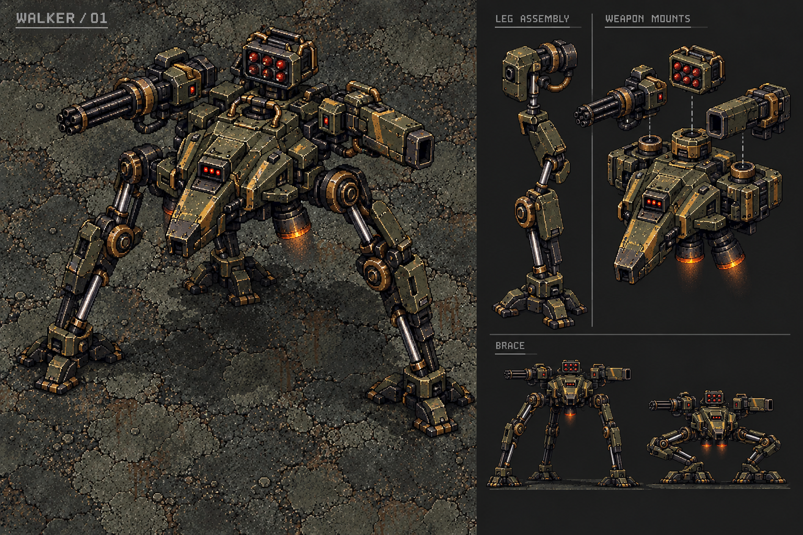

# Mechanical boss workshop — Walker / 01

**Current status — 28 October 2026:** Walker is an implemented, Training-only
candidate under creator review. The latest recorded verification is a clean
analyzer and846 passing tests with5 intentional skips; this does not establish
physical acceptance. The latest intent/recoil section supersedes earlier numeric
candidate tables below. Use Training → Start → Pause → Boss Practice → Walker.

**Next workshop proposal:** [Ariet — modular gunship workshop plan](ARIET_BOSS_WORKSHOP_PLAN.md).
This is a written plan, not an implemented second boss or a declaration that
Walker is finished. Its first deliverable is the assembly/flight rig, followed by
individual modules and a separately reviewed Training trial.

## Creator direction

27 October 2026: discard the rejected eight-boss overhaul and start with ONE
mechanical boss. The sentry is the reference for functional machinery, not a
body to enlarge. The robot needs its own identity and LONGER legs. Build it
modularly so each part can be made convincing before another is added. Required
combat modules: multiple guns/turrets, laser targeting, rockets and a
rocket-assisted charge ending in a melee strike. The creator further requires
all-direction motion, independently360-degree gun mounts with firing/recoil,
rockets that travel before beginning pursuit, and a large damaging death
explosion. This machine arrives by dropping from the sky, never the occult
portal/reveal used by the existing roster.

The large scale is intentional. Preserve boss scale and supply artwork/detail
that supports it. Do not reduce the boss to conceal weak source resolution.

## Reset completed

Client candidate changes from this conversation were restored to pre-overhaul
HEAD c892580, preserving its unrelated pickup/audio, catalogue, player and other
systems. Removed only the candidate's newly added runtime helpers, tests,
generated boss audio and validation artifacts. The older roster still exists
at its prior baseline; it has not become approved art by being restored.

The sibling backend candidate commit daea1a9 was reverted without creating a
commit or rewriting history; the revert remains staged. It removes capability10
and the conversation's changed boss mechanics/chain flight while retaining the
preceding backend work. No hosted publication occurred. The earlier phone
installation still contains the rejected candidate until a new installation.

Rollback verification: clean Flutter analyzer;12 focused geometry/readability/
online-presentation tests pass;199 backend tests, typecheck and module build
pass. Evidence: validation/boss-rollback-2026-10-27. These verify source rollback,
not visual quality or physical performance.

## First identity study

Compact suspended armored body, long separated hydraulic legs, wedge-shaped
breaching nose, offset rotary gun/heavy cannon mounts, dorsal missile rack and
rear/belly thrusters. Weathered iron/olive/brass, functional red optics, actual
bearings and piston attachments. No reused organic boss silhouette or humanoid
face. This is an original proposal, not yet creator-approved runtime artwork.

The board's views describe the same machine conceptually. They are not ready
for sprite extraction: final modular assets need compatible perspective,
occlusion, pivots and resolution at the actual game camera. The illustrated
weapon bank is a destination; it is not the first implementation milestone.

## Build order and review gates

### 1. Chassis and long-leg locomotion only

Produce matching isolated chassis, hip bearing, upper leg, lower leg, foot and
piston parts. Use a shared part manifest with source rectangles, physical length,
pivots, shading orientation and draw layer. Allocate source pixels from measured
phone coverage rather than choosing a small universal atlas decode size. Retain
the existing runtime texture budget or document measured requirements before
increasing it. Keep this work in a separate workshop/review harness initially;
do not silently replace a boss kind or add it to survival/Boss Rush.

One authoritative root moves through normal occupancy/cover. The rig consumes
actual displacement after collision, not attempted velocity. Each foot records
a world-space planted anchor. A scheduler lifts one foot, transfers it to a
reachable predicted landing and settles it before another unstable step. Start
with a deliberate crawl and three supporting feet. Solve each leg's two-link
joint from its actual hip and foot, with a stable outward knee bend and bounded
reach. Pistons join real moving sockets. Body yaw and elevation are distinct
from ground movement; projected height must never displace damage coordinates.

Walking should show load transfer, foot lift/placement, joint limits and a
settled stop. Turning and reversing replant legs deliberately. Idle feet remain
fixed; no sinusoidal foot skating, idle jogging, rubber limbs or disconnected
pistons. Reduced Motion keeps essential foot/body placement but removes optional
body sway and dust. Pause freezes the rig; restart/disposal reset every anchor.

Review the same rig walking, stopping, reversing, turning, meeting a wall and
crouching on BOTH real floors at actual phone scale. Inspect both an uncluttered
view and the normal camera/HUD context. Tests must cover planted-foot invariance,
reachable joints, deterministic gait at30/60/120Hz, no movement while paused,
wall-stopped motion and bounded part/effect counts. A render/motion proof must
look convincing before combat modules begin.

### 2. One aiming gun

Attach ONE turret to a documented yaw socket. Independent bounded tracking,
visible muzzle, barrel recoil and real projectile release from the same solved
muzzle. Targeting laser uses sight/cover and locks before firing; source, warning
and impact share that commitment. Body/leg direction remains independent of
turret yaw. Verify every heading and near targets before duplicating mounts.

### 3. Rocket-assisted ram

Read the intent through mechanism: slow/brake, lower chassis, brace feet,
orient ram, spool thrusters, lock direction, launch, swept melee contact, brake
and recover. Exhaust originates at actual nozzles. No late homing, hidden melee
disk or warning marker substituting for the robot's preparation. Collision uses
normal body/wall occupancy and swept contact. Thruster movement must explicitly
retract or skid braced feet rather than reuse a walking gait at impossible speed.

### 4. Additional modules, individually

Heavy cannon, rotary burst, rocket rack and further turrets each own targeting,
commitment, muzzle/socket, cooldown/reload, recoil, release, impact and cleanup.
Add one at a time. Each must work alone and in the rig before combination. A
shared director limits concurrent major attacks and preserves escape space.
Rockets are visible moving ordnance; their flight/cover contact is authoritative.
Breakable parts, phase changes and rewards are later encounter-design choices,
not assumptions baked into the initial art.

### 5. Sky deployment and mechanical destruction

Implement the physical drop/landing and the complete warned death-explosion
timeline described below. These are part of this robot’s identity and gameplay,
not a later application of the old occult entrance/death animation.

### 6. Encounter admission

Only after the rig and individual modules pass creator visual review: choose the
roster slot, health/body/contact footprint, attack sequencing, damage and
difficulty. Then implement native/server parity and capability/save migration
where actually needed. Preserve large open arenas and unrelated balances. No
new online protocol, release bump, public deployment or phone installation is
implied by this concept study.

## Required behavior contracts

These are implementation requirements from the creator’s direction. Numeric
health, damage, speed, duration and range values have not been selected; tune
those in the workshop after the mechanisms are visible. Do not interpret an
unset number as optional behavior or silently replace a requirement.

### All-direction movement, facing and rendering

- Separate root position, travel heading, chassis yaw, body elevation, each
  turret yaw and each leg’s pose. Strafing, retreating and turret rotation must
  work without immediately rotating the chassis toward the player.
- Locomotion supports forward, backward, lateral and diagonal movement at every
  angle. Chassis yaw uses bounded shortest-route rotation. Crossing the negative/
  positive pi boundary must not cause a full spin. Reversals brake/replant.
- Use actual ground displacement after occupancy/wall resolution for stride.
  Rotate each hip’s rest target with the chassis, but keep a planted foot fixed
  in WORLD space until its lift. Turning in place schedules real steps.
- IK clamps reachable extension, maintains a consistent outward knee bend and
  handles coincident/near-zero hip–foot distance without NaNs or knee flips.
  Pistons telescope between documented sockets, with bounded overlap/travel.
- Ground footprint and body height are distinct. Feet cannot plant through
  arena walls or occupy impossible floor. Decorative leg reach must not create
  hidden player collision; choose and visibly communicate any damaging leg/body
  contact before encounter admission.
- Art must cover every heading. Use compatible directional chassis/part views
  where perspective demands them; do not rotate one strongly side-lit painted
  view through360 degrees. Asymmetric weapons stay on their actual mounts;
  horizontal mirroring must not swap cannon/rotary-gun identity.
- Define near/far legs, chassis, pivot rings, gun barrels, rocket rack, flash and
  exhaust occlusion from their real sockets/depth. A gun aiming behind the body
  may move behind it visually without changing origin or snapping to the front.
  Shadows stay on the ground and feet remain readable beneath the large body.
- Preserve large boss scale, sharp source detail and contact with BOTH arena
  floors. Body bob/load transfer must not move the authoritative ground root,
  hitbox or weapon origin unpredictably. Optional sway is removed in Reduced
  Motion; meaningful limb placement remains.

### Player tracking and independent360-degree turrets

Each mount owns target identity, pivot, yaw, angular velocity, recoil offset,
weapon state and solved muzzle. The chassis has its own navigation intent.

1. Acquire a valid visible player through the authoritative world/cover query.
   Use target persistence/hysteresis so tiny distance differences do not cause
   frantic switches. In multiplayer, target identity belongs to the weapon;
   it must not accidentally switch because another player sent movement input.
2. Slew continuously through360 degrees at a bounded rate. Do not fire before
   the barrel is sufficiently aligned. Close/overlapping targets must not
   normalize a zero vector, spin the mount or put a muzzle behind its pivot.
3. Read the targeting laser as the gun’s actual sight, clipped at cover. Its
   origin follows the solved mount/muzzle. Tracking, locking and active fire
   need distinguishable poses/light/audio. No detached beam or wall penetration.
4. Precision/cannon attacks track while acquiring, then lock their chosen aim
   before release. Sustained rotary fire may continue bounded tracking but
   needs its own readable spool/burst envelope. No instantaneous tracking that
   perfectly follows a player’s dodge. Lead/prediction uses bounded observed
   motion and is committed per shot/burst as appropriate.
5. Losing sight before commitment cancels or searches. After commitment,
   follow the chosen shot policy consistently; neither silently redirect a
   warned strike nor refresh its destination to a new player. Document muzzle
   clearance and friendly/cover collision before releasing any shot.
6. Chassis turning may help bring a mount into a good firing posture, but
   independently traversing turrets do not require immediate body rotation.
   Damage, muzzle flash, projectile and sound share the actual release event.

### Weapon-specific mechanisms and recoil

Every equipped weapon must have its own complete preparation, release and
recovery. Mechanisms are driven by simulation time and release events, not a
looped decorative firing clip. Start with one working gun; add families in the
following order rather than firing the whole concept sheet simultaneously.

| Module | Preparation and firing | Physical response and recovery |
|---|---|---|
| Rotary gun | Barrel spin-up, readable tracking/lock behavior, short controlled burst, discrete rounds from rotating barrel sockets | Barrel/receiver recoil, mount dampers and restrained chassis response; spin-down and cooling pause |
| Heavy cannon | Breech/load or charge preparation, settle aim, committed shot with visibly slower heavy round | Barrel slides along its OWN local axis, cradle absorbs impulse, short hold then damped return; visible reload cycle |
| Missile rack | Lid/cell opening, rack orientation and one launch event per loaded cell | Remaining missiles/empty cells visible, local launch kick, exhaust through the correct vent, cooldown/reload before reuse |
| Targeting laser | Visible sight from an independently aimed mount, clipped at cover, distinct lock cue | Sight stays aligned through mount movement and recoil according to the weapon; no damaging beam unless that weapon explicitly has a separate beam-firing state |
| Rocket ram | Brake, lower body, brace, align ram and spool thrusters before commitment | Body mass drives acceleration/strike/braking; feet retract or skid deliberately; leg recovery/replant before walking resumes |

- Recoil is local to the barrel/receiver/cradle, not an elastic stretch of the
  whole gun. Its maximum travel cannot detach hardware or put the muzzle inside
  its housing. The pivot ring stays attached to the chassis.
- Each actual shot produces exactly one recoil impulse, flash and audio event.
  Do not trigger them again through snapshot interpolation, reconnect or pause.
- Recoil recovery can overlap permitted tracking through a clear transform
  hierarchy: root → mount pivot/yaw → receiver → barrel travel → muzzle.
  Solve the shot from the correct transform at release; do not retroactively
  bend an emitted projectile as the barrel recovers.
- Independent mounts need independent timing; firing one must not reset another
  mount’s pose. Ammo/cell consumption, reload and cooldown belong to that module
  and advance only through actual releases and active-time mechanisms. An empty
  or disabled mount cannot keep producing flashes, recoil or damage.
  Clamp accumulated recoil during rapid fire. Shared chassis load
  is bounded so multiple guns do not shake the entire screen or skate the feet.
- Add muzzle light/smoke, spent casing/belt motion and heat venting only where
  the actual module supports them. Use textured material art and bounded effects,
  not smooth diagram circles, triangle strips or generic outline flashes.

### Muzzle, own-body and cover collision

This is a design/geometry requirement, not a cosmetic patch after firing works.

- Assign boss/part ownership to every shot. Its own chassis, turret, feet and
  emitter must not consume its projectile or trigger impact/explosion at spawn.
  Use explicit owner identity/part filtering, never a global enemy-collision
  disable, indiscriminate grace timer or a bullet spawned beyond the target.
- Build barrel lengths, elevated mounts and firing sockets so the gun can
  traverse360 degrees credibly. A barrel clipping through the hull is an art/
  rig failure even if owner collision is filtered. Test all cross-body headings.
- If a roof-level turret fires across its own deck, establish that physical
  clearance in the rig and draw the round/flash at the corresponding depth until
  clear. A low-mounted weapon whose path is obstructed by its hull must wait,
  use a valid posture or stow; it cannot shoot invisibly through solid machinery.
- Sweep muzzle clearance against external cover using the projectile radius.
  If the muzzle is behind/inside a wall, suppress the release or resolve contact
  at that wall according to the weapon. Never teleport it to the wall’s far side.
- Start from the actual muzzle, not the root center or a player-based offset.
  Sweep the first movement interval and every subsequent interval. No launch
  tunnelling through a close player, minion, second boss or thin obstacle.
- Preserve the existing explicit boss/minion collateral policy; document it for
  each new projectile. Owner filtering must not accidentally grant immunity to
  other bosses, the player or unrelated actors.
- Ordinary player bullets must still hit the visible hittable chassis/selected
  modules. Broad leg art and gaps should not imply invisible invulnerability or
  damageable empty space. Decide whether module hits share body HP, damage
  reduction or breakable health before exposing them as targets.

### Rockets: launch, travel, acquisition and pursuit

Rockets must visibly travel BEFORE going for the player. Their launch vector,
phase, distance/age and homing state are authoritative simulation data.

1. **Eject:** leave a real loaded rack cell along its launch axis, with visible
   separation from the machine. Own-body immunity and cover contact are explicit;
   ejection never grants permission to cross an external wall.
2. **Initial flight:** travel a positive, visible minimum distance/time along
   the launch direction. Do not steer toward the player during this phase. Show
   this travel through rocket position and exhaust, not a fake curved trail.
3. **Acquire:** after separation, acquire a valid target with defined range and
   cone. Distinguish engine ignition/acquisition visually. Rockets with no target
   continue their documented ballistic/search behavior within a bounded lifetime.
4. **Pursue:** bounded angular turn rate and acceleration, no teleporting or
   instant180-degree reversals. Let a successful dodge matter. A trailing rocket
   must not orbit a player forever; limit pursuit/lifetime and retain cover.
5. **Impact or expire:** swept body/cover contact, one explosion, then removal.
   Early contact must resolve honestly even before full pursuit; clearly specify
   blast arming versus flight contact so an unarmed rocket never vanishes or
   passes through solids without explanation. No reused arbitrary grenade fuse.

Salvos stagger their cells and initial trajectories without silently changing
warned landing areas or saturating all dodge routes. Lock targeting per rocket
or salvo as explicitly defined; do not retarget on every network snapshot.
Smoke/exhaust lifetime and count are capped, floor dust stays below actors and
Reduced Motion retains the real projectile position/flight time.

### Rocket charge and melee contact

The charge is a complete animation/mechanics sequence, including a miss.

| Stage | Required visible behavior and simulation contract |
|---|---|
| Approach | Long legs carry the chassis; mounts can acquire independently |
| Brake and brace | Feet replant/support mass, chassis lowers, ram faces the selected direction; turrets take a physically safe posture |
| Thruster spool | Engine/nozzle preparation gives time to react; selected player route/heading becomes committed at the documented point |
| Launch | Acceleration is visible; exhaust remains attached; launch heading does not home after commitment |
| Charge | Root movement uses swept occupancy/wall contact; legs explicitly retract or maintain designed skid contact |
| Melee hit | Actual ram/body leading geometry sweeps the player; one strike hit ledger prevents frame-by-frame repeat damage |
| Miss or obstruction | Respect wall/body contact and stop/brake; no bending around cover or passing through other bodies |
| Recovery | Thrusters decay, chassis settles, feet replant and weapons recover before another major attack |

Define separately ordinary body contact, charge contact, ram damage and any
knockback. Do not stack all of them accidentally on one impact. Player dash/
protection rules still apply. If a wall impact makes damaging debris, that is
another explicitly warned/visible mechanic, not free hidden splash. The opening
can be punished; no unannounced immunity just because the robot is animated.

### Sky-drop deployment — no occult entrance

- This boss alone uses a mechanical deployment, replacing the portal/reveal
  path when it is eventually admitted. Do not apply the existing occult clips,
  magic runes, spectral fade or teleport pose to it. Other bosses retain their
  baseline until deliberately redesigned.
- Find a legal landing area with actual body/foot clearance from solids,
  player deployment and objectives. Reserve its space with the encounter runtime;
  pending reservations are not living actors. A failed/cancelled drop releases
  them. Never relocate a player or crush them without a fair warning.
- Approaching engine audio, an advancing/growing grounded shadow and a readable
  dust footprint warn the committed landing. The robot visibly descends from
  above the camera, uses braking thrusters and extends its legs for touchdown.
  Keep the landing point fixed once warned.
- On contact, feet and pistons absorb the load, body compresses/settles, dust and
  debris spread from actual feet/ground contact, then weapons unlock. Do not
  begin firing while the model is still falling or use an idle pose in midair.
- Decide landing damage explicitly. Initial workshop default is a non-damaging
  landing; the creator has required death-blast damage, not arrival damage.
  If landing damage is later chosen, its warning and collision must share the
  same reserved footprint with enough escape time.
- Preserve a usable camera and player control rather than forcing an occult
  cinematic. Do not double-deploy the player or invoke PlayerEntrance recovery
  accidentally. Reduced Motion keeps the warning/touchdown timing but shortens
  or conceals the large descent/pan and omits shake; meaningful danger remains.
- Cancel pending art/audio loads, descent, footprint and reservations on route
  disposal, restart or training target replacement. Pause/background freezes
  the entire simulation-clock timeline, not just the robot sprite.

### Destruction and large damaging death explosion

A kill starts a real destruction sequence, not an immediate reward-screen cut.
The final large explosion MUST be able to hurt the player.

1. **Fatal hit:** atomically disable new targeting, gun release, charge and
   locomotion. Preserve already-fired ordnance according to a deliberate policy;
   start with disarming/cleaning boss-owned hostile ordnance so the warned final
   explosion has a readable escape window. Cancel delayed callbacks and queued
   rockets so death cannot emit another normal attack.
2. **Failure:** lock/brake mounts, sag/collapse the legs onto valid supports,
   vent smoke/sparks and show worsening core/thruster failure. Small decorative
   pops do not secretly add damage. Keep enough chassis silhouette to explain
   the blast source.
3. **Escape warning:** unmistakable mechanical/audio escalation and a clear
   grounded danger footprint. The player can move/dash/reload normally. Do not
   freeze combat into victory, move the camera away or cover escape space with
   a picker before the damaging event resolves.
4. **Core detonation:** one large material fire/pressure explosion at the actual
   wreck position. Damage uses explicit world-space blast radius, body-edge
   intersection and solid-cover occlusion, shared with its visible footprint.
   The wreck/own chassis must not mistakenly count as solid cover against its
   own explosion. External arena cover still blocks according to the shared
   blast contract.
   Respect existing guard, invulnerability/training protection and accepted
   damage-feedback settings. One per-player hit ledger; repeated ticks,
   pending removal, reconnect or restored snapshots cannot repeat the blast.
5. **Aftermath:** pressure/dust decay, bounded debris and grounded wreck/scorch.
   Decide whether the wreck blocks movement; never leave an invisible collider.
   Decorative flying pieces do not deal damage unless separately specified.
   No long full-screen flash, forced camera shake or indiscriminate bloom.
6. **Settlement:** award the kill/core/loot exactly once and stage victory,
   next-boss pacing and choice screens so they cannot hide or neutralize the
   death blast. The encounter remains responsible for the wreck until resolution.
   If the blast kills the player, use the ordinary death/recovery flow with no
   duplicate rewards or new boss spawned over that flow.

A death explosion is separate from rocket blast tuning. Large must be legible
and escapable; do not choose its radius from an artistic halo. Paused/background
or upgrade state must not let the warning elapse invisibly. In training with
Take damage enabled it can hurt/trigger training recovery; protected training
still shows the same blast without health loss. Reduced Motion keeps the
warning and damage timing and uses restrained light/fade instead of a flash.

## Additional systems we must not forget

### Attack coordination and fair space

- A shared director owns permission to spool/commit major attacks. Independent
  turrets are not permission to fire every module continuously. Define permitted
  overlaps, quiet recovery windows and a maximum simultaneous projectile/hazard
  budget. Preserve at least one reachable escape route at commitment.
- Charge preparation, sustained tracking fire and a homing salvo cannot form an
  unavoidable trap. Keep the first admitted sequence simple and add combinations
  only after each module works alone. Phases change behavior at a safe boundary;
  do not shorten an already warned attack when crossing a health threshold.
- Resolve unreachable targets, cover hugging, a player underneath the chassis,
  a player behind the robot, edge/corner drops and blocked charge routes. Avoid
  endless idle/search loops and instantaneous attacks at zero distance.
- Slow survivors/base reloads, fast developed builds, normal hordes, supply pods
  and existing arena hazards all need room to operate. Preserve the open arena
  and current crowd/reservation distinctions.

### Health, modules, feedback and identity

- Choose body damage/hit response independently of decorative legs. Preserve
  boss mass/occupancy and planted behavior under ordinary bullet impact.
- If parts become breakable, destroyed gun/rack state must affect behavior and
  visible silhouette, cancel its pending releases and remain destroyed through
  saves. No detached invisible gun firing after destruction. Keep part/body hit
  ledgers from multiplying one projectile’s damage across overlapping parts.
- Mechanical sound identity includes foot weight, piston motion, turret servos,
  gun-specific firing/reload, thruster spool/charge and core failure/detonation.
  Bound concurrent voices and shared gains. Prewarm necessary cues; stop looping
  servos/engines cleanly on pause, death, restart and disposal.
- Distinct textures/shape, view-angle source detail, selective warm highlights
  and ambient grading establish one robot identity. Targeting optics, missile
  flames and heat are functional signals. No decorative effects obscuring the
  player or covering large portions of the floor in flat paint.

### Simulation, saves and online ownership

- Root, rig, gun mechanisms, rocket phases, drop and death timeline use active
  simulation time. Pause, background, training replacement, restart, game over
  and disposal each have explicit transitions. No wall-clock delayed release.
- Save/restore must not replay a landing crush, shot, missile launch, blast,
  death reward or settlement. Track encounter/actor/generation and event identity.
  Existing transient-attack restoration policy may clear shots, but must handle
  death warning/detonation consistently; never revive an already killed robot.
- Server owns target choice/commitment, movement, muzzle solve, projectile flight,
  rocket acquisition, damage and death-blast/reward state. Clients cannot supply
  trusted boss position, hit results or explosion timing. Visual interpolation
  must not turn one projectile or recoil into multiple releases.
- Directional art readiness, lazy leases, pending loads and runtime atlas budgets
  apply through sky drop, multiple module states, destruction and restart. No
  permanently loading the full robot’s eventual arsenal for a leg-only workshop.
- When encounter admission occurs, add deliberate capability/schema migration;
  do not reuse the discarded capability10 candidate by accident or change the
  existing roster/checkpoints merely to display a workshop prototype.

## Review and verification matrix

| Area | Required cases |
|---|---|
| Directions | Full360-degree turret sweep, continuous body yaw, forward/back/side/diagonal walk, wrap boundary, turning in place, reversal, close/underbody targets |
| Legs | Every foot/joint through plant/lift/transfer/settle, wall-stopped body, crouch, body rotation, valid knee bends, long-leg reach, stationary idle, stable piston sockets |
| Gun release | Every mount/heading, body occlusion, alignment gating, local-axis recoil, rapid fire, muzzle in/near cover, near target, independent simultaneous mount states |
| Own-body collision | Shot emitted over/across/behind own hull and near legs; no self-hit, no wall skipping, real first-frame target hits, correct collateral on other actors |
| Rockets | Visible initial straight travel, delayed acquisition, lost/dead target, turn/acceleration limits, early wall/body contact, evasive dash, lifetime, staggered salvo, one blast |
| Charge | Every heading, lock before launch, miss, wall/body obstruction, swept hit, no stacked contact damage, braking, feet replant, protected player |
| Drop | Both floors, legal/blocked landing, committed shadow, brake/touchdown/settle, input/camera, Reduced Motion, disposal while loading, replacement mid-fall |
| Death | Fatal hit in every attack stage, escape window, cover/body-edge blast, guard/protection, normal/training death, pending removal, pause before detonation, exactly-once blast/rewards |
| Lifecycle/online |30/60/120Hz, large steps, pause/background, restart/dispose, save/Continue during drop/death, packet delay/reconnect, old client rejection/migration when actually admitted |
| Presentation | Actual phone-scale views on both floors with normal HUD, all headings, sharp source detail, shadows/depth, muted play, physical sound fatigue, reduced motion and bounded effects |

Behavior tests are required for real collision/state contracts. They do not
approve artwork, motion comfort or device performance. Each workshop milestone
needs actual rendered motion alongside its tests; prove the individual module
before making the full robot busier.

## Historical first working rig study

Implemented as an isolated native Flutter workshop at **Training → Walker
workshop**, before starting a run. Live survival/Boss Rush, boss enums,
checkpoints and backend gameplay are unchanged. The workshop is a rig study,
not a combat encounter and not final art approval.

- Dedicated textured modular chassis, upper/lower links, bearings, feet,
  receiver/barrel and cold thrusters in workshop/walker_parts_v01. The original
  identity board remains a concept; this first assembly still needs comparison
  against it in motion, including every angle and body/leg proportion.
- Four long two-link legs, world-planted feet, a one-foot transfer scheduler,
  acceleration/braking, shortest-route chassis turns and a low brace pose.
  Independent bounded turret yaw/pitch covers360 degrees while the chassis
  can stand or strafe. No shots are emitted yet.
- Walk/strafe/turn/stand/brace modes; tap the floor for a destination, drag the
  Rook target to aim, restore automatic target motion, switch both floors,
  inspect joints and toggle Close view. Close view follows the chassis and
  uses the same inverse transform for touch coordinates.
- Fixed120Hz rig stepping; tests compare30/60/120Hz and cover planted-foot
  invariance, fixed link lengths during continuous turn/reversal/brace,
  stationary blocked-root behavior, pause, turret wrap/all headings and brace.
  A future combat root still needs the real occupancy/cover integration; the
  current review floor uses bounded destinations and a tested resolver hook.
- Route-local part ownership handles disposal during asynchronous load. Arena
  floors are borrowed from the shared non-lazy world cache, not decoded again.
  Part atlas retains full1774px source width (~6MiB). Measured standalone shared
  cache + workshop decode is~27MiB, under the32MiB decoded-art budget. This is
  not total process/GPU memory or phone performance. Entry before a run avoids
  retaining a developed paused encounter alongside the dedicated rig.
- Normal training selections are preserved when opening/closing the workshop.
  The entry footer adapts to narrow/large-text layouts. Background/pause freezes
  the view; resume does not fast-forward a stalled display. No run rewards,
  profile/saved-run mutations or normal-enemy spawning occur in the workshop.

Source: systems/walker_rig.dart, presentation/walker_art.dart and
views/walker_workshop_view.dart. Reproduce24s clips of the actual shared painter
with `REGUN_WALKER_CAPTURE=1 flutter test test/walker_workshop_test.dart`.
Output: build/walker-workshop/{breach,foundry}.mp4, rig-headings.png and
texture-budget.txt. Walk, strafe, turn, stand, brace and stand/recover occupy4s
each. They are rendered simulation evidence, not physical-device play footage.

Not implemented: weapon firing/recoil/reload, muzzle collision, rocket flight,
charge/melee damage, sky drop, destruction/death explosion, admission or online
replication. The current barrel is an independently aimed visual mounting study;
its over-deck clearance/occlusion must be resolved before live firing. Body art
is currently a rotatable top-view assembly, not a completed directional view
set. Load-transfer refinement, real floor-obstacle foot placement and final
lighting/perspective remain review work before claiming locomotion is finished.

No phone installation or new version change was performed for this slice.

Verification: clean analyzer,816 tests passed with5 intentional skips via
`make verify`. See [first rig evidence](validation/walker-workshop-2026-10-27/README.md)
for clips, cache accounting and the specific open visual/implementation gates.

## Complete native Training encounter — 27 October 2026

The creator requested the finished fight in the proper Training boss selector.
**Training → Start → Pause → Boss Practice → Walker** now summons it in the
existing run, with the selected survivor/weapon/build and normal controls. The
rig workshop remains an optional inspection tool; it is not required to fight.
Normal Training preserves its visit's Take damage setting (default Off). Turn
it On to receive weapon, body, ram and death-explosion damage. Fatal player damage
uses the existing Training recovery/landing, freezing the encounter timeline.

Implemented: mechanical sky warning/descent/landing; 230-unit/s pursuit (260 at half health)
with actual occupancy/cover and long-leg IK; independent360-degree rotary gun,
cannon and missile rack; physical muzzle/round origins outside the hull; local
barrel recoil, flash/spin and mechanism sounds; clipped laser sights; committed
cannon shots, bounded tracking rotary bursts, staggered rockets and a committed
thruster ram with braking/recovery; half-health variants pinned per attack;
warned core failure, large damaging detonation, wreck and replay. No occult
portal/departure is used. Switching to another practice boss/rush retires the
robot, its rounds, layers and textures; pending load cancellation is guarded.

| Contract | Implemented candidate value |
|---|---|
| Health / ground body |190 HP /88-unit radius; visible long legs are decorative |
| Rotary |36 rounds at .10s spacing (48 at .085s enraged),650 speed,1 damage; bounded tracking/strafe |
| Cannon |4 shots at .48s spacing (5 at .40s enraged),420 speed,85-unit blast,2 damage; follow-up aim commits .16s before release |
| Rockets |3 missiles (4 enraged),.28s stagger;220 initial speed,390 pursuit speed |
| Pursuit |No steering before BOTH.6s travel and100 units;1.8rad/s max turn;5s lifetime |
| Ram |Brace/spool/lock,400→1100 acceleration,720-unit limit;2 damage once; body-contact grace prevents an immediate second hit |
| Death |2.6 active seconds of escape warning;330-unit blast,3 damage once; cover/body-edge/protection rules apply |
| Drop |1.3s warning,.9s descent,.8s landing/leg compression; no landing damage |
| Budgets |24 owned rounds /12 short blasts; borrowed floor cache; trial clears other boss/horde/support/drop pressure |

Numbers are actual test-candidate values, adjustable after playtesting. Each gun
has elevated mounting clearance and a158-unit barrel solution; the real muzzle
must clear the body plus projectile radius at every heading and sweep against
external cover. Shots are simulated in an owner-local hostile list, so they
cannot hit their own chassis. Cannon/rocket blasts and death blasts each resolve
once; cover clips impacts before a wall. Upgrade recovery removes touching owned
rounds without causing their explosions. No extra primary-ammunition/reload or
player-weapon balance changes were made.

A fatal hit retires the hittable body from enemy occupancy but keeps separate
world render layers/controller alive until the mechanical failure/blast/wreck
finishes. It does not call occult departure, grant boss healing/core/XP, open a
picker or settle the Training profile. Replay uses the same boss selector path.
Pause → Boss Practice also exposes Walker destruction to review the death
sequence directly after deployment. No checkpoint kind/schema, normal survival
roster, random Boss Rush bag or hosted backend admission was added.

The supplementary arsenal atlas supplies separate cannon receiver/barrel,
missile rack, rocket, wreck and optic. The complete fight decodes the main atlas
at1536px (chassis source~385px for a206-unit draw) and arsenal at896px. This
preserves screen-appropriate detail while retaining the32MiB decoded-art budget
in the native integration test; the rig-only inspector retains1774px. Existing
recorded mechanism/weapon/ordnance cues are prewarmed, respecting native audio
settings. New bespoke sound design and physical mix/comfort remain for review.

Native end-to-end verification exercises the actual normal Training selector,
all attack phases, primary-shot damage, a paused death warning, exactly-once
3HP death-blast damage at the body edge, no kill/reward, replacement/reentry and
pending-load cancellation. Pure contracts cover rockets, hull/muzzle clearance,
cover suppression, committed swept ram, phase transitions and30/60/120Hz.
Evidence/capture: validation/walker-complete-2026-10-27. The release candidate
was installed/launched on the connected iPhone for creator playtesting. This is
not a claim of physical art, motion comfort, difficulty or performance approval.

## Pressure and agility follow-up — 27 October 2026

Creator requested sustained aggression, interceptable missiles and heavy-but-agile
walking. Approach/reposition commands are230/150 units per second,260/170 at half
health; close retreat180. In battle only, acceleration600, body yaw1.5rad/s and
.16s diagonal paired steps retain at least two supporting feet. World-planted
supports never slide; brake/brace and terrain/body occupancy remain authoritative.
The separate rig inspector retains its original conservative gait.

Rotary now sustains36/48 rounds and cannon4/5. Blocked or misaligned attempts no
longer consume a shot; retry spacing remains bounded and each firing phase has
a fixed end so cover never creates an infinite state. Both guns strafe at100/80
units per second. Recovery is.9s/.65s, approach delay.45s. Rocket salvos still
finish before the next attack; warnings, original damage, rocket turn bounds
and the24-round budget remain.

Live rockets are lightweight projectile targets through the same shared weapon
path as primary shots, rays and streams. Any positive accepted weapon hit
detonates once at its current position. Shooting nearby is risky: the normal
110-radius/2HP hostile blast remains; shooting at distance provides the escape.
No XP, heal, kill, core, proc reward or enemy occupancy is granted for a missile.
Pause, destruction, retirement and restart disable/clear these targets. Ram
contact retains2HP once, committed heading, cover checks and post-contact grace;
a native test proves actual HP loss with Training Take damage On. Training
Off, dash protection, shields and normal hit cooldown continue to apply.

Regression coverage includes sustained normal/enraged volleys, actual primary
rocket interception, no kill rewards, once-only near/far interception blasts,
real ram health loss, high-speed planted feet, fixed limb lengths, support count,
controlled stopping and deterministic fixed-clock stepping. Native feel remains
for creator review after installation.

## Pursuit and committed ram — 27 October 2026

Walker now closes distance diagonally during gun lock, gunfire, rocket salvos
and recovery. Beyond420 units its forward command rises to230 (260 enraged),
with bounded lateral repositioning; within260 it briefly backs off to make room
for its barrels. Mounts aim independently and terrain/body routing remains in
force. It no longer spends a whole firing sequence orbiting a distant player.

At attack selection, a visible player at780+ units prioritizes a warned rush.
Rushes have a ten-active-second cooldown; an active volley is never silently
cancelled. The1.45s brace follows the intercept for its first.95s, then commits
the final.5s warning. Travel is the committed distance plus180 units, bounded
720–1200, with a1.4s safety timeout, unchanged400→1100 acceleration and2HP swept
contact once. It carries through rather than braking before a distant target.
Heading never homes after commitment; sidestep, cover, dash and Training damage
protection remain valid. Death warning/blast and Training-only admission stay
unchanged. Regression tests cover moving gunfire, long-range rush priority,
cooldown, fixed warning/escape, cover and real native ram damage. Physical
aggression/fairness still require creator playtesting.

## Stable procedural gait and faster cannon — 27 October 2026

Creator's IMG_3037 review identified shaking feet and twisted/crossed legs in
turns. The rig already used procedural two-bone IK, but the root yaw was not
constrained by the planted stance. The outward knee pole rotated with the body
and could approach the leg chord, while foot yaw snapped at lift-off. Prior
limb-length tests did not establish visual stability or separation during turns.

The controller now gates body translation AND yaw against leg reach and separate
foot quadrants (including feet in flight). Swing targets anticipate up to.3rad
of turn with bounded local lead; feet cannot plan across the chassis centreline.
A stable vertical knee pole replaces the rotating outward pole. Foot orientation
blends over the swing and stays fixed while planted. The battle swing is.20s
(previously.16), with a40-unit step threshold (previously23) to reduce short,
frequent correction steps. Diagonal pairing, planted supports, fixed link lengths,
terrain routing, pause/fixed-step behavior, and aggressive pursuit remain.

The heavy cannon round now travels650 units/s (previously420, about55% faster).
Its lock warning, volley timing, damage2, blast85, cover and swept collision stay.
Rotary and homing missile speeds are unchanged.

Research informing the correction:
- [OpenKCC's author: Foot IK design](https://nickmaltbie.com/OpenKCC/docs/manual/kcc-design/foot-ik-design.html)
  describes grounded/released foot states, position/rotation thresholds and smooth
  release/replanting. This is a humanoid example, not a quadruped drop-in; the
  stance constraints here are specific to Walker.
- [Unity: Two Bone IK](https://docs.unity3d.com/Packages/com.unity.animation.rigging@1.2/manual/constraints/TwoBoneIKConstraint.html)
  documents target placement plus a separate hint controlling bend direction.
  Walker keeps its own Dart analytic solver and stabilizes that bend plane.

Regression adds moving/reversing sharp turns, foot-lane separation, foot spacing,
per-tick knee motion, planted orientation and settled-no-chatter checks, plus
cannon speed/swept damage. Rendered turn sheets/native fight captures supplement
those checks; they do not constitute physical-device animation approval.

## Forward rocket launch and planted-step cadence — 27 October 2026

Creator still saw shaky walking after the first stance correction. Battle gait
now starts a deliberate diagonal pair together, with.24s swings and at least.10s
of planted settling before either foot in the next pair can lift. Correction
threshold is50 units; resolved strides below24 are suppressed. Quintic horizontal
easing and a squared-sine26-unit lift give zero takeoff/landing velocity, instead
of a sine lift with an abrupt vertical start/stop. The turn/reach constraints,
fixed IK lengths and independent aiming remain. Tests verify minimum planted
intervals, diagonal timing, no correction taps, no settled chatter and continued
pursuit. Physical firmness remains for creator review.

The roof launcher art and its port markers now use rackYaw directly instead of
rackYaw+pi. It turns at2.4rad/s, waits for alignment within.18rad after its minimum
1.1s arming warning, then ejects forward through a small fan from its44-unit tip.
Misaligned/blocked releases retry without spending a rocket, with a bounded salvo
end. Existing straight-launch acquisition(.6s and100 units), bounded homing,
salvo counts, damage, interception and pressure budget remain. Eight-heading,
normal/enraged tests prove that a launcher initially facing away rotates before
releasing and that all emitted rockets start toward the player.

## Tactical chassis decisions and rush landing damage — 27 October 2026

The creator requested independent gun/body decisions rather than turning the
whole chassis to chase every aim update. Within useful firing range Walker holds
its body heading/position through gun lock and fire; mounts continue tracking.
Close range still permits retreat. Beyond680 units it deliberately turns and
pursues; pursuit remains active until480 to prevent threshold chatter, then the
body holds its reached heading. Between attacks only, a target more than1.7rad
off the body's heading can trigger one committed repositioning turn. Existing
far-gap warned rush priority/cooldown remains. This reduces unnecessary planted
stance changes without removing distant pressure or independent gun tracking.

Rush damage is2HP on swept body contact during both thrust AND braking. A rush
ends with a180-unit landing shock area plus the player's hurt radius,2HP once,
with clear cover sight required. A player already contacted by that rush cannot
also take its landing hit. Normal dash protection, shields, hit cooldown and
Training Take damage still apply through game.damagePlayer. The native test now
verifies actual health loss from a path interception and from a170-unit lateral
near miss inside the landing area. Pure tests cover braking contact, one-hit
budget, body-edge area, pause and cover.

A dust/scuff perimeter marks the predicted, solid-clipped stop during brace and
thrust; a graded outward dust impact and the existing landing cue resolve at the
actual stop after braking. It reuses shared material VFX without new textures or
an ember explosion. The12-blast budget remains bounded. No change to Walker's
Training-only admission, rewards, checkpoint support or death blast.

## Sustained danger and burst-first escalation — 27 October 2026

The creator rejected the previous pressure as too weak and requested repeating
bursts BEFORE the machine gun, followed by faster/more cannon shots and rockets.
The controller had no independent repeating-burst phase. It now stages8 three-shot
bursts (10 four-shot bursts enraged), then directly spools into72 sustained rotary
shots (96 enraged). Intra-burst intervals.075/.06s and burst gaps.24/.19s make the
step to continuous.06/.05s fire legible. Both use the existing rotary gun/muzzle,
independent tracking and damage1. Aim turn rates are3.6rad/s rotary,2.8 cannon.

Cannon now8/10 shots at.28/.23s. Failed release retries no longer move the scheduled
shot deadline forever: an overdue shot reacquires after.20s, instead of remaining
locked to an obsolete point. Its last.12s scheduled aim commitment remains;
blocked cover never spends shots. The initial cannon warning is.85s. Eight-heading
rocket salvos now6/8, staggered.18s in a narrower forward fan; visible rack markers
now have8 ports. Rocket damage/speed/turn limits/interception remain unchanged.

Approach delay.25s; recovery.35/.25s. Completed gun sequences exit shortly after
their final shot instead of waiting out an empty timer tail. Recovery resumes
while remaining homing missiles are airborne; the following burst/rotary/cannon
sequence separates successive rocket salvos. Chassis tactics, rush/death warnings,
cover, landing damage and Training protection still apply.

Missed shots formerly lived up to5s/2600 units and filled the24-round pool,
throttling subsequent fire. The bounded owner-local pool is now48; rotary rounds
retire at1300 units and cannon at1800, rockets2600/5s. Expiry retires silently;
real cannon/rocket impacts still explode. The moving-target regression verifies
complete bursts AND full sustained totals in both health phases with that cap,
plus full moving-target cannon volleys after an initial180-degree misalignment.
Native performance and physical difficulty need creator review at this higher
projectile count.

Rocket launch now uses original soft air-ignition audio instead of grenade throw.
`tool/generate_walker_rocket_audio.py` deterministically generates the.24s mono
44.1kHz WAV, seeded427, with zero endpoints and peak.417; runtime gain.3. It has no
impact/explosion transient. SHA256:a399fefd11715159f5ff8ecac792b75aa24c23ca723a60370f0d2a26babbc53f.
The prior expiry explosion could sound before a later launch; an explicit test
now proves timeout cannot emit blast audio or damage. Speaker mix remains open.

## Intent, return-fire windows and actual recoil — 27 October 2026

Creator clarified that aggression must leave attack opportunities and should not
read as the same four-stage rotation. Attack selection is now weighted by range,
recent choice, live missiles and rush cooldown, using a fresh native encounter
seed. It avoids immediate repeated families and boosts an available family after
three missed selections to avoid starvation. Far-distance warned rush priority
still responds deliberately to escape. Burst-to-machine-gun escalation stays an
internal attack, rather than prescribing the whole fight order. Choices and
recoil have independent seeded random streams so presentation cannot alter tactics.

Completed sustained fire now leaves1.1–1.3s recovery, cannon.95–1.15s, rockets
.85–1.05s and rush1.2–1.4s (each.2s shorter at half health). During recovery Walker
remains vulnerable and cannot emit a new attack; normal arming warnings follow.
Existing projectiles may still be in flight. Counts/cadence/damage from the prior
aggression revision stay intact. No new invulnerability or damage resistance.

Shots now sample actual bounded top-down recoil, not only draw variation: bursts
±1.5degrees, sustained rotary±1.8 growing to±3, cannon±.8. Muzzle lateral variation
is±3 rotary/±1.5 cannon. Rotary retracts7 and recovers at150 units/s; cannon18 at120.
The analytic muzzle clamps retraction to remain beyond the body+13 clearance,
including adverse mount headings. Displaced muzzle-to-pivot cover is checked.
Barrel art and flash use that same sampled muzzle/heading; bullets then fly
straight. Separate visual kick settles exponentially, without moving the chassis
or camera. Damage, speed and firing totals remain unchanged.

Regression covers both sides of recoil, distinct physical origins, art/shot
muzzle agreement, spread limits, non-homing bullets, recoiling hull clearance at
64 headings, seed-varying non-repeated decisions and vulnerable paused-safe return
fire windows. Native fight capture exercises actual gun/rocket/rush damage and
cleanup. The native test fixes its encounter seed; player encounters remain varied.
Physical naturalness, fairness, recoil readability and performance require review.

## Walker roster and collateral — 28 October 2026

Walker now enters normal solo survival, Training/Boss Rush and capability-10 online co-op. Mirror Saint is retired from all playable selection; legacy solo checkpoints migrate it to Walker while preserving the run/build. Old co-op clients receive Marshal instead when migrating a living Saint, and cannot select Walker. The Walker workshop button is removed from loadout; the internal art inspector remains available to tests. Walker uses its mechanical arrival/destruction, never occult portals, and is solo in Boss Rush.

Grounded chassis participates in ordinary enemy occupancy. Rotary fire kills intercepted minions; cannon shells detonate on contact and clear nearby minions. Rockets ignore minion flight collisions, remain shootable, and clear minions within their cover-tested explosion. Thruster rush ignores ordinary minions while airborne and clears only its landing blast area; it still damages players along the swept path and at landing, once per player per rush. These are environmental kills without player rewards or procs. Solids and other bosses still constrain movement.

Normal checkpoints retain rig feet, AI/random state, release schedule, live ordnance and destruction phase. Victory/core/director progression happens once after mechanical destruction completes. Training remains without profile rewards. Online snapshots are server authority; Flutter only interpolates/draws the shared rig, and route-owned assets/audio are cleaned up on leave/restart.

Validation: Flutter analyzer clean; full suite856 passed,5 skipped; focused shared-contract tests7 passed. Server typecheck,208 tests and SpacetimeDB2.12 build pass. Disposable local three-player WebSocket smoke proves capability10, replicated Walker gunfire and the delayed single death blast. Shared native/server snapshot fixtures verify mechanics through30 seconds. Physical readability, performance and difficulty remain for device review.
