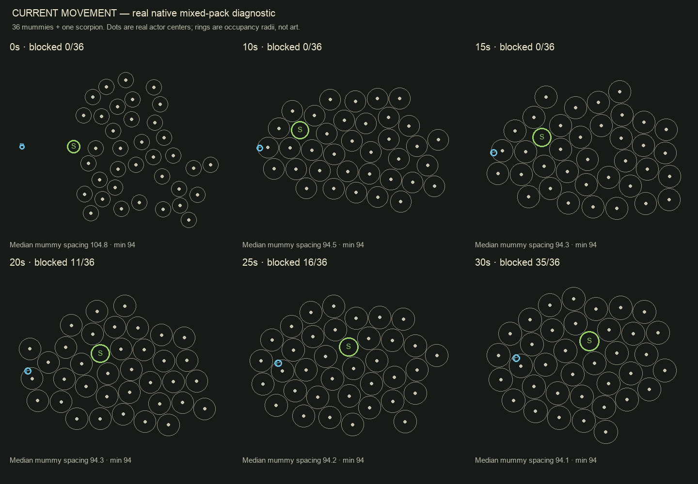

# Minion movement investigation — 29 October 2026

## Finding

The reported diagonal packing is reproducible with current native game actors. It is a failure of crowd navigation, rather than an intentional formation or an enemy being designated as a leader. The existing overlap prevention works, but identical pursuit goals, nearly uniform body clearance and very short-range avoidance let enemies settle into tightly packed rows. Different enemy types participate in the same occupancy system: one scorpion can be embedded inside a packed mummy crowd.

No production movement, damage, boss or balance code was changed during this investigation. The working checkout already contained unrelated Lodestar changes, including changes in `game.dart` and `crowd_occupancy.dart`; this report describes the inspected checkout. The player reports cannot be tied to an exact distributed binary without their build/session information.

## Reproduction and evidence

A new opt-in diagnostic mounts the actual `BaseView` / `RegunGame`, uses the real `Enemy2Component` and `EnemyComponent`, disables automatic arrivals and audio, and keeps Training damage off. It places 36 mummies behind one scorpion from seeded irregular positions. The player retreats at 38 units/second for 20 seconds, then stops; no shooting or joystick prediction is involved. It advances the real game at 60 Hz, including production steering, occupancy, animation and component ordering.

| Time | Median nearest mummy spacing | Mummies reporting blocked | In melee |
|---|---:|---:|---:|
| Start | 104.79 | 0/36 | 0 |
| 10s | 94.51 | 0/36 | 0 |
| 15s | 94.27 | 0/36 | 0 |
| 20s | 94.27 | 11/36 | 1 |
| 25s | 94.19 | 16/36 | 1 |
| 30s | 94.11 | 35/36 | 1 |

The physical minimum between two mummy centers is **94 units**. The pack converges almost exactly to that minimum, despite open surrounding floor. “Blocked” is the existing animation/progress detector: less than 3 units of net movement in a quarter-second, not an assertion that an actor moved exactly zero. The scorpion remains alive inside the formation.



These are recorded actor centers and occupancy rings, not a screenshot of enemy art. P = player, S = scorpion. Each panel is fitted independently to its bounds. [Full native positions](validation/crowd-investigation-2026-10-29/native-mixed-pack.json).

A second diagnostic exercises the production `EnemyTactics` and `CrowdOccupancy` classes for 40 seconds with 12/48 same-type actors and seeds 7/19/43, without combat/walls/spawning. In 48-actor pursuit:

- Mummy nearest-spacing medians end at 94.4–94.7 units; moving-actor heading alignment averages .871–.919 over the last ten seconds.
- Scorpion medians end at 81.2–81.7 units, against an 80.5-unit minimum; heading alignment is .962–.968.
- Alignment is the length of the mean unit movement vector (1 = parallel motion); it excludes stationary actors. Parallel pursuit by itself is expected. Combined with the dense rows and blocked actors, it explains the apparent rigid moving group.
- Some runs show substantial sixfold bond order, consistent with local triangular/diagonal packing. This statistic alone does not establish a perfect arena-wide lattice, and its value varies with the seed.

[Shared-probe summary](validation/crowd-investigation-2026-10-29/shared-probe-summary.json).

A separate isolated boss-yield probe holds a boss stationary at (0,0), player at (800,0), and moves one enemy from (100,125) at 95 units/second through the production yield function. In five seconds it switches between yield/pursuit **101 times**. This confirms boundary chatter in the steering rule even without neighbors. It does not simulate full boss combat. [Recorded result](validation/crowd-investigation-2026-10-29/boss-yield-boundary.json).

## Current movement stack

1. Each role chooses its desired direction in `EnemyTactics.intent` or its attack state machine.
2. `RegunGame.moveActor` may replace ordinary intent with boss yielding, then optionally route around solid cover.
3. `EnemyTactics.spaced` adds local repulsion from an immutable position snapshot using 128-unit search cells. It caps repulsion at 1.6, multiplies it by 1.8, adds pursuit and caps final magnitude at one. It has no neighbor velocity or time-to-collision calculation.
4. `CrowdOccupancy.move` enforces real circular body clearance, taking steps of at most 12 units. It tries a tangent around the first blocking body, then the opposite tangent; otherwise movement stops.
5. Accepted moves reserve their positions immediately. Native component update order follows render depth (`CombatEnemy.priority` depends on world Y); online actors advance sequentially in the server enemy array.

The spatial cells index neighbors; they do **not** snap actor positions onto a grid. The diagonal rows are an emergent result of circle packing. Movement does not contain an explicit “match neighbor velocity” or “follow this scorpion” command.

## All ordinary roles

Base speeds below exclude cycle scaling (up to 1.5×), elite scaling (1.15× on applicable `ArenaEnemy` roles), hit reactions and slow fields.

| Role | What it currently does | Crowd weakness |
|---|---|---|
| Scorpion | Speed 60. Adds a stable clockwise/counterclockwise tangent, maximum .65, fading out between 330 and 110 range; then contact pursuit. | Only two approach personalities, selected by ID parity. Slow body can bottleneck mummies. Near the player the flank contribution disappears, so all converge. Its walk animation continues even when movement is blocked. |
| Mummy | Speed 95. Pursues one common player position predicted .5s ahead, capped at 120 units of lead. At actual 36-unit melee reach it stops to strike after .15s, then every .6s. | No alternative pursuit goal, personal lane, bypass commitment or open-floor jam recovery. All mummies seek the same point with the same speed/lead. Distance-driven gait starts from the same phase, which can reinforce synchronized appearance. |
| Revenant | Speed 80. Approaches/retreats around 355 range, with radial correction over a 100-unit band and tangent .6. Plants for a .4s cast after its 2s attack clock is ready and range/sight allow. | Shared preferred range creates crowded bands. No allocated clear firing approach or crowd-aware retreat goal. Equivalent cast clocks can also align for simultaneous arrivals. |
| Skitter | Ground speed 105, alternating flank tangent up to .85. At <480 range with sight, warns .75s then commits to a direct or predicted leap. Airborne speed 1050; 180–520-unit travel, 1.4s recovery. Nearby attackers serialize warning/leap/early recovery within 700 units. | Ordinary approach can still pack. Airborne leap intentionally ignores normal bodies, while respecting bosses/cover; this recent fix does not solve ground traffic. Waiting attackers keep the same crowded approach behavior. |
| Shield Warden | Speed 55, direct pursuit, shield faces player. At <125 range, plants for .75s warning and 1.2s recovery. | Slow moving/planted obstruction. No flank strategy or crowd traffic priority. Shield facing follows player direction rather than the actual detour. |
| Burster | Speed 90. Pursues common .35s predicted point, lead capped at 120. At <130 range it plants for .9s before detonation. | Same convergence problem as mummy; an armed burster becomes another stationary blocker until it explodes. |
| Brood Nest | Stationary. Every 5s within 1000 range, attempts two Skitter arrivals, subject to runner count/population admission. | Deliberate fixed obstacle. Other minions have only local sliding to get around it in open floor, and both arrival points repeat at ±65 X before placement resolves occupancy. |
| Sentinel | Stationary. Every 3.6s within 850 range, warns a player-centered ground attack for 1s. | Deliberate fixed obstacle. Same crowd bypass limitation as nest. |

Native factory: `lib/game.dart:1179`; role implementations: `lib/components/enemies/enemy_component.dart`, `enemy_2_component.dart`, `enemy_3_component.dart`, `arena_enemy.dart`; shared intent: `lib/systems/enemy_tactics.dart:99`.

Ariet's two mechanical escorts are an additional special case, not entries in `EnemyKind`. They already use a richer shared plan (`ArietEscortTactics`): pressure/intercept roles held for four seconds, separate approach sectors, bounded velocity filtering, cover-aware goals, angular waypoints and firing-lane checks. Their rig has acceleration/braking, cover routing, a partner traffic rule, shared separation and hard occupancy. That is useful precedent for goal ownership and committed bypasses, but should not simply be copied onto all ordinary minions: escorts have a different combat role and only two participants.

## Where it fails

### 1. The previous anti-grid fix changes preferred spacing, not the jam mechanism

`EnemyTactics.spaced` varies pair preference by .92–1.08 using an ID modulo-17 formula. Two mummies therefore prefer 95.68–112.32 units of separation. Hard occupancy still imposes exactly 94 units for every mummy pair (`45 + 45 + 4`); scorpions impose 80.5, and mummy/scorpion pairs 87.25.

Under sustained pursuit pressure, the small soft variation cannot preserve open lanes. Repulsion can cancel pursuit, and the hard solver packs equal-radius bodies into diagonal neighbors. Mummies around a scorpion use the same rules, so the scorpion is treated as one more disc in the packing. The mixed native probe reproduces this. The scorpion is not necessary for packing, as the same-type probes also show.

Source: `enemy_tactics.dart:40`, `crowd_occupancy.dart:128`, `game.dart:735`.

### 2. Collision avoidance only reacts after traffic has already closed

The soft solver sees positions, not movement, future crossings or available exit corridors. The hard solver picks the first blocker returned by cell iteration, uses that body's normal and tries two tangents. It does not score a route around an entire cluster. Both candidates can fail against a second/third neighbor even with free space a short detour away.

There is no persistent “pass this slower body on the left” decision, queue fairness, or open-floor stalled-progress replanning. ID parity is reused for flank side and collision fallback. Sequential occupancy also makes choices order-dependent; render depth should not decide movement priority. The resulting directional bias is a plausible contributor to row orientation, but was not isolated as the sole cause in an ablation.

Source: `crowd_occupancy.dart:128`, `crowd_occupancy.dart:183`, `combat_enemy.dart:309`.

### 3. Cover routing is narrower than its implementation suggests

`ObstacleRouter` can plan around all registered solid rectangles and can abandon an occupied corner after .65s without 12 units of progress. However, native `moveActor` only invokes it when a **dynamic** obstacle exists, and never when boss yielding is active. Foundry's static columns alone do not enable this planner. The route's stuck recovery is therefore not a general crowd recovery mechanism; in unobstructed floor, it exits early and clears progress state.

This can make enemy navigation change simply because a supply pod/sentry becomes active elsewhere. The online server routes based on map clearance without that native dynamic-obstacle gate.

Source: `game.dart:818`, `obstacle_router.dart:21`, `obstacle_router.dart:47`.

### 4. Boss yielding is an abrupt corridor override

Native code uses only `activeBoss` (the first live boss). Any ordinary moving minion in the 420-unit-long, ±130-unit-wide rectangle in front of the boss is ordered sideways. The corridor points from the boss toward the player; it does not use boss velocity, actual intended route, body shape, attack phase or time to contact. It can be active while the boss is planted.

Crossing lateral 130 instantly switches back to pursuit, which can steer into the corridor again. There is no entry/exit hysteresis or side commitment; the isolated test records 101 switches in five seconds. Many nearby enemies receive similar parallel side commands at once. Cover routing is skipped during yielding. A second boss is still physically blocking, but does not get the same anticipation rule. If the first boss is airborne, anticipation is skipped even if another grounded boss is present.

Normal boss pursuit still respects minion occupancy; selected committed boss attacks clear minions through the existing no-reward collateral path. Early sideways yielding is therefore not a complete guarantee of a clear boss route. Airborne Ariet and Walker charge/brake phases intentionally use different ground occupancy behavior; their paths need phase-aware handling.

Source: `enemy_tactics.dart:82`, `game.dart:229`, `game.dart:803`, `game.dart:917`.

### 5. Native and online already disagree

The sibling server's `spacetimedb/src/actors.ts` uses the same overall intent/repulsion/occupancy idea but:

- No native pair-spacing variation: equal sizes have exactly equal soft gaps.
- Repulsion reads live positions from the sequential enemy array, rather than one immutable frame snapshot; it scans all enemies.
- `unit()` always normalizes nonzero steering, even near force cancellation. Native preserves sub-unit steering magnitude. At zero, server `unit()` falls back to +X.
- Boss yielding is added to repulsion for each applicable boss, rather than replacing intent for the first boss.
- Native skips airborne bosses for anticipatory yielding; the server neighbor loop skips airborne Walker and Skitter but has no equivalent blanket phase-aware boss policy.
- Server cover routing is not gated on dynamic solids.

These are source-confirmed differences, not a claim that the currently deployed server has been tested or matches this checkout. Fixing only Flutter would leave online movement with a different failure profile.

Source: sibling `actors.ts:303`, `:366`, `:409`, `:442`, `:476`; `survival_runtime.ts:815`.

## Why the tests missed it

Existing spacing tests prove no overlap, speed bounds, some forward progress and safe attack headings. A dense, regular moving lattice can pass all of those checks. The mummy crowd test explicitly expects at least ten blocked mummies and verifies a planted alert pose, avoiding mirror jitter/walking in place. That was a presentation correction for blocked enemies, not a fix for their inability to navigate out of the jam.

The recent Skitter change solves airborne collision against ordinary bodies. The recent mummy change solves opening attack timing. Neither changes the shared packing algorithm. The old crowd revision should be regarded as an overlap/capacity repair, not evidence that all formation behavior was eliminated.

## Recommended implementation order

1. **Give blocked enemies another reachable goal.** Detect sustained lack of progress toward the role's goal in open floor, not only at solid-cover corners. Commit to a legal flank/bypass around the slow body or congested group, with hysteresis. Replan when the obstruction dies/moves or the route becomes invalid. Outer mummies should spread toward accessible contact opportunities or deliberately hold, rather than all pressing the same center. Avoid replacing this grid with a uniform fixed ring of attack slots.
2. **Use velocity-aware local avoidance before hard contact.** Evaluate a bounded set of candidate velocities against a shared position/velocity/body snapshot and nearby swept occupancy over a short horizon. Score progress, collision risk, density, turn change and committed bypass side. Decelerate or wait when needed. Keep hard swept occupancy as the final authority; preserve cover, fast attacks and committed telegraph headings. Separate simulation movement priority from render Y and give waiting actors bounded fairness.
3. **Replace the boss rectangle with phase-aware yielding.** Consider every grounded boss's actual footprint and short intended movement/committed path. Yield when a collision is predicted; use separate enter/exit thresholds and hold a side until safely clear. Keep a viable route around solid cover. Preserve the existing deliberate airborne/collateral contracts.
4. **Apply one routing policy to static and dynamic solids.** Invoke routing on actual obstruction, with bounded/cached queries. Keep occupancy and living-body stalls distinct from static route validity. Match native/server behavior.
5. **Add restrained individual variation after navigation works.** Stable, seeded differences in approach angle, preferred stand-off/lead, decision age and gait start can reduce identical motion. These should be bounded, reproducible and reset/checkpoint compatible. Avoid per-frame random steering, which can hide the packing while introducing twitching and fairness problems. Speed/damage buffs are not necessary to fix navigation.
6. **Keep role differences.** Scorpions choose broader flanks; mummies commit to contact/bypass goals; Revenants seek clear firing space; Skitters retain committed jumps and pack turn-taking; Wardens retain slow pressure; Bursters retain readable planted warnings; nests/sentinels remain stationary obstacles. Use escort planning as a small-scale precedent, not a global formation template.
7. **Validate native and authoritative online together.** Shared seeded fixtures should compare intent, occupancy, boss phases and stuck recovery. Measure prolonged stalls with a reachable alternative, packing persistence, switches/second, neighbor swaps, forward threat, speed/clearance and processing cost. Include one scorpion among mummies, stationary nests/sentinels, different approach angles, static Foundry cover without pods, pods at walls, all grounded boss types and two-boss scenes. A natural horde can still share a heading; alignment alone must not become a failing test.

Device play remains necessary for difficulty, warning readability, motion comfort and frame pacing. Headless evidence here establishes the navigation problem, not acceptance of a future solution.

## Re-run

```sh
flutter test --no-pub tool/crowd_movement_probe_test.dart --reporter expanded
flutter test --no-pub tool/crowd_native_probe_test.dart test/crowd_occupancy_test.dart test/enemy_tactics_test.dart test/mummy_crowd_test.dart test/minion_engagement_test.dart test/temporary_cover_navigation_test.dart test/ariet_escort_tactics_test.dart --reporter expanded
flutter analyze --no-pub tool/crowd_movement_probe_test.dart tool/crowd_native_probe_test.dart
```

Final combined run: **41 passed**; analyzer reports no issues for both diagnostic tools. Focused native/routing/crowd/escort run: **39 passed**. Shared diagnostic run: **2 passed**, including twelve pursuit scenarios plus the boss boundary case. These diagnostic passes mean execution completed and results were recorded; they do not label the reproduced crowd behavior as correct. Full project verification, server runtime tests and physical-device testing were not run for this read-only movement investigation.


## Implementation handoff

The complete proposed repair, checkpoint revisions, ordered tasks and acceptance
criteria are in [MINION_NAVIGATION_IMPLEMENTATION_PLAN.md](MINION_NAVIGATION_IMPLEMENTATION_PLAN.md).
The recovered client/server candidate and its fresh verification are recorded in
[the 3 November validation notes](validation/minion-navigation-2026-11-03/README.md).
