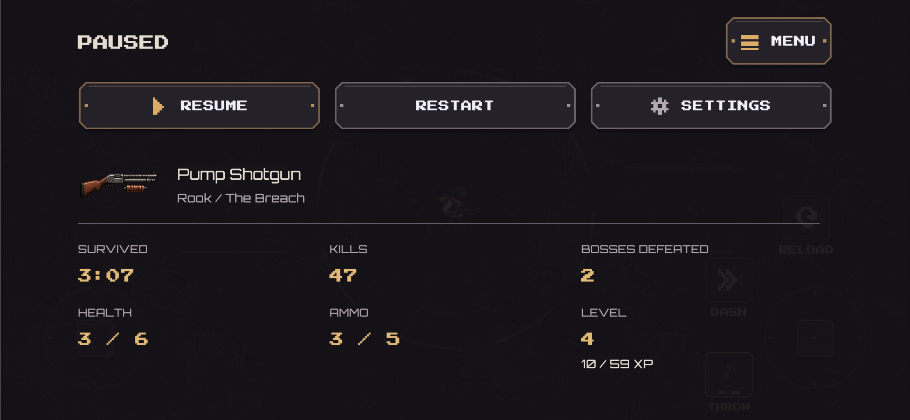
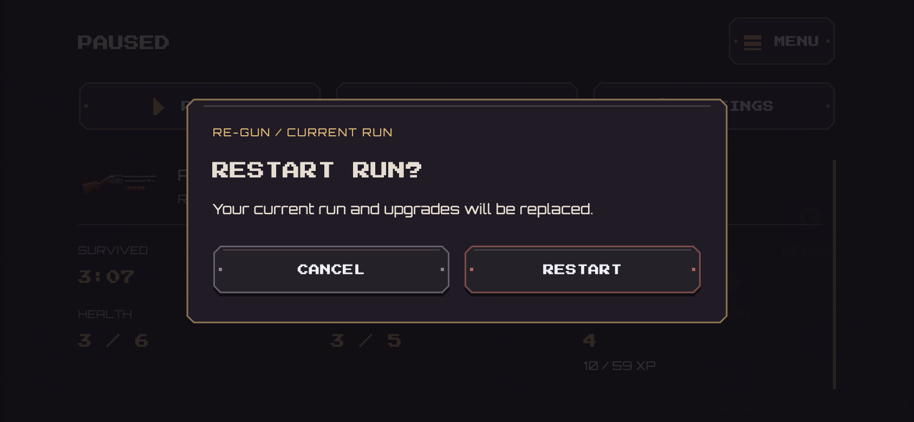
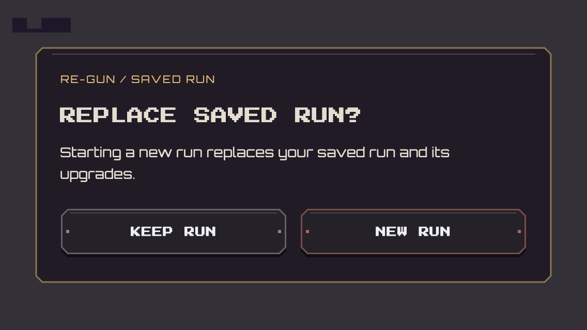

# Pause information, confirmations and shared banners — 22 October 2026

Normal survival pause now uses its space for a recorded run snapshot: elapsed
survival time, kills, bosses defeated, current/max health, current/max ammunition,
and level with XP progress. Reloading adds the frozen remaining reload time.
The current weapon silhouette, survivor and arena identify the kit. These are
existing authoritative counters/resources, not estimated accuracy, DPS, rewards,
or fabricated performance ratings. Training retains its practice sections.
The pinned navigation/actions and responsive scroll viewport remain.

## Run actions

Menu and Restart require confirmation during normal and Training play. Cancel,
back or tapping the backdrop leaves the run paused and intact; Cancel has initial
keyboard focus. Repeated taps cannot stack confirmations or execute an action
multiple times. System back from a live run follows the Menu confirmation too.

Normal Menu saves the checkpoint for Continue, with explicit Save & leave copy.
If that write fails, the player stays on the pause screen with a visible styled
save warning and can retry. Restart replaces the current run/build only after
confirmation. Training explains that its practice/build ends or resets. Results
are already terminal, so their existing navigation remains immediate.
Multiplayer's leave action uses the same confirmation with a forfeit warning for
an unfinished versus match. Opening its match menu still does not leave or pause
the match; canceling Leave keeps local match-menu input suppression intact.

## Banner design standard

The creator supplied IMG_2888.PNG (approved update notice) and IMG_2889.PNG (plain
saved-run replacement). `GameNotice` extracts the approved update notice's actual
stepped charcoal/plum surface, brass edge and inset top line, small contextual
heading, pixel title, paper body text, spacing and responsive action layout.
Update, saved-run replacement, profile reset, Training briefing, coming-soon and
run/online leave confirmations all share this component. Compact save errors and
online notifications use its frame through `GameNoticeStrip`, without becoming
modal. Destructive primary actions use the existing muted rust accent; secondary
choices use the same subdued treatment as Check again/Later.

Update policy behavior is unchanged: only an actual update prompt blocks taps,
focus and semantics; passive checking remains a small non-blocking label.
Required retries, store errors, offline behavior, optional Later and foreground
checks retain their contracts. No new bitmap assets or animations are introduced.

## Verification

New native tests cover the recorded pause values, paused time, reload readout,
restart cancel/accept and double-tap protection, save/leave cancel/accept/failure,
shared confirmation layouts at compact/portrait sizes and 1.5x text, and online
forfeit cancel/accept. Existing update-policy, first-run Training, settings,
menu/controls and combat suites remain required. Validation records contain real
rendered pause/confirmation images, build and installation evidence. Physical
readability/touch comfort remain for the creator's review.

Final result: analyzer clean,462 Flutter tests passed (5 optional skipped). The
signed143.2MB1.0.0+11 build was verified, installed in place and launched on the
creator's iPhone12. Data retained; no backend deployment or new art textures.

