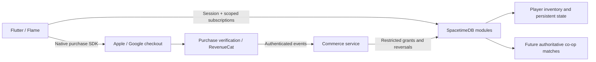

# Regun — monetization, backend and multiplayer plan

Research and repository audit: **19 October 2026**. This is a proposed product/implementation plan, not an announcement that billing, ads, online accounts or multiplayer are implemented. Prices below are test hypotheses in USD; actual checkout must use localized store product data. Sources are linked beside findings and indexed in [the research record](research/MONETIZATION_SOURCES_2026-10-19.md).

## 1. Recommended direction

Make the core game free, sell appealing permanent content, and later add limited optional continues and rewarded ads. Build a trustworthy purchase/account backend before accepting money. Use **SpacetimeDB as the preferred backend candidate**, subject to a native Flutter integration spike. Keep the current offline solo game. Add online co-op as a separate update once the authoritative simulation works.

The strongest initial products are distinctive weapon/character packs and substantial cosmetic sets. The strongest repeat-purchase candidate is a capped continue system. A large gem economy, season subscription, equipment gacha and paid damage escalation would require a much bigger progression/live-operations game than we currently have. They can produce revenue elsewhere; copying their shop without their content depth would leave Regun with little reason to return or buy again.

Do not depend exclusively on dying players to fund the game. A player should also want to buy something after an exciting successful run, discovering a weapon in Training, beating a boss, or seeing a character/build they want to master.

## 2. What exists today — audited code

| System | Current implementation | Monetization relevance |
|---|---|---|
| Earned currency | `PlayerProfile.scrap`, run settlement and Collection shop | A real soft-currency foundation, but local and not safe as a paid wallet. |
| Scrap earnings | Run Scrap + floor(kills/10) + 15 × bosses + floor(seconds/60); Training grants none | Retain the present economy for existing players. Measure real earn rates before pricing more sinks. |
| Existing shop | Copper 100, Moss 100, Ivory 150 Scrap | Only three tints; insufficient value for a sustainable paid shop. |
| Weapons | Shotgun, Carbine, Revolver, Arc Caster | Four functioning mechanics; all currently earned, no paid weapon products. |
| Survivors | Rook; Scrapper after 500 total kills; Warden after eight-minute best survival | Keep those earned promises. New paid survivors can be added without taking old unlocks away. |
| Other unlocks | Training → Carbine; Shadow → Revolver; Demon → Arc Caster; Queen → Foundry; challenge cosmetics | A useful achievement backbone; do not retroactively charge for it. |
| Builds | Thirty upgrades, six fusions, three bosses, two arenas, twenty challenges | Provides a replay loop that new gear can deepen. Paid gear needs compatible upgrades/fusions. |
| Saving | Local profile/backup in SharedPreferences; separate run checkpoints; once-only run settlement | Useful offline recovery, but not cross-device inventory, purchase validation or fraud protection. |
| Results/death | Death immediately triggers settlement and checkpoint clearing | A revive cannot safely be bolted onto the current results screen. The lifecycle must change first. |
| Accounts / commerce | No current backend, account system, billing SDK, paid receipts, entitlement service, ad SDK or purchase analytics | These are real implementation requirements, not console switches. |
| Multiplayer | None | Existing Flame movement/collisions run on one device. Network synchronization alone is not authoritative co-op. |

Primary audit files: `lib/models/player_profile.dart`, `lib/game.dart` (`earnedScrap`, `settleRun`, phase listener), `lib/services/local_preferences.dart`, `lib/data/loadout.dart`, `lib/views/collection_view.dart`, `lib/notifiers/game_notifier.dart`, `pubspec.yaml`.

Example using today's formula: 300 kills, one boss, ten minutes and no extra run Scrap yields **55 Scrap**. This is arithmetic, not an observed average session. A 100-Scrap tint would take approximately two such runs. Selling large Scrap packs before measuring this would risk making the entire existing shop irrelevant instantly.

## 3. What comparable games actually sell

Observed listings are snapshots, not complete product catalogs, conversion studies or revenue evidence. Reviews embedded in listings are not developer-confirmed mechanics. Storefronts, versions, promotions and prices can differ.

| Comparable | Verified observation | Useful lesson for Regun |
|---|---|---|
| Vampire Survivors mobile | US listing is free with advertising and named DLC IAPs; observed examples include Moonspell $0.99, Foscari $1.79 and Castlevania $3.99. | A generous core can coexist with paid lasting content. Content packs need enough characters/weapons/experiences to feel substantial. |
| 20 Minutes Till Dawn, free edition | US listing includes characters such as Yuki $0.99, Katana $0.99, Temple Map $0.99, currency products and Ad-Free Forever $11.99. | Direct character/weapon/map purchases are established in this exact genre. |
| 20 Minutes Till Dawn:Premium | A separate US listing is $4.99. | Distinguish premium and free-to-play editions; do not assume every platform/version has the same model. Regun should initially use one app with clear IAP ownership. |
| Brotato, free mobile listing | Observed products include Starter Pack $0.49, a currency pack, VIP products, No Ads $19.99 and Abyssal Terrors $2.99. | Starter, convenience and expansion tiers can coexist. This is not a reason to copy its prices or promise a VIP benefit we cannot deliver. |
| Survivor!.io | Observed US products include Chapter Pack 1 $1.99, Month Card 2 $9.99, Some Gems $0.99, Growth Fund $6.99 and daily packs. | Recurring spend is supported by layered progression and ongoing content. That is a different operational commitment from adding a Buy button. |

Sources: [Vampire Survivors](https://apps.apple.com/us/app/vampire-survivors/id6444525702), [20 Minutes free](https://apps.apple.com/us/app/20-minutes-till-dawn/id1635123906), [20 Minutes premium](https://apps.apple.com/us/app/20-minutes-till-dawn-premium/id1630887189), [Brotato free mobile](https://apps.apple.com/us/app/brotato/id6445884925), [Survivor!.io](https://apps.apple.com/us/app/survivor-io/id1528941310).

Mobile-store reviews describe optional revive/end-run reward ads in Vampire Survivors, but this research did not independently play-verify the current placements. Treat that as a placement reference to validate, not an official specification. GameAnalytics' hybrid-casual guidance supports designing progression and monetization together rather than laying IAPs over an otherwise shallow loop; it does not establish that our particular shop will convert. [GameAnalytics guidance](https://www.gameanalytics.com/blog/hybrid-casual-higher-retention-better-engagement)

## 4. The offer catalog

### First commerce release: permanent products

Start with a compact catalog that we can finish and support. Suggested price points are experiments, not promised revenue or exact regional tiers.

| Product | Proposed contents | Indicative test price | Store type |
|---|---|---|---|
| Founder's Kit | Exclusive Rook outfit, weapon finish, banner and results pose; permanent ownership | $2.99 | Non-consumable |
| Armory Pack 1 | Two new weapons, associated mastery paths and themed weapon finishes; both trialable in Training | $4.99 | Non-consumable |
| Survivor Pack 1 | One new survivor with distinct ability, authored body/actions, mastery challenges and a premium outfit | $2.99 | Non-consumable |
| Facility Expansion | A genuinely new arena, new enemy/encounter content, boss, unlock track and music | $4.99–$6.99 | Non-consumable; release only when content exists |

No subscription at first. Do not sell Founder's Kit as a promise of all future DLC. Keep its contents fixed and visible. Avoid overlapping permanent bundles initially; they create duplicate-ownership and value problems across Apple/Google products. If bundles are later added, define an explicit owned-item policy before selling them; app-controlled dynamic proration is not a native-store feature we should assume.

“Stronger” weapons can deliver satisfying power spikes and new build ceilings, but should have meaningful tradeoffs. A paid weapon that simply does twice the damage with no downside makes the earned arsenal feel obsolete. Sell a distinctive fantasy and build depth first. If we deliberately add paid permanent combat boosts later, keep them in a clearly marked progression mode with bounded stats; do not mix those runs into equal-loadout competitive challenges or future PvP.

### Repeat purchases after the foundation passes

| Product / mechanic | Proposed rule | Why / dependency |
|---|---|---|
| Three Continue Charges | $0.99 initial hypothesis; purchased charges persist until used | Consumable IAP with server wallet and durable spending ledger. Earned tutorial/sample charge lets players understand the effect first. |
| Rewarded continue | Optional ad as an alternative when available | Same one-continue-per-run cap regardless of ad or paid source. Only if ad quality, privacy and revenue justify the SDK cost. |
| Rewarded salvage bonus | Clearly stated fixed bonus after final results; first test once per run | Do not multiply challenge unlocks or accidentally re-settle a run. Test a capped +25% run Scrap hypothesis against economy data. |
| Cosmetic collection drops | Named bundles with exact visible contents | Recurring content without consumable power inflation. Production cadence must be realistic. |
| Season track, later | Free reward track plus one-time premium season access | Only after enough weekly content and retention exist. Prefer a non-renewing seasonal product to accidental recurring obligations. |

A “remove ads” product should not be sold while the game contains no ads. If later added, distinguish “removes forced ads” from “also replaces optional reward ads with specified free claims.” State exact frequency/caps and honor them offline where promised. Avoid an unlimited-continue entitlement.

### Currency policy

**XP** stays run-only. **Scrap** stays earned soft currency for crafting, cosmetics and bounded progression. **Continue Charges** become a separate inventory balance if phase two ships. There is no need to introduce Gems as a fourth number on day one.

For future premium cosmetics bought using currency, use a clearly named premium balance with an authoritative server ledger. Show the real pack cost and quantities; prevent awkward leftover balances from becoming the only path to a desired item. Purchased currency must not expire under Apple's rules. Existing local Scrap is migrated once as earned legacy value, never reclassified as a verified cash purchase. Do not create an unrestricted `add_currency(amount)` reducer callable by players. [Apple review rules](https://developer.apple.com/app-store/review/guidelines/)

## 5. New value to build

### Armory: weapons with a reason to own them

The user's gauntlet idea is a strong candidate, not existing content. Proposed Armory Pack 1:

- **Thunder Gauntlets:** short-range aimed shock punches with a charge/overheat rhythm. A clear reach limitation, visible impact cone and quick movement support close-range play. Upgrades extend arcs, add a shockwave or reward perfect cooling; a new fusion changes the playstyle rather than only increasing a number.
- **Rail Lance:** slow precision shots with a wind-up, penetrating line and a vulnerable recovery. Rewards lining up dense enemies and committing to a shot. Distinct charge/cooling animation, recoil, sound and fusion support.

Neither can reuse the shotgun pump Lottie. Both need body hand anchors, all directional poses checked, their own feedback, balance data, descriptions, Training trials, Collection entries, save schema migration and mastery rewards. We must also budget enlarged fusion/upgrade offer pools so a new weapon does not dilute existing builds into frustration.

Next survivor concept: **Conductor**, whose timed discharge interacts with electrical builds but trades durability or range. This needs a fully supported ability and readable new body, not a recolored Rook with a price tag.

### Progression worth returning for

Add earned weapon mastery tracks, selected daily/weekly contracts, a clear permanent collection, named biome challenges and useful Scrap sinks. Favor alternate starting kits, craftable finish variations and bounded training/progression improvements over an endless paid damage treadmill. Preserve challenge badges as achievements; sell visually distinct alternatives.

Improve hit readability, boss fairness, dense-scene performance, save recovery and clear unlock explanations before increasing shop exposure. Persistent crashes or unclear value will turn a purchase system into a support burden. New seasonal content requires a production calendar; do not sell a pass for hypothetical rewards we have not built.

## 6. Where purchases fit into play

| Moment | Offer | Frequency / behavior |
|---|---|---|
| First successful return after learning the game | Founder's Kit preview | At most one dismissible introduction; remain available in shop. No purchase modal before first play. |
| Inspecting or trialing a weapon | Its Armory Pack | Permanent product detail with exact contents and native localized price. |
| Boss/cycle completion | Next expansion preview, if released | Celebrate earned unlocks first; no misleading “claim” button that is actually Buy. |
| Final death / downed choice | Spend owned Continue Charge, optional ad if ready, or End Run | Game stopped; clear choices; no purchase sheet appearing while the player is still being attacked. |
| Results | Optional capped bonus reward | Distinct from collecting already-earned rewards. No repeated interruptions. |
| Collection | Owned items, purchasable packs, Restore Purchases | Predictable destination; owned products cannot be accidentally repurchased. |

A near-death purchase during live movement is a poor fit for twin-stick controls: the thumb is already occupied and the OS checkout interrupts play. Move that emotional opportunity to a **safe downed state**, where the saved build has clear value. Do not increase difficulty dynamically to provoke spending, introduce fake stock shortages, reset fake sale timers, or auto-select a purchase after a tap intended for firing.

### Continue lifecycle — required engineering

Current death immediately settles the run. Replace that sequence with:

`playing → downed → continuation decision → playing OR finalizing → results`

1. At zero health, freeze combat, run time, reload time and input; persist a recoverable downed checkpoint. Do not settle or clear the run yet.
2. Allow one continue per run, across all sources. Clear End Run remains equally available. No artificial short countdown while store authentication or Ask to Buy is pending.
3. If a charge is owned, the backend atomically issues one run-bound continue grant. If bought here, native checkout verifies/grants inventory first; spending is a separate explicit step.
4. Resume from the same build with a proposed three hearts and brief three-second protection. Clear nearby hostile projectiles without granting XP, and ensure enemy overlap cannot cause an instant repeat death. Exact balance is a test parameter.
5. Persist `runId`, continue grant ID, use count and application status. Duplicate taps/callbacks/reconnects cannot produce another life or lose a charge. Server spending uses an idempotency key; the client safely reapplies the same grant after a crash.
6. If checkout becomes pending or completes after this run has ended, add the purchased charges to inventory. Never silently resurrect a different run. Canceled/failed purchases grant nothing and spend nothing.
7. On End Run or later final death, settle exactly once and clear the checkpoint only after durable finalization.
8. Track `continued` separately from existing `assisted` (currently aim assist). Keep separate best-run categories where appropriate. Define achievement eligibility explicitly; cosmetics can remain attainable, but no-continue challenges must require an uncontinued run.

A charge bought once must survive reinstalls and account recovery through our ledger. Native restoration of finished consumables is not enough. [Flutter purchase restoration guidance](https://pub.dev/packages/in_app_purchase)

## 7. Native store integration and policy

Use Apple's StoreKit and Google Play Billing through a maintained Flutter integration. Native sheets handle payment authorization; Regun must still manage fulfillment and recovery. Regional external-payment exceptions exist, but they add complexity we do not need for this release.

- Apple requires IAP for these in-app digital goods, restore support for restorable purchases, and non-expiring purchased currency. Paid randomized item mechanisms require odds disclosure. Subscriptions require ongoing value. [Apple review guidelines](https://developer.apple.com/app-store/review/guidelines/)
- Google requires Play Billing for digital purchases in Play-distributed apps except applicable exceptions. Purchased virtual currency is limited to the app/game title; randomized paid items need nearby odds disclosure. We will use fixed-content products initially. [Google Payments policy](https://support.google.com/googleplay/android-developer/answer/9858738?hl=en)
- Google's integration docs currently state **Billing Library 8+ for new apps/updates from 31 August 2026**, with an extension option until 1 November 2026. Our future purchase SDK's resolved Android dependency must meet the actual submission requirement; a successful Flutter build alone is not evidence. [Billing integration](https://developer.android.com/google/play/billing/integrate)
- Treat pending transactions as pending, not success. Google requires timely acknowledgment after a purchase becomes purchased; its documented window is three days. Verify, durably grant, then acknowledge/finish through the chosen SDK's prescribed flow. [Google integration](https://developer.android.com/google/play/billing/integrate), [Flutter plugin](https://pub.dev/packages/in_app_purchase)
- Provide Restore Purchases for permanent ownership, refresh after reinstall and handle refunds/revocations. Apple supplies server refund notifications and refund testing. [Apple refunds](https://developer.apple.com/documentation/storekit/handling-refund-notifications), [refund testing](https://developer.apple.com/documentation/storekit/testing-refund-requests)
- Reward ads need clear advance reward information and affirmative opt-in; declining must preserve normal use. Grant promised rewards only through a verified completion path, including recovery from duplicate callbacks. [AdMob reward policy](https://support.google.com/admob/answer/7313578?hl=en-GB), [rewarded implementation/SSV](https://developers.google.com/admob/android/rewarded)

Show store-returned localized prices, currency, contents and purchase type. Never infer affordability from region or personal vulnerability. If experiments personalize an automated price, applicable disclosure requirements must be reviewed; initially vary product presentation or test cohorts without individualized pricing. Refresh age/content ratings, privacy policy and store data disclosures after adding accounts, analytics or advertising. ATT is needed if the implementation tracks under Apple's definition, not automatically for every purchase. Do not gate rewards on tracking permission.

If accounts are offered, ship the applicable in-app/account deletion paths, provider-login compliance (including an Apple-compliant equivalent when qualifying third-party login is offered), and a clear explanation of purchase recovery after deletion. A deletion/privacy policy cannot simply erase the accounting history needed for legally required records; retain only what is justified and disclose retention. This needs a specific implementation review before release.

## 8. Purchase infrastructure: RevenueCat versus direct integration

**Recommended candidate: RevenueCat Flutter SDK + SpacetimeDB inventory + a small trusted commerce service.** Apple/Google still take payment. RevenueCat is a purchase-management service, not an alternative checkout or a game server. It reduces platform receipt/entitlement lifecycle work. Its current documentation also offers virtual-currency APIs, which may be useful, but we should select exactly one wallet authority.

For Regun, keep the spendable Continue Charges ledger in SpacetimeDB. RevenueCat supplies validated store ownership/events; the commerce service applies grants/refunds to our ledger. Do not also independently spend the same balance in RevenueCat Virtual Currencies. If we later choose their wallet instead, document that as a replacement and use a reservation/outbox flow to avoid cross-system double spending. [Flutter setup](https://www.revenuecat.com/docs/getting-started/installation/flutter), [currency documentation](https://www.revenuecat.com/docs/offerings/virtual-currency)

Alternative: Flutter's `in_app_purchase` package + our server calling Apple's App Store Server APIs and Google Play Developer APIs directly. It supports native stores and StoreKit 2 by default in the retrieved docs, but we own verification, callbacks, refunds, purchase completion and all customer recovery. It avoids a purchase vendor fee while adding long-term engineering/support work. [Official Flutter package](https://pub.dev/packages/in_app_purchase)

RevenueCat's retrieved pricing says free up to $2,500 monthly tracked revenue, then 1% of tracked revenue once that threshold is reached. This is a vendor charge in addition to store fees, and terms must be rechecked when choosing a plan. Do not interpret it as 1% only of revenue above the threshold. [Pricing](https://www.revenuecat.com/pricing/)

## 9. SpacetimeDB backend — preferred, with a compatibility gate

### Fit and limitations found in the research

SpacetimeDB combines database state and server-side functions, live subscriptions and scheduled logic. That is a plausible fit for inventory now and a shared combat simulation later. Its official client list in the retrieved docs names Rust, C#, TypeScript and Unreal; **Dart is not listed as an official client**. Community Dart packages exist and describe 2.x support, code generation, binary protocol and reconnect features. Those are maintainer claims, not native-device validation performed here. [Official clients](https://spacetimedb.com/docs/clients/), [community package](https://pub.dev/packages/spacetimedb), [another community client](https://github.com/mikaelwills/spacetimedb-dart-sdk)

Reducers provide transactional state changes. External HTTP operations belong in procedures or a separate service; procedures have explicit transaction management, with unstable notes for some language paths in the retrieved docs. Keep store webhooks, secrets and verification in a small conventional TypeScript service using the official client. It can call authorized commerce reducers. Do not make server-side HTTP verification a blocking dependency of a combat tick. [Procedures](https://spacetimedb.com/docs/functions/procedures/), [reducer context](https://spacetimedb.com/docs/functions/reducers/reducer-context)

Use an authentication provider/token flow, not passwords stored in tables. Every write checks authenticated caller identity and authorization. Private commerce tables and per-user views prevent subscription-based data leaks; subscription filters alone are not an authorization system. [Authentication/architecture FAQ](https://spacetimedb.com/docs/intro/faq)

### Proposed architecture

Use Rust as the initial game-module candidate and TypeScript for the commerce bridge; finalize the language after testing scheduled simulation and generated client bindings. Separate commerce/player modules from high-frequency match data so combat traffic and maintenance do not unnecessarily couple to financial inventory. Cross-module operations are not assumed atomic; match admission consumes durable grants through idempotent commands/outbox reconciliation.

No separate Supabase database is required by this preferred design. Supabase Auth/Postgres/Edge Functions was researched as a lower-risk commerce alternative; Nakama has an official Dart client and authoritative-match model as a multiplayer alternative. Keep those as fallbacks if the SpacetimeDB spike fails, rather than building three backends. [Supabase security](https://supabase.com/docs/guides/database/postgres/row-level-security), [Nakama authoritative matches](https://heroiclabs.com/docs/nakama/concepts/multiplayer/authoritative/), [Nakama Dart](https://github.com/heroiclabs/nakama-dart)

### Mandatory Flutter/SpacetimeDB spike

Before migrating profiles or shipping purchases:

1. Pin a server release, client package revision and binding generator. Documentation version labels and community compatibility claims are not a tested matrix.
2. iPhone + Android release clients authenticate, subscribe to their own inventory, invoke a permitted reducer and reconnect after backgrounding/network loss.
3. Try reading another player's private inventory and calling privileged grant reducers; both must fail server-side.
4. Test numeric/enum/optional fields, large IDs, binary protocol, code generation and subscription add/remove behavior. Check memory and callback cleanup across repeated game-route mounts.
5. Persist session credentials in platform secure storage. Test account linking/recovery without losing purchases; never key ownership only to an ephemeral installation ID.
6. Run a tiny two-player movement arena with sequence-numbered inputs, server updates and local interpolation. Test delayed/reordered input, dropped connection and matching SDK/server upgrades.
7. Record an explicit pass/fail report. If it fails, use a thin official-SDK gateway or the documented fallback; do not rewrite Flutter or adopt an embedded JavaScript runtime merely to force a fit.

Do not enable a community SDK's generic offline optimistic mutation replay for purchases, currency, unlock grants or match rewards. These require authoritative transactions. Offline solo checkpoints can remain local.

### Durable data model

| Domain | Records / constraints |
|---|---|
| Identity | Stable player ID, provider mappings, guest/link state, creation/deletion state. Never use supplied playerId as authorization. |
| Catalog | Product/entitlement IDs, exact grants, store mapping, availability, catalog version. No secrets in client config. |
| Receipts | Environment + store + unique transaction/purchase token, product, player, verification/fulfillment/revocation status. Deduplicate transaction identity, not each webhook delivery ID. |
| Entitlements | Permanent packs/outfits/weapons, source transaction, grant/revoke history. Existing earned ownership is a separate source. |
| Wallet ledger | Charge grant/spend/refund entries, balance invariant, idempotency key, reason and related run. One authoritative balance. |
| Runs | Server-issued run/session identifier for online commercial actions, ruleset version, continuation grants, finalization marker. Offline result uploads are not automatically trusted competitive evidence. |
| Saves | Versioned profile/checkpoint metadata, migration/import marker, conflict policy, backups. Do not last-write-wins merge two balances. |
| Operations | Durable webhook inbox, retries/outbox, audit log, catalog kill switches, support adjustments with staff authorization. |
| Future co-op | Lobby, party membership, match IDs, players, entities, inputs, snapshots, reconnect deadlines and match reward settlement. |

Purchase flow: native result → verified transaction → durable receipt + grant once → refreshed entitlement/wallet → SDK completion. Events may arrive late or out of order. Refunds use compensating ledger entries/revocations; never delete history or revoke separately earned access to the same weapon. Reject negative spending and forged transactions. Distinguish test/sandbox and production everywhere. Backend/provider secrets stay server-only.

Guest play should remain frictionless. Before significant consumable purchases or cross-platform recovery, offer a clear link/recovery path. Native permanent purchases can be restored for the purchasing store account; they do not automatically transfer from Apple to Google. Cross-store access requires a linked game identity and a defined entitlement policy. Account merges require server rules; do not sum two copies of the same receipt.

### Offline policy

- Existing solo play and earned progression remain available offline.
- Previously verified permanent content is cached for offline use; reconcile refunds/revocations on reconnection. Do not implement a timer that makes the purchased content itself expire.
- New purchases, purchased-charge spending and authoritative co-op require connectivity. Clearly state that before checkout/use. Begin with this simpler policy rather than an insecure offline wallet.
- Import existing local Scrap/achievements once without penalizing legitimate players, but classify them as legacy/unverified. Do not accept them as paid currency or trusted ranked results.
- Cloud saves need explicit conflict/recovery behavior. A local profile reset must not silently remove paid entitlements; a purchase restore must not duplicate consumables.

## 10. Multiplayer update

Start with **two-player invite co-op**, then consider four players. This is a future update, not required for first commerce. Avoid PvP initially: aim assist, paid content, server trust, input prediction and mobile latency make competitive fairness a separate project.

The server owns enemies, damage, projectile hits, spawn clocks, boss phases, upgrade offers, RNG, rewards and final settlement. Clients send bounded input/intents rather than “I killed a boss” or “give me 50 Scrap.” Flame stays the renderer/input/presentation client; collision/combat assumptions must be extracted and implemented on the authoritative server. Version shared balance tables and run common scenario fixtures across the Dart solo simulation and server simulation to catch divergence.

Initial experiments can use a 20 Hz server tick with interpolated client rendering and sequence-numbered inputs. That is a starting design parameter, not a proven performance target. Decide which visual projectiles are reconstructed from shot events instead of synchronizing every particle. Subscribe only to the player's match/nearby relevant state. Hundreds of entities broadcast to every connected player can create expensive traffic even if the database is fast.

Test latency bands around 50/100/200 ms, loss and reconnect, including players in Nigeria and intended launch regions. Include server load, phone frame time and bandwidth measurements. SpacetimeDB's performance claims do not establish Regun's match capacity.

Design decisions required for co-op:

- Upgrade choice should not globally slow a remote friend's game unexpectedly. Proposed first mode: upgrades resolve together at safe encounter breaks, or one player's picker uses a brief protected state with an agreed timeout. Validate against the current deliberate solo slow motion; preserve solo behavior.
- Use shared XP collection or explicit per-player rewards to avoid pickup contention. Rewards settle once per participant and match ID.
- Friends can play with an owned expansion if we deliberately implement a host-access guest policy; guests do not silently gain permanent DLC ownership.
- Disable paid continues in first co-op. Use a teammate revive/downed mechanic so a purchase screen cannot stall the party or pressure friends to pay.
- Handle host departure, backgrounding, reconnect grace, pause semantics and disbanding. An authoritative server removes host simulation authority but does not solve these UX rules.
- Cosmetics are the simplest co-op-visible purchase. No trading/marketplace or paid player-to-player transfers initially.

## 11. Infrastructure and revenue economics

SpacetimeDB's retrieved pricing lists Maincloud Free at $0/month and Pro at $25/month with resource credits; usage beyond included capacity is metered. Resource equivalents on that page are alternatives consuming a shared budget, not simultaneously guaranteed free allocations. Production backup/replication availability differs by plan. Budget compute, resident table memory/storage, subscriptions/egress, backups, commerce service, monitoring and authentication. [Current pricing](https://spacetimedb.com/pricing)

The repository uses Business Source License 1.1 with future license conversion terms; do not describe it as unrestricted open-source infrastructure. Check the exact selected release/license and hosting terms when deploying. [Vendor repository/license](https://github.com/clockworklabs/SpacetimeDB)

Apple's Small Business Program offers a 15% reduced commission to qualifying enrolled developers, with eligibility/associated-account conditions. Google has a 15% first-$1M tier with enrollment requirements, but its current fee page also distinguishes regional rollout, install cohorts and billing components. **Do not assume a single worldwide commission percentage.** Use actual country/program economics in a launch spreadsheet. [Apple program](https://developer.apple.com/app-store/small-business-program/), [Google enrollment](https://support.google.com/googleplay/android-developer/answer/10632485?hl=en), [current regional fee table](https://support.google.com/googleplay/android-developer/answer/112622?hl=en)

Illustrative model, not forecast: 10,000 monthly active players × 2% paying × $8 monthly spend = **$1,600 gross IAP**. At an assumed 15% fee that leaves $1,360 before taxes, refunds, backend, content and acquisition; at 30% it leaves $1,120. The conversion/spend/fee values are assumptions. RevenueCat's example free tier would apply at this tracked-revenue level if current terms apply. Ads are separate: rewarded impressions / 1,000 × actual realized eCPM. Fill rate, geography, consent and ad frequency matter; no fixed ad yield is guaranteed.

Compare conservative/base/upside scenarios and actual cohorts. Track net LTV versus acquisition cost and content/support cost; high first-purchase conversion with worse retention or refunds is not success. Do not add a season subscription simply to make the spreadsheet recur.

## 12. Measurement and launch gates

Events: tutorial completion, first/second/third run, death cause/time, boss encounter/defeat, upgrade/fusion, weapon trial, content detail view, offer impression/dismissal, checkout start, pending/canceled/error/verified/fulfilled/refunded, restore outcome, continue grant/use, rewarded-ad completion, save recovery and session/network interruption. Log product/catalog/ruleset versions and anonymous experiment cohort. No payment-card data; minimal player data and updated disclosures.

Measure D1/D7/D30 retention, runs per active player, first-session deaths, upgrade engagement, trial-to-detail conversion, detail-to-purchase conversion, payer conversion, ARPDAU/ARPPU, net IAP/DAU, ad participation/fill, refund rates, support incidents and crash-free purchase fulfillment. Compute conversion with clear cohort/denominator definitions. Early small samples are directional, not significance.

Run one meaningful offer/price test at a time with retention and refunds as guardrails. Example internal soft-launch acceptance hypotheses: no lost/duplicate grants in failure-injection tests; all restores verified; zero purchase-induced run loss; crash-free purchase paths; D7 retention not materially worse than a comparable non-monetized cohort. Numerical retention/conversion targets should be chosen after a baseline and sufficient sample size, not presented as established genre benchmarks.

## 13. Implementation work packages

| Order | Work | Acceptance |
|---|---|---|
| 0 | Baseline retention, combat stability and catalog/content definitions | Current game regression suite stays green; exact paid value and earned promises documented. |
| 1 | SpacetimeDB/Flutter native spike, identity and access controls | iOS/Android release compatibility and two-client reconnect/security checks pass. Fallback decision documented. |
| 2 | Backend schema, migrations, signed-in/guest recovery, authoritative grants, support/audit tools | Legacy import idempotent; private data cannot leak; backups restore; wallet/receipt replay tests pass. |
| 3 | Native products and purchase adapter; permanent shop; real product detail/trial previews | Sandbox/test-track purchase, cancellation, pending, refund and reinstall restore all pass. |
| 4 | Deliver gauntlets/second armory weapon, new survivor and premium cosmetics | All animations, fusions, Training, save compatibility and balance contracts supported; no empty paid promises. |
| 5 | Durable downed/continue lifecycle, charge consumables, separate continued records | Death regression expanded; crash/reconnect/duplicate/late payment cannot lose money or grant duplicate rewards. |
| 6 | Optional rewarded ads, if justified by retention/economics | Consent/disclosure, no-fill/cancel/audio interruption and SSV replay tested; no forced gameplay ads. |
| 7 | Soft launch and economy/offer iteration | Country/device cohorts and real net economics reviewed before scaling acquisition or premium live-ops. |
| 8 | Co-op simulation prototype → two-player update | Authoritative correctness, poor-network behavior, match access/privacy and phone/server performance measured. |

Purchase acceptance matrix must include store unavailable/missing SKU, localized price, double tap, insufficient funds, user cancellation, Ask to Buy/pending approval, app killed during checkout, app killed after grant before completion, webhook replay/out-of-order/refund, reinstall, second device, account link/merge, sandbox/prod isolation, server outage, entitlement revoked, low storage, migration rollback and restore with changed store account. Paid wallet and run rewards need atomic/idempotent tests; they are higher impact than reversible UI changes.

Before real sales the creator needs to supply/complete store Paid Apps agreements, tax/banking/payment profiles, native product setup/credentials, approved privacy/support details, backend billing/project ownership and any chosen RevenueCat configuration. Secrets should be entered through secure configuration, not pasted into this document/chat. These dependencies do not block coding local catalog/SDK adapters and sandbox tests, but no amount of client code can replace store approval and live configuration.

## 14. Decisions this research recommends

1. Keep the existing core and earned unlocks intact; retain Scrap as earned currency.
2. Sell fixed-content weapon/survivor/cosmetic products first. Create gauntlets as new supported gameplay, not a generic stat purchase.
3. Add a one-continue-per-run option after the downed/recovery/ledger work, with owned charges and optional rewarded access. Do not open checkout during live danger.
4. Prefer SpacetimeDB for the backend path the creator wants, with a real Flutter compatibility/security spike before committing paid state to it.
5. Use native stores; evaluate RevenueCat as the purchase-management layer and keep a single authoritative spend ledger.
6. Preserve offline solo; start future multiplayer with authoritative invite co-op and no paid in-match continue prompts.
7. Defer gem inflation, gacha, subscriptions, heavy equipment rarity/fusion economies and PvP until retention/content capacity proves their value.

All recommendations above are design/engineering judgments drawn from the audit and sources, not claims that a particular revenue outcome is guaranteed. Nothing in this research pass changes the installed game's prices, currency, player progression or external accounts.

## Saved creator follow-up: optional support and native payouts

The creator clarified that Regun's paid game content will use native Apple/Google checkout only. Bachs is not required in that payment path. RevenueCat manages purchase state; it does not receive and forward app revenue. Apple/Google pay the configured developer bank account. RevenueCat's [current store-payment documentation](https://www.revenuecat.com/docs/platform-resources/developer-store-payments) describes this separation; the old African-payment-platform forum thread concerns processor integrations, not a blanket Nigeria restriction.

Keep an optional **Support Regun** entry in Settings as a future catalog item. A Bachs support link is a candidate only where the relevant platform/storefront rules permit the exact flow; it must not grant weapons, currency, badges or other digital benefits. Google documents a creator-tip exception with 100% to the creator and no digital benefits. Apple has conditional individual-gift rules and developer tipping via IAP. The default consistent implementation can therefore be native tip products; do not ship a universal external donation link on the assumption that the label “donation” exempts it. [Google tipping rules](https://support.google.com/googleplay/android-developer/answer/10281818), [Apple guidelines](https://developer.apple.com/app-store/review/guidelines/).

No donation product, external checkout, payment SDK or backend was activated by saving this decision. The immediate priority has changed to correcting sprite locomotion and perceived animation holds throughout gameplay.
