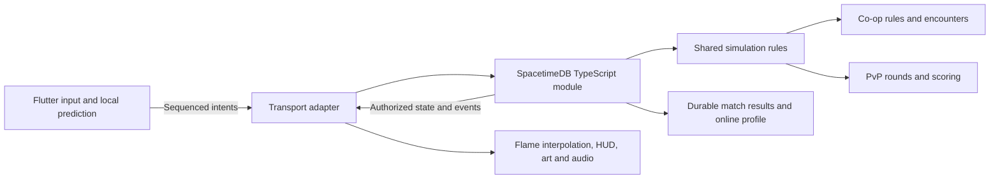

# Regun multiplayer plan: co-op and competitive PvP

**Date:** 20 October 2026  
**Status:** proposal for review; multiplayer is not implemented.  
**Requested scope:** online co-op **and** competitive PvP, using SpacetimeDB with TypeScript as the preferred server language.  
**First platforms:** native iOS and Android. Desktop/web can support development clients; production support needs its own acceptance pass.

**Revision:** updated after the creator's mode/map clarification and a fresh code review on 20 October 2026. Co-op is normal survival with friends, up to **three total players**, on regular arenas. PvP includes **1v1, 2v2 and 3v3 in this implementation pass**, capped at six total/three per team. PvP defaults to **Versus with enemies**; **Versus without enemies** is optional. Players do not select enemy types. Two to three dedicated PvP maps, modular walls/cover and a top-of-screen ping display are explicit deliverables. These requirements supersede the earlier two-player-only co-op/open-ended four-player expansion proposal. Detailed layouts and cover contracts are in [the multiplayer maps and cover plan](REGUN_MULTIPLAYER_MAPS_AND_COVER_PLAN.md).

## 1. Recommended direction

Keep Flutter/Flame for the game client. Build an authoritative TypeScript simulation inside SpacetimeDB. Share networking, movement, weapons, collision, identity and match lifecycle across both modes, then supply separate co-op and PvP rules.

Start with a small two-device transport test, then deliver co-op for two or three total players and Versus in **1v1, 2v2 and 3v3 in this implementation pass**. Co-op rooms cap at three total; PvP rooms cap at six, with three per team. Enemies are On by default in every PvP format; an optional enemies-off variant shares the foundation. Deliver tested map variants for each supported team size rather than merely adding spawn points. Open ranked PvP only after fairness, population and operations pass explicit gates; ranked is not a prerequisite for private matches.

The critical first uncertainty is native Dart integration. SpacetimeDB officially supports TypeScript server modules, but its official client list does not include Dart. A community client must be tested against an exact server version before committing the gameplay migration. If it fails, test an official TypeScript SDK gateway; changing the Flutter client is not the default solution.

The existing offline game remains available. Multiplayer does not require completing the earlier commerce roadmap first. Accounts needed for online identity are included; billing, ads and premium-wallet work are separate projects.

### What success means

- A player and one or two friends can create/join a private room, choose loadouts and a regular arena, complete normal survival together, recover from a short disconnect and receive one correct result each.
- Two, four or six participants can play 1v1, 2v2 or 3v3 Versus with server-controlled enemy arrivals by default, optionally turn enemies off before starting, and receive correct team outcomes/rematches under both variants.
- PvP has two complete, distinct cover-based maps at release, with a third targeted only if it passes the same gates. No open survival map is substituted for these deliverables.
- Every player's connection is visible at the top in milliseconds, with good/fair/poor states distinguishable without color alone.
- Online controls retain Regun's touch layout and weapon identity, with acceptable responsiveness on real iPhones and Android phones in intended regions.
- Ranked matchmaking, when enabled, uses trusted online results, equal competitive access and documented disconnect/rating rules.
- Solo saves, progression, reloads, slow-motion upgrade selection, training and presentation continue to work.

## 2. Current game and the migration it requires

This plan extends [the complete-game blueprint](REGUN_COMPLETE_GAME_PLAN.md), [the progress log](REGUN_PROGRESS.md), [the playtest guide](PLAYTEST_GUIDE.md) and [the earlier backend plan](REGUN_MONETIZATION_AND_BACKEND_PLAN.md). Where the earlier plan proposed Rust first or deferred all PvP, this proposal evaluates TypeScript first and includes both modes. It does not claim their implementation or acceptance.

The refreshed audit is release **`1.0.0+7`**, retaining later gameplay changes despite historical +8–+12 labels. Flutter is **3.47.7**, Dart **3.13.5**, and SoLoud is pinned to **5.2.1**. There are four weapons, three survivors, two regular arenas, eight enemy roles, eight bosses, thirty upgrade families now reaching VIII, and six fusions. These are reusable foundations, not network-ready simulation contracts.

Preserve the latest contracts: XP curve marker 3 (8,18,35,59,…), funded offers with four active seconds of prompt grace and no immediate chained screens; explicit banked fusion cores; Carbine-only tactical manual reload; full reload commitment for the other weapons; three base shotgun pellets; bounded Carbine heading; cumulative-distance `WeaponBallistics`; 1450 dash speed; whole-cluster control sizing; recorded audio and native session recovery. See [XP progression](XP_PROGRESSION.md), [distance damage](WEAPON_RANGE_BALANCE.md), the latest progress/playtest notes and AGENTS.md. These must enter the shared fixture inventory rather than porting obsolete prototype values.

At review start, the working tree was clean, including untracked files; latest commit was `4c908d8` (control sizing/dash). The existing plan was already committed in `9edaad3`. No pending baseline changes needed a commit. `make verify` passed: analyzer clean, **159 tests passed, four opt-in skips**. These checks establish the local baseline, not native multiplayer performance or physical approval.

| Current area | Observed coupling | Required change |
|---|---|---|
| `lib/game.dart` | One `myPlayer`; owns spawning, firing, combat, camera, run lifecycle and persistence | Separate online session/replication from local simulation; address actors by match-scoped IDs |
| `PlayerComponent` | Reads local joysticks, global state and local collision directly | Separate local input, predicted local movement, remote actor presentation and authority |
| `GameNotifier` | One player's health, build, ammo, reload timers, upgrades and phase | Keep solo behavior; online HUD reads a per-player projection of server state |
| `CombatSystem` | Direct references to `game.myPlayer`, local RNG and component targets | Server simulation uses player/entity IDs, factions, pure rules and bounded proc budgets |
| `BulletComponent` | Both renders and applies local swept collision/damage | Online visuals reconstruct server shots; authoritative hit resolution runs server-side |
| Dash/reload controls | Buttons directly mutate dash, immunity, ammo and timers | Emit action intents; reconcile predicted feedback with server acceptance |
| Director/tactics/occupancy | Target and visibility decisions assume one player | Team-aware targets, relevance and safe spawn/escape rules |
| Bosses/attack geometry | Actor components own attacks and presentation timing | Server attack state/timelines; client art uses the same committed geometry and timing |
| `RunStore`/checkpoints | Local solo schema 1/2; serializes one run and transient-state recovery | Preserve solo format; online resume attaches to a server match, never uploads a trusted world |
| Profile/settlement | Local earned progression and once-only run settlement | Separate online match ledger and authoritative rewards from unverified local results |
| Maps and scenery | One Tiled source, rectangular obstacle groups, sparse prop art and simple painted perimeter bands; `ArenaScenery` fades props against `myPlayer` only | Add separately versioned PvP map definitions, modular wall art, cover/material semantics, multiplayer occlusion and navigation; retain regular arena layouts for co-op |

There is no multiplayer dependency or implementation in the audited app. The local CLI reports SpacetimeDB **2.12.0**; that is an installed candidate, not a verified server/client compatibility matrix.

## 3. Product scope and proposed rules

Player counts, regular co-op arenas, the default PvP enemy setting, no enemy-type selector, dedicated PvP maps and ping HUD are creator requirements. Numeric timing, scoring, AI roster and balancing below remain proposed defaults to test.

### Co-op survival

| Decision | Proposed first-release rule |
|---|---|
| Players | Two or three total, including the room creator; room capacity is three, not host plus three friends |
| Maps and loop | The same Breach/Foundry maps and normal survival loop as solo; do not route co-op into the dedicated Versus maps |
| Entry | Private invite code, readiness and a shared countdown; public co-op queue later |
| Starting content | Rook, shotgun, Breach and a small enemy subset for the slice; expand to the full current roster before claiming full co-op support |
| Friendly fire | Off; collision rules explicitly distinguish teammates from enemies |
| XP | Shared team XP; each player gets a personal build/offer pool; one pickup credits the team once |
| Upgrades | Preserve funded personal choices; test synchronized safe 0.1× choice windows for all connected players, with reload/input/damage gated; preserve active-time prompt grace and subsequent-pickup gating |
| Picker timeout | Initial experiment: 15 seconds of real server time, then a documented valid fallback; never run this deadline on the slowed combat clock |
| Death | Downed state with a revive interaction; initial experiment: three-second hold, damage interrupts, twenty-second bleed-out |
| Defeat/re-entry | All players downed means defeat; a bled-out player spectates and may return at an earned checkpoint/boss break if the teammate survives |
| Disconnect | Neutralize input immediately on confirmed disconnect, retain a slot for an initial 30-second grace, no free repeated immunity |
| Pause | A local menu does not pause a live teammate; unanimous pause only in safe intermissions |
| Rewards | Server settlement once per participant/match; reconnect retrieves the same result |

Co-op must feel like normal survival with friends, including its arena hazards, boss rhythm and earned builds; do not convert it into unrelated wave rooms. Any safe selection transition needs pacing support: stop reinforcements, finish or retire hostile attacks under a defined rule, then enter selection without waiting indefinitely for a kill. Preserve XP overflow, four active seconds of grace and a subsequent pickup before another funded ordinary prompt; do not drain overflow as a chain of screens. In shared XP, each player's credited eligibility/offer remains explicit. Bank fusion cores and request real recipes separately. If synchronized selection materially changes the normal loop, compare a bounded individual-choice prototype and review it before locking the policy.

Two- and three-player tuning is measured separately: shared XP is not tripled per pickup, health/spawn growth is bounded, and the director considers all living players' occupancy/visible regions. Document split-team leash/rejoin behavior and boss target switching. Do not add impassable PvP walls to normal arenas as a side effect of this work.

Disconnected players stay vulnerable under a declared policy; a disconnect must not become a dodge. Co-op initially permits reconnects, not arbitrary late joins. If only one player remains past grace, offer a clearly marked solo finish or end the match according to the chosen reward rules. Never silently replace a partner with a bot.

### Competitive PvP

| Decision | Proposed first-release rule |
|---|---|
| Format | 1v1, 2v2 and 3v3 all in this pass; proposed scoring baseline is round-based, first team to three round wins |
| PvP room capacity | Maximum six total, three per team; selected format sets capacity to two/four/six; launch only with equal ready teams |
| Team rules | Explicit lobby slots/teams; teammates do not damage each other; elimination and round wins are team-owned, not awarded to the last individual kill |
| Enemies | **On by default**: normal Versus with enemies entering under a server preset. Optional **Without enemies** is chosen in the room before readiness |
| Enemy selection | No enemy-type/pack/difficulty composer; the server-owned versioned ruleset chooses arrivals, roles and pacing |
| Round pacing | Initial experiment: 90-second cap, then a clearly warned overtime rule; define the tie outcome explicitly |
| Arena | Two to three dedicated dark tactical maps with hard cover, distinct routes and tested 1v1/team-size variants; no open survival-arena shortcut |
| Loadouts | Equal baseline survivor; first slice uses mirrored shotgun, then all four weapons after dedicated PvP tuning |
| Access | Competitive legal equipment available equally, independent of solo unlocks or purchases |
| Builds | No survival RNG upgrades, fusions, guards or proc chains until deliberately designed and balanced for PvP |
| Combat | Server damage and projectile collision; distinct competitive health/damage values where required |
| Respawn | Between rounds, with explicit input reset, countdown and deployment protection |
| Camera | Consistent gameplay-visible area across aspect ratios; wider screens must not reveal opponents earlier |
| Aim assist | Explicit competitive policy, measured and applied consistently; do not inherit solo assistance silently |
| Disconnect | Initial 30-second reconnect grace; no global pause or immunity; ranked abandonment may forfeit under published rules |
| Rewards | No rating for private matches; cosmetic/progression rewards must resist repeated farming |
| Ranked | Public launch only after the later ranked acceptance gate |

“Private” describes who can join; it does not imply enemies are absent. Lobby copy is **Versus** with a custom **Enemies: On / Off** selector, initially On. All members see the chosen variant, map and team size. A change clears readiness; lock it at countdown. Rematches retain the agreed variant, while a newly created room defaults to On. Public admissions include variant in the ruleset key; never silently mix them or pool their ratings without independent balance evidence.

Team selection, moves between slots, room capacity and equal-team readiness are server-validated. An eliminated PvP participant spectates permitted teammate views until the next round; co-op's downed/revive mechanic is not inherited automatically. A team with one living member continues; the round ends when one entire team is eliminated, with explicit trade/draw resolution. A disconnected player uses the same grace/abandonment policy, while remaining teammates continue; do not instantly forfeit the whole team because one client blipped. Define surrender voting, permanent departure, cancelled pre-start matches and any ranked rating adjustment before public release. Matchmaking includes team size and party composition, preventing a three-player party from being admitted to 1v1 or assigned silently across opposing teams.

#### Versus with enemies: fair PvPvE rules

AI is a neutral hostile faction, opposed to both players/teams. Propose a fixed, tested normal-enemy roster for the first slice, excluding bosses, nests and persistent hazard generators until map safety is demonstrated. This is developer tuning, not a player selector. Reuse committed attacks and material cues, with bounded population/attack budgets separate from survival. Enemy eliminations do not replace defeating the opposing player/team as the win condition.

Spawn from authored paired arrival sockets away from spawn shelters, immediate cover exits and occupied warning areas. Use seeded schedules and symmetric arrival opportunities, then inspect whether targeting and navigation create unequal actual pressure. Validate safety for **every** player/team, not just the nearest actor; skip/defer invalid arrivals rather than forcing them through walls. Targets are chosen by server rules with commitment/hysteresis, no preference for room creator or account identity. AI must not permanently seal a lane or body-block the only exit. Do not guarantee identical damage merely from mirrored spawn counts.

Proposed round outcome: the last living player/team wins even when AI caused the final death; simultaneous full elimination is a draw, with bounded overtime/rematch handling. AI kills grant no competitive XP, upgrade rolls, healing, ammo or rating by default, preventing a hidden PvE farming advantage. Health loss, kill attribution and the score show whether the source was an opponent or AI. Reset AI/attacks between rounds. Test kiting a pack toward an opponent, camping a spawn, deliberate AI suicide, wall traps, double elimination and 30-second reconnect abuse. These rules require a separate PvPvE balance pass from enemies-off combat.

Choose spawn points, sightlines and cover through playtests. Prevent first-shot spawn advantage, repeat spawn trapping and camera-edge ambush asymmetry. Test left/right and top/bottom starting sides. Overtime must be readable and independently tuned; it must not introduce an untested damaging floor effect as a shortcut.

For ranked: use a versioned rating model such as Glicko-2, provisional placement, regional latency limits, an expanding skill window and a visible maximum wait. Final model and thresholds are a separate decision after population estimates. Never hide bots in the competitive queue. If population cannot sustain fair matches, launch private/casual duels and defer the ladder.

## 4. Technical architecture and authority



**Server owns:** membership, ready/start transitions, spawn locations, movement bounds, dash/immunity, fire cadence, ammo/reload, projectiles, collision, damage, statuses, RNG, enemies, bosses, upgrades, rounds, revive, rewards and match results.

**Client owns:** touch interpretation, camera within competitive constraints, predicted local feedback, remote interpolation, animations, audio, material VFX, accessibility settings and menus. Predicted effects never award damage or rewards.

Use a TypeScript SpacetimeDB module for authoritative tables and transactional reducers. Keep the simulation core independent of database APIs so headless scenarios can exercise it. This runtime is not assumed to be an unrestricted Node.js server: verify package/runtime restrictions and scheduled execution on the selected release. A conventional TypeScript service is optional for gateway, matchmaking coordination or future external integrations; it must not become a second combat authority.

Start with one regional deployment and logical match isolation. A module/database is a scheduling and resource boundary, not automatically an independently scaling process per match. Measure transaction duration and cross-match contention before choosing matches per database, regional sharding or dedicated match allocations. High-frequency combat tables should not share an avoidable failure/maintenance boundary with future commerce.

### Proposed repository structure

```text
server/
  spacetimedb/          # Schema, reducers, schedules, lifecycle and access rules
  simulation/          # Movement, geometry, weapons, entities and mode rules
  tests/               # Reducer integration, bots, abuse and load scenarios
shared/
  rules/               # Versioned numeric content and arena geometry
  protocol/            # Reviewed application contracts/version metadata
  fixtures/            # Cross-language movement/combat expected outcomes
tool/
  multiplayer/         # Export/check contracts, run local instances and bots
lib/multiplayer/
  transport/           # SDK-specific adapter and generated bindings
  models/              # Inputs, snapshots, events and online state
  prediction/          # Movement replay, reconciliation and interpolation
  presentation/        # Remote actors and network-driven combat rendering
  session/             # Connection, membership and lifecycle controller
docs/validation/multiplayer/
                         # Compatibility, network, fairness and device evidence
```

Names are proposed, not existing files. Generated wire bindings come from the pinned SDK/schema toolchain. Separate application contracts must not duplicate that generator's serialization logic.

## 5. Native Flutter compatibility gate

Evaluate `spacetimedb` **1.3.0** as an initial community-package candidate: its maintainer advertises v2 support, generation, subscriptions and a binary codec. That broad claim does not prove compatibility with 2.12.0. Inspect source, maintenance, license, security and transitive dependencies before adding it. Pin the exact tested package/generator revision and server/runtime versions.

The spike must demonstrate:

1. A TypeScript module builds, publishes locally and runs a server-driven scheduled simulation with no gameplay client connected.
2. Generated Dart bindings correctly handle IDs larger than 2^53, identities, enums, optional fields, timestamps and binary messages.
3. Release iOS and Android clients authenticate, invoke permitted reducers, receive initial state and transaction updates, unsubscribe and reconnect.
4. A client cannot subscribe to another room's restricted data or mutate another player's state. Filtered subscriptions alone are not authorization.
5. Repeated enter/leave/restart/background cycles clean up callbacks, subscriptions and credentials correctly.
6. Inputs are never replayed after a disconnect as generic offline mutations. Disable the SDK's offline action queue for gameplay and rewards.
7. Two devices receive consistent match state and recover from Wi-Fi/mobile-data transitions.

If the direct client fails materially, run a bounded gateway comparison: Flutter WebSocket → authenticated TypeScript gateway → official SpacetimeDB TypeScript SDK. Measure added delay, bandwidth, session mapping and cleanup. The gateway must bind each user to authorized operations/views; a shared privileged identity must never accept a client-supplied player ID as proof. Choose direct SDK or gateway in a written decision record before continuing; do not maintain both production paths without demonstrated need.

## 6. Data model, access and lifecycle

| Record | Purpose and important constraints |
|---|---|
| Online player/account | Stable authenticated identity, display name, linking/deletion state; separate from local profile ID |
| Room/member | Co-op/Versus, capacity (co-op max three), team size, enemy variant (Versus default On), map variant, leader, readiness and expiry; atomic join prevents overfill |
| Match | Region, ruleset/content/protocol/map versions, enemy preset/seed, authoritative tick, phase and terminal result; configuration immutable after start |
| Participant | Account-to-slot binding, team, connection generation, grace deadline and abandonment state |
| Player actor | Transform, aim, health, ammo, dash/reload/status timelines and current life/round |
| Latest input/action receipt | Accepted sequence, bounded movement/aim and deduplicated dash/reload/choice requests |
| Entity/projectile/drop | Match-scoped IDs, authoritative owner/faction, collision state and bounded lifetime |
| Attack | Source actor, committed geometry, warning/activation/recovery ticks and cancellation state |
| Build/offer | Per-player ranks, authoritative eligible offers, offer ID and deadline; private until reveal rules allow |
| Round/score | PvP round state, side/spawn assignment, score and outcome reason |
| Match result/reward ledger | Unique match/participant/ruleset settlement; retry returns the existing result |
| Rating update | Unique rated result plus algorithm/season version; correction history, no client rating writes |
| Schedule/cleanup | One active loop per match/allocation, expected generation and expiry; stale callbacks cannot advance replacements |
| Connection quality | Per-participant connection generation, timestamped RTT sample/summary and freshness; authorized match visibility, bounded update rate, no client-selected RTT values |

Use private backing tables and identity-authorized views/operations for member-only state. Determine the exact access mechanism during the compatibility gate. Public combat data should contain only information deliberately safe for anyone to read; do not rely on an honest client's match filter. Do not replicate hidden opponents/offscreen information if the competitive rules promise it is secret. Invite codes are rate-limited discovery aids, not account credentials.

Every mutation verifies caller membership, current phase, connection generation, bounded values and request freshness. Admission/loadout validation is server-owned. Membership changes, room start and settlement must remain correct under concurrent calls.

### State machines

```text
Session: signed out → connecting → authenticated → room → loading → live
         live → reconnecting → rejoined | expired
         any state → leaving → disposed

Match: waiting → loading barrier → countdown → active
       co-op: active ↔ safe upgrade break; active → team defeat | completion
       PvP: active → round result → countdown; final round → match result
       terminal → settled → retained result / cleaned transient state
```

Provide loading deadlines, minimum participant readiness and cancellation behavior. A slow asset load cannot start one player in a damaging arena while the other is still loading. Joining/rejoining carries a match epoch and life/round generation so late events cannot affect a new match or respawn.

## 7. Simulation, protocol and responsive play

### Inputs

Send normalized movement, normalized aim, held fire, action sequence IDs and input sequence numbers. Commands identify the intended session/match generation, but authorization derives from the authenticated caller. The server controls elapsed time and speed; client timestamps are diagnostic/untrusted.

Clamp vector magnitude, reject non-finite coordinates, bound request frequency and input queues, deduplicate actions and reject old sequences. On stale input, clear held fire/movement after a short measured timeout. A backgrounded app must not continue walking/firing indefinitely.

### Tick and clocks

Begin with an experiment at **20 Hz** (50 ms), compare **30 Hz** for PvP, and raise only when measurements justify cost. The carbine's 0.1-second cadence and fast bullets require accurate substep timing/swept tests; merely raising render FPS does not fix authority.

Use a server tick index and a deterministic order: accept bounded inputs → move actors/occupancy → advance weapon/AI/attack timers → sweep projectiles/resolve damage → apply deaths/drops/XP/round outcomes → publish state/events. Document simultaneous lethal-hit/trade behavior rather than depending on reducer arrival order.

Separate simulation time from real deadlines. Co-op selection may slow simulation; disconnect, loading and upgrade-choice deadlines keep advancing. Implement one idempotent scheduling chain per match/allocation. Test delayed callbacks, restart, tick overrun and duplicated schedule requests. Bound catch-up work; do not fast-forward minutes of lethal combat after a deployment stall. If a server restart cannot restore a valid match, abort it explicitly and settle/void it under documented policy.

### Prediction and reconciliation

- Predict local movement and dash using the same numeric geometry and constraints as the server.
- Server updates include the authoritative tick and last processed input sequence. Restore authoritative movement and replay only unacknowledged permitted inputs.
- Smooth small position errors; snap safely for respawn, invalid predictions and large discrepancies. Never smooth an actor through a wall.
- Interpolate remote actors behind server time using a small adaptive buffer; cap extrapolation and then hold/fade rather than inventing movement.
- Show local muzzle/recoil/reload feedback promptly; reconcile accepted shots/ammo. Key effects by shot/action ID to avoid double audio/VFX on confirmation or reconnect.
- Apply authoritative health, hit confirms, death, XP and rewards. A speculative hit marker must not look like confirmed damage.

### PvP latency and hit policy

Start with projectiles on the current authoritative world, without full-world rollback. Establish server-time input handling, maximum accepted input age and clear dash/immunity boundaries. For each hit, log shot time, resolution tick, victim position, immunity and wall test in development evidence.

Compare this baseline at 50/100/200 ms RTT. If it produces unacceptable disadvantage, prototype a **bounded** compensation policy with stored transforms, server-estimated time and strict maximum age. Do not trust client hit claims or rewind victims through cover/dash protection without explicit rules. Benchmark fairness for both attacker and defender before locking policy. Ranked is blocked until this choice is resolved and communicated.

### Replication and bandwidth

Subscribe only to authorized match state. Co-op encounters must consider all three players' relevant areas and PvP up to six participants; individual camera culling must not stop the server simulation. Separate persistent actor state from short-lived shot/impact/attack events. Reconstruct decorative particles locally. Projectile events include IDs, owner, origin, direction, speed/range and spawn tick; snapshots retain enough active damaging projectiles/attacks for late rejoin.

Apply a transaction's changes coherently before rendering a frame. Give transient events monotonic IDs and bounded retention; reconnect takes a fresh snapshot and a valid event cursor, without replaying old explosions or missing still-active hazards. Never delete a damaging attack merely because a client culled its visual.

## 8. Shared contracts and content port

Extract numeric tuning from Flutter enums into a reviewed, versioned source with generated Dart/TypeScript outputs. Preserve stable IDs across releases; names and translated labels are not wire IDs. Export world bounds, obstacle geometry and hazard footprints from the authoritative arena layout. Add map/mode/team-size compatibility, spawn and AI-arrival sockets, route labels and cover semantics from the same authored source; see [the map/cover specification](REGUN_MULTIPLAYER_MAPS_AND_COVER_PLAN.md). Do not overload the solo `ArenaType`/`Loadout` save enum with incompatible online maps. The server must not try to run Flame or depend on sprite dimensions for collision.

Cross-language fixtures cover movement at walls/corners/seams, dash distance/immunity, body occupancy, swept projectiles, pellet once-only damage, cumulative-distance falloff, pierce/ricochet, Carbine-only tactical reload, full reload commitment, VIII/effective-rank distinctions, XP curve/grace, explicit fusion cores, RNG, proc ceilings and attack geometry. Match expected outcomes/tolerances, not identical rendering. TypeScript numbers, Dart doubles and integer IDs require explicit limits/serialization; avoid accidental precision loss or different RNG behavior.

Port incrementally:

1. One survivor, movement/dash, shotgun and a static target.
2. All four weapons with authoritative reload, ammo, spread and collisions; competitive variants use separate values.
3. Basic enemies, shared XP and a representative upgrade/fusion path.
4. Full enemy roles, elite/director logic and both arenas.
5. Boss timelines/weak points/phases, then all eight bosses and the full build roster.

Enemy targeting must consider eligible living teammates, target hysteresis and readable commitment. Spawn safety covers all players; distance/visible population limits use the relevant union rather than multiplying budgets blindly. Preserve separate living occupancy/pending spawn reservations, boss priority, actor-based movement and emergency caps. Revalidate escape budgets for attacks threatening all three co-op positions; solo escape tests do not prove co-op safety.

## 9. Co-op and PvP presentation

Keep the custom charcoal/brass pixel UI, brief player copy, mirrored control clusters and dash/reload under the aiming thumb. Reuse material `AttackVfx`, grounded actors, directional poses and weapon art. No generic Material switches or geometric placeholder attacks in the finished mode.

Add Online → Co-op / Versus, create/join, invite copy, readiness, connection status, teammate health/downed/revive indicators, PvP score/countdown, reconnect, result and rematch flows. Co-op shows regular arena choice and up to three player slots. Versus shows dedicated map, team-size preset and **Enemies: On / Off**, On by default, with no enemy-type picker. Keep offline Play/Continue available. Early development modes stay behind an internal flag until functional; no broken public menu entries.

Warnings carry server activation times and committed geometry. A client receiving a warning late must resynchronize; it cannot gain extra local immunity by delaying presentation. Define a severe-desync policy so a match does not continue deceptively. Initial fresh load/rejoin uses a readiness/protection rule, not the training world's global freeze.

Preserve planted warnings, attack impact clips/recovery, texture leases and disposal guards. Online hit flashes, weapon recoil and sound cues must survive reconciliation without duplication. Reduced Motion and audio preferences remain local. Co-op landing/revive does not pause everyone; any invulnerability is server-owned. The shotgun retains its normal timing and original Lottie. PvP balancing must not overwrite solo values.

### Dedicated map and wall production

[The companion map plan](REGUN_MULTIPLAYER_MAPS_AND_COVER_PLAN.md) is part of this scope, not an optional art wishlist. Build two complete PvP maps (Ossuary Cross and Ironworks Relay, working names), with a third (Ashen Cloister) targeted after those pass. Each release map has cover/route variation and **playable, tested 1v1, 2v2 and 3v3 variants in this pass**, paired spawn/AI sockets and independent fairness acceptance. Prototype all three layouts before committing final art, then prioritize the two strongest. Co-op retains the actual regular maps.

Upgrade the current simple perimeter treatment into a modular wall/cover kit: stone and iron straights, inner/outer corners, ends, T-junctions, damaged appearances, columns, barriers and machinery. Hard cover blocks actor movement **and** shots; decorative debris is explicitly nonblocking. Readable tops/footprints, join geometry, shadows and occlusion matter as much as texture quality. Destructible walls, height-based shooting and doors are later mechanics, not implicit promises from the art.

### Top-of-screen player ping

Display a compact connection chip beside each player's top HUD identity: for example `YOU 42 ms`, `ROOK 95 ms`. Show both opponents in 1v1, all three co-op participants, and grouped team rows for 2v2/3v3, including all six participants. Keep local ping continuously visible; do not move all remote values into a hidden scoreboard. Layout uses safe areas, preserves health/ammo/score and stays clear of the aiming controls. Provide scalable layouts and short stable player labels; show full names in the room/scoreboard.

| State | Initial display rule | Example |
|---|---|---|
| Good | RTT <80 ms; subdued green | `42 ms` + good signal glyph |
| Fair | RTT 80–150 ms inclusive; amber | `95 ms` + fair signal glyph |
| Poor | RTT >150 ms; warm red | `186 ms` + poor signal glyph |
| Unavailable/stale | No valid recent sample; neutral gray | `— ms` + pending/stale glyph |
| Disconnected | Confirmed connection loss | `OFFLINE` + broken-link glyph |

Thresholds are proposed Regun tuning, not an industry standard or proof that 149 ms feels fair. Use numbers plus distinct glyphs; color is additional information. No blinking/flashing. Apply brief threshold hysteresis so 79/80 ms does not flicker. Preserve the underlying numeric sample and show a separate instability cue for jitter/stalls rather than calling all low-ping links good.

Measure round-trip time to the **actual match endpoint**, using a supported transport ping/pong API when available. Otherwise use an authenticated nonce echo sampled around once per second, timed with a monotonic local clock and returned outside the combat tick if the runtime permits. A reducer echo includes queue/processing delay: label/document it as application RTT and record tick/queue health separately; never advertise it as pure network latency or halve it as one-way ping. For a gateway, distinguish client-to-gateway from the full authoritative path and disclose which is shown.

Use a short rolling median/EWMA and update text around once per second. Track variance and missed probes separately. Initial stale budget: three seconds without a fresh response; actual disconnect follows session liveness, not one failed probe. Reset samples on reconnect/region/connection generation changes. Remote chips use server-observed/validated connection summaries; never broadcast a player-supplied arbitrary `pingMs`. If transport lacks server-side measurement, design an authenticated bounded challenge/ack exchange, document the application-delay bias and retain `— ms` until supported rather than fabricating remote values. Diagnostic ping must not grant authority, immunity or rating advantages.

Riot's network analysis distinguishes RTT from buffering/jitter and processing delay; a ping chip alone cannot diagnose every hitch. Expose details in a developer overlay while keeping player copy brief. [Gameplay consistency analysis](https://playvalorant.com/en-us/news/game-updates/valorant-gameplay-consistency-update/)

Acceptance covers 42/95/186 ms examples and threshold boundaries, no-response/stale/offline, rapid jitter, background/rejoin, route disposal, three-player co-op and live four/six-player PvP HUDs at enlarged text. Verify displayed values under injected delay, confirm probes do not amplify match writes, and retain honest unavailable states when remote telemetry cannot be measured.

## 10. Identity, rewards, safety and competitive integrity

Use authenticated online identities with secure native token storage and a defined guest-to-linked-account path. Guest private rooms can be supported first; ranked requires recoverable accounts. Resolve simultaneous sessions by connection generation rather than allowing two devices to drive one slot. Account linking must not duplicate rewards or merge unverified balances by addition.

Offline Scrap/unlocks remain local/legacy state. Competitive stats and authoritative online rewards use a separate ledger. Do not accept local saves or uploaded solo results as rated proof. Define how earned online rewards appear in the existing Collection; allow idempotent claim/projection and recovery without making a locally edited balance authoritative.

Protect against forged IDs, speed/fire spam, invalid aim, stale inputs, room enumeration, ready/start races, offer replay, duplicate settlement, reward farming and rating manipulation. Competitive access/effect budgets must not depend on paid power. Server authority does not eliminate aimbots or collusion: retain bounded match evidence, anomaly signals and a review/appeal process. Avoid speculative permanent bans from a single latency anomaly.

Exclude chat/voice from the first release. Display names still need length/character rules, reporting and moderation. Before public ranked, provide report/block behavior, abandonment rules, proportionate retention and a privacy/deletion process. Never log auth tokens. Specify retention for diagnostic inputs and match evidence before enabling production collection.

## 11. Deployment, observability and cost

Use separate local, staging and production databases/credentials. Keep module schema migrations and app/protocol releases versioned together. Existing matches stay on their ruleset; incompatible clients fail admission with a clear update path. Avoid changing weapon values halfway through a match.

Deploy by draining admissions, allowing live matches to complete, then publishing/migrating; test rollback and schema compatibility in staging. Do not assume an old binary can read a newly migrated schema. Backups, restoration and failure recovery require a rehearsed procedure. Start self-hosted locally; select managed versus self-hosted production only after measuring regional latency, operations and costs.

Measure: active rooms/matches/players, connection/rejoin success, RTT/jitter, stale inputs, correction distance, tick interval/duration/overruns, reducer failures, memory/table growth, bytes per client, warning lead-time, hit disputes, settlement retries, disconnect causes, queue waits and result consistency.

Load test many simultaneous matches with realistic input rates and entity counts. Include idle connections, reconnect storms, room churn and maximum legitimate proc/projectile loads. Define admission limits and saturation behavior; stop admitting new matches before existing matches collapse. Report measured matches per allocation with hardware/configuration and headroom.

Model cost per concurrent match-hour from compute, resident rows/memory, bandwidth, retention, auth, gateway if used and monitoring. Do not infer free production capacity from vendor headline rates. Compare measured 20/30 Hz cost and latency; verify current hosting/pricing/backup terms when making the deployment decision.

## 12. Delivery milestones and exit gates

Milestones are dependency-based deliverables, not a claim that multiplayer can be completed in a few days. Estimate dates after the compatibility and combat slices reveal measured work. Review scope at each gate rather than cutting fairness/recovery at the end.

| Milestone | Deliverable | Exit evidence |
|---|---|---|
| M0 — Approve scope/contracts | Updated three-player co-op/default-enemy Versus scope, architecture, threat model, current balance fixtures and map briefs | Review baseline recorded (159 passing/four opt-in skips); proposed scoring/upgrade rules distinguished from creator requirements |
| M1 — Native compatibility | Pinned TS module, Dart client/generator or measured gateway, identity/access, schedule and reconnect spike | iOS + Android release evidence, access rejection tests, written go/no-go and exact versions |
| M2 — Shared movement room | Two-device baseline, then co-op three-slot and PvP two/four/six-slot rooms with team assignment; readiness/loading, prediction/interpolation, ping and teardown | Up to six connected clients, equal-team start checks; corner/body/ping tests; no stale input, leaks or cross-room state |
| M3 — Authoritative combat | Shotgun first, then four weapons; health, projectile sweeps, reloads, death and result foundation | Simulation/reducer tests and latency matrix; no client-authored damage or duplicated shots |
| M3A — Map and cover prototype | Three route blockouts, playable 1v1/2v2/3v3 layouts, wall/cover schema and stone/iron art slice; settle minimum two map selection | Two/four/six-player reachability, sightlines, spawns, body/dash/cover and weapon-range evidence; no premature final art |
| M4 — Private Versus alpha | 1v1 then 2v2/3v3 within this milestone, enemies **On by default**, optional Off, server AI preset, covered map, team rounds/reconnect/rematch | All three formats × both variants; no type picker; six-client fairness/camera review; AI cannot trap exits or farm score |
| M5 — Co-op vertical slice | Normal Breach loop with two/three players, director, shared XP, funded personal builds, downed/revive and one boss | Both party sizes finish representative runs; no immediate overflow screens; interruption/result retry works |
| M6 — Full content and PvP map pack | Full co-op roster/builds on regular arenas; two finished PvP maps with 1v1/2v2/3v3 variants and wall kit; third subject to acceptance | Physical three-player co-op and six-player PvP; each map × team size × enemy variant passes fairness/art/collision; third not claimed until complete |
| M7 — Public online beta | Recoverable accounts, casual admission, regions, reports, operations, load caps and durable rewards | Security/load/recovery evidence; privacy flows; regional device/network acceptance |
| M8 — Ranked PvP | Settled hit policy, map/variant balance, matchmaking/rating, placements/season policy and anti-abuse review | Sufficient population; trusted idempotent rating; explicit enemy-variant queue/rating policy; acceptable waits/latency |
| M9 — Release | Staged rollout, rollback, support docs; deliver accepted co-op up to three and PvP 1v1/2v2/3v3 up to six in this pass | Full map/format/variant matrix, six-client load/fairness evidence and clean recovery; no deferred team modes presented as completed scope |

M3A follows the current combat/range fixture inventory and must precede PvP fairness sign-off. M4 and M5 share infrastructure and basic AI, but each has independent acceptance. An enemies-off combat harness can be used internally during M3; it does not satisfy the default enemies-on Versus alpha. Two complete PvP maps and all three formats (1v1/2v2/3v3) are required in this pass; the third map is a stated stretch deliverable. Testing 1v1 first is an implementation sequence, not permission to defer 2v2/3v3. Four-player co-op, spectators and tournaments are outside this scope.

## 13. Verification and acceptance matrix

| Layer | Required cases |
|---|---|
| Solo regression | Existing `make verify`; original shotgun reload/Lottie, 0.1× choice, save schema 1/2, training entrance/recovery, controls and art contracts |
| Pure simulation | Fixed-seed movement/combat fixtures; collisions, simultaneous kills, dash immunity, all weapon reloads, XP/build/proc caps and mode transitions |
| Server integration | Real module reducers/schedules; authorization, concurrent joins, start/settle races, duplicated/stale requests, forged data and cleanup |
| Client lifecycle | Route enter/exit, restart, callback disposal, token restore/link, readiness failure, app update mismatch and background input reset |
| Network | 50/100/200 ms RTT; asymmetric delay/jitter; underlying packet loss and retransmission stalls; disconnect/reconnect; Wi-Fi/cellular switch |
| Transport correctness | WebSockets preserve order within a connection; test stale application callbacks/retries across reconnects rather than assuming UDP-style wire reordering |
| Co-op | Two/three players on both regular arenas; far-apart targets, shared pickup conservation, funded/grace-gated offers, explicit cores, boss phases, two downed/third alive, all downed and critical-phase disconnect |
| PvP | All 1v1/2v2/3v3 formats × enemies On/Off × both release maps; equal teams, friendly-fire exclusion, last teammate alive, AI/trade attribution, full-team elimination, overtime, camera parity, dash/reconnect and six-client load |
| Maps/walls | Route connectivity/rotation times, clearances for bodies and packs, spawn isolation, shared map hash, projectile/Arc/ricochet corner rules, art footprint/occlusion, no hidden passage advantage |
| Ping HUD | Per-player RTT, good/fair/poor boundaries, instability/stale/offline, reconnect reset, remote provenance, safe areas and enlarged text in three/six-player layouts |
| Integrity | Duplicate reward/rating settlement, restarted server, delayed finalization, account double-session, private-state reads, farming/collusion scenarios |
| Performance | Real release clients during dense co-op and PvP; multi-match server load, gateway overhead if used, sustained memory/bandwidth and frame times |
| Operations | Drained deploy, stale schedules, restart recovery/void outcome, backup restore, incompatible schema rollback, overload admission and service outage messaging |

Record device/OS/build, server region/version, SDK/generator version, ruleset, network profile and exact scenario. Include screenshots/video for controls, warnings and competitive fairness. Headless bots cannot approve touch comfort, attack readability or physical-device performance.

### Proposed measurable starting targets

These are reviewable budgets, not achieved results. Ratify them after M1–M3 measurements; revise explicitly if the intended devices/regions cannot meet them.

- Target 60 FPS on selected supported phones, with a documented p95/p99 frame-time budget and thermal-duration test; measure dense co-op for at least 30 minutes.
- At 20 Hz, aim for p95 simulation work below 25 ms and p99 below the 50 ms tick budget at the accepted allocation load, leaving operational headroom.
- Target p95 reconnect to playable state within five seconds after connectivity returns, while still inside grace.
- Initial ranked eligibility experiment: RTT at or below 150 ms with acceptable jitter; 200 ms remains an explicit degraded-condition test, not a promise of ranked fairness.
- Track correction-distance distribution; repeated visible teleports during ordinary movement or systematic wall-crossing are release blockers.
- Zero accepted unauthorized writes, duplicate terminal results, double reward/rating grants, cross-room leaks or damaging attacks without the intended warning contract.
- Set and publish a measured bandwidth budget after M3 rather than guessing before content/event payloads exist.

## 14. Main risks and decision points

| Risk | Response / decision gate |
|---|---|
| Community Dart SDK falls behind server protocol | Pin/test early; compare official-SDK gateway; stop the migration if neither passes native acceptance |
| Ported TS gameplay diverges from solo | Shared numeric data, stable IDs and fixtures; retain mode-specific values explicitly |
| PvP feels unfair under latency | Measure early duel; settle hit policy, competitive geometry, tick rate and regional admission before ranked |
| Co-op grows to three viewpoints/builds | Team-aware director and VFX budgets; preserve escape space rather than multiplying enemies by player count |
| PvPvE decides outcomes through unfair AI | Neutral preset, seeded safe arrivals, lane budgets and measured targeting/side pressure; independently test enemies-off |
| Tactical maps become mazes or ranged camp sites | Purposeful connected lanes, measured travel/sightline distances, wall kit/geometry parity and map-specific weapon tests |
| Ping display misrepresents connection quality | Measured endpoint RTT, declared processing bias, jitter/stale states, no fabricated remote values |
| Upgrade/pause design harms flow | Prototype synchronized safe breaks; preserve solo semantics; review pacing before full content port |
| Shared database saturates across matches | Measure transactional contention/load; allocation/sharding plan and admission caps |
| Reconnect grants advantage or corrupts rewards | Connection/life generations, no generic replay, authoritative recovery and idempotent ledgers |
| Public PvP has too few players across three formats/two variants | Deliver private 1v1/2v2/3v3 this pass; constrain public queue availability transparently if needed, defer ranked rather than fake opponents or silently change formats |
| Scope expands into commerce/social infrastructure | Keep purchases, ads, trading, voice/chat and guilds outside this release |

Creator direction is already captured: three-player co-op on regular maps; default enemies-on Versus with optional Off and no enemy selector; 1v1/2v2/3v3 up to six players **in this pass**, dedicated covered maps and top HUD ping. Remaining review decisions are scoring/overtime, PvPvE roster and rewards, co-op upgrade/downed details, final map themes/layouts and release order. Technology choices remain conditional on M1; rates, timeouts and balance values remain experiments.

## 15. First implementation packet after plan approval

The first packet is **M0–M1 only**: record the solo baseline, create an isolated TypeScript module, pin candidate tools, implement two authorized test identities plus a tiny scheduled movement state, generate/test Dart bindings, and document native connection/reconnect/access results. Keep it outside the normal public game flow.

Its deliverables are reproducible local commands, a version matrix, automated protocol/access tests, an iOS/Android device checklist and a direct-SDK versus gateway decision. It does not migrate profiles, add purchases, change solo balance, deploy production infrastructure or claim playable full multiplayer. Once this gate passes, M2 connects the first private room to Regun's actual controls and presentation.

## 16. Research and evidence

Primary sources checked for this planning pass:

1. [SpacetimeDB language support](https://spacetimedb.com/docs/intro/language-support/): TypeScript server modules are supported and run on V8. This establishes language availability, not Regun throughput.
2. [SpacetimeDB official client list](https://spacetimedb.com/docs/clients/): Rust, C#, TypeScript and Unreal are listed; Dart is absent from that list.
3. [SpacetimeDB functions](https://spacetimedb.com/docs/functions/): transactional reducers, external-effect procedures and read-only views have different roles.
4. [Reducer documentation](https://spacetimedb.com/docs/functions/reducers/): schema/reducer patterns and execution context; exact scheduling API still needs a compiled spike against the selected release.
5. [Community Dart package](https://pub.dev/packages/spacetimedb): retrieved version 1.3.0 in the earlier pass advertised SpacetimeDB v2, binding generation and offline mutation replay. Recheck the package at M1; those claims do not establish native compatibility.
6. [Riot: The Birth of Ascent](https://playvalorant.com/en-gb/news/dev/the-birth-of-ascent/): three-lane design, iterative geometry tests, route orientation and legibility; useful process guidance, not a top-down shooter template.
7. [Riot: The Creation of Split](https://playvalorant.com/en-us/news/dev/the-creation-of-split/): playtest-driven revisions to positions and combat focus.
8. [Supercell: Mystery at the Hub patch notes](https://supercell.com/en/games/brawlstars/blog/release-notes/mysteryatthehub-patch-notes/): indestructible walls and deliberately distinct Duels maps; demonstrates relevant top-down design tradeoffs without proving Regun balance.
9. [Riot: Gameplay Consistency Update](https://playvalorant.com/en-us/news/game-updates/valorant-gameplay-consistency-update/): RTT, jitter and buffering are different contributors to responsiveness.

The retrieved vendor documentation displays a **2.0.0** version label while the locally installed CLI reports **2.12.0**. Do not infer exact API compatibility from these pages. Research caches are ignored local files under `.firecrawl/regun-multiplayer-*`; the public links above are the durable references.

Repository evidence: `lib/game.dart`, `lib/notifiers/game_notifier.dart`, `lib/components/game_utils/player_component.dart`, `lib/components/weapons/bullet_component.dart`, `lib/components/movement/boost_component.dart`, `lib/systems/combat_system.dart`, `lib/systems/encounter_director.dart`, `lib/systems/arena_geometry.dart`, `lib/systems/boss_encounter_runtime.dart`, `lib/services/run_store.dart`, `lib/data/loadout.dart`, `pubspec.yaml` and the existing tests.

No gameplay code or dependencies were changed for this revision. The refreshed baseline ran `make verify` (159 passing, four opt-in skips; analyzer clean). No multiplayer network simulation, native build/install, server load test or physical-device multiplayer validation was performed. Creator requirements are separated above from proposed rules, layouts, budgets and milestone order.
