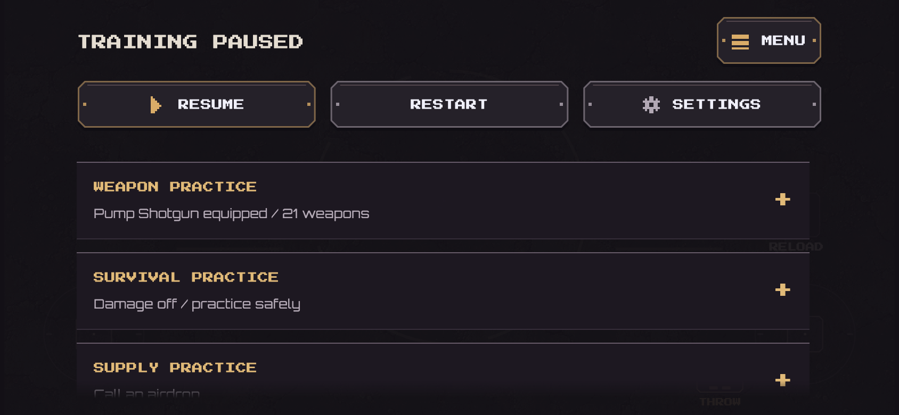
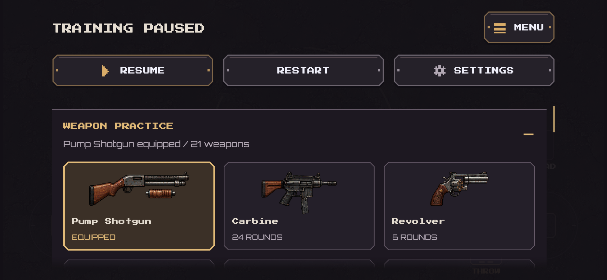
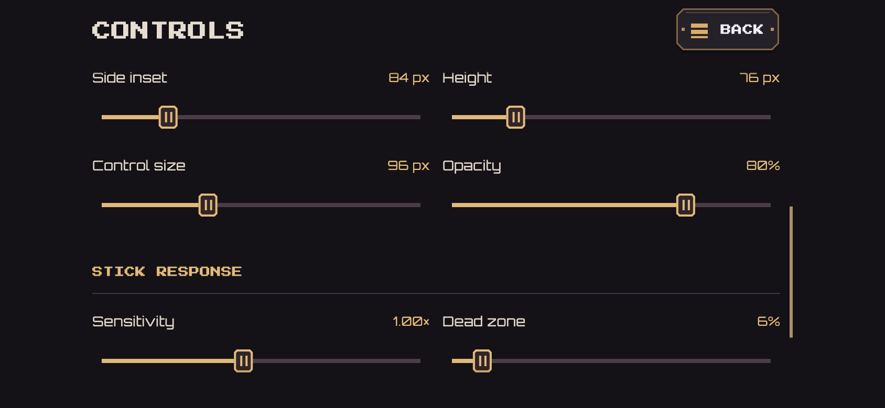

# Training and shared settings — 22 October 2026

Training's pause menu now starts with pinned Menu, Resume, Restart and Settings.
The practice list has its own scroll viewport, so the main actions remain usable
at the end of a weapon list. The game HUD is concealed while paused. Settings is
the sole Controls entry in the pause flow, shared with normal survival play.

Weapon, Survival, Supply, Boss and Fusion practice start collapsed on each pause
visit. Their summaries show the equipped gun, damage state or active rush round.
Each header is an accessible expand/collapse action; content opens/closes over
180ms with a short eased reveal. Reduced Motion and OS Disable Animations settle
immediately. Closed content is removed after its exit so it cannot receive taps,
be read by a screen reader, or retain unused weapon-art leases.

Weapon Practice shows all 21 exact gameplay silhouettes with names, base magazine
capacity and an explicit EQUIPPED marker. Switching stays paused and uses the
existing weapon-change/reset contract. Loadout and practice share WeaponThumbnail;
changing a thumbnail's weapon replaces its keyed lease, including pending loads.
No new textures, art redesign, weapon stats or damage behavior are introduced.

Boss Practice combines random rush, restart/next round and individual bosses in
one section. Supply still exists only in Breach. Training damage and fusion retain
their current behavior. The first-run guided visit retains briefing/hints/Skip and
Ready. Ordinary practice and completed-player visits never mount those tutorial
controls; subsequent visits do not resume the middle-of-screen Skip prompt.

Settings groups Audio and Gameplay. Controls groups Thumb layout, Position &
visibility, and Stick response, with deliberate row/section gaps. Labels and
current values sit above 48px slider tracks. Choice labels move above selectors
when width or text size requires it. Aim-hand mirroring, thumb cluster ownership,
arrangement, reset, existing bounds and saved preferences are unchanged.

Multiplayer's Menu button is now top-right, with reserved roster space. Its match
menu opens the same Settings/Controls pages, so preferences apply there too.
Opening Settings does not pause the authoritative match or re-enable local input;
the existing match-continues notice and forfeit/leave behavior remain.

## Verification

New tests exercise repeat-visit tutorial suppression, pinned navigation through
long weapon lists, all 21 thumbnails, paused weapon changes, art lease cleanup,
expansion motion, Reduced Motion, compact/portrait pause layouts, 1.5x text and
online Settings navigation/persistence. Existing first-run training, normal game,
settings/arrangement and boss/entrance tests follow the revised navigation.
Menu layout checks still cover notched, compact, portrait and enlarged-text pages.
Actual rendered pause, weapon, settings and control images are saved with the
validation record. Native touch comfort remains for the creator's playtest.

Final result: analyzer clean,457 tests passed (5 optional skipped). The signed
143.2MB1.0.0+11 app was installed in place and launched on the creator's iPhone12;
no uninstall or data reset. Validation logs, rendered images, source hashes and
device records are in `docs/validation/training-menu-2026-10-22/`.

