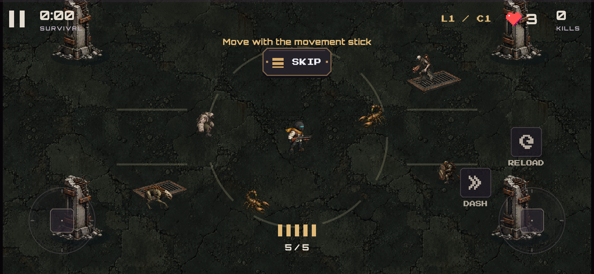
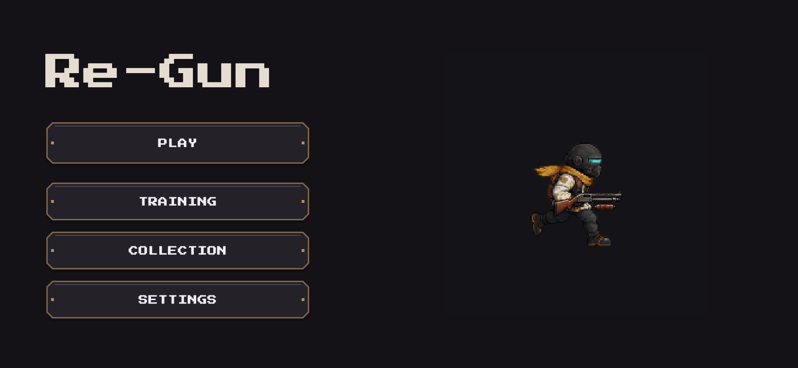
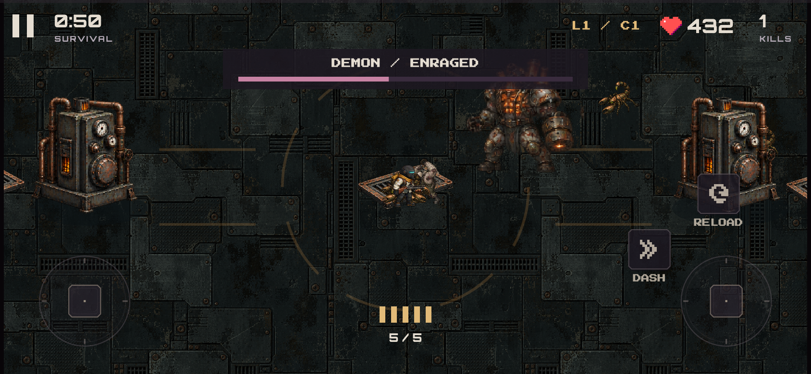

# Art overhaul implementation and review

**Latest status:** the initial connectivity problem was resolved and the art build was installed. A subsequent full-body animation candidate is now installed too; see [ANIMATION_REPAIR_2026-10-19.md](ANIMATION_REPAIR_2026-10-19.md) for current assets, playback checks and remaining visual review. The original art-pass numbers and evidence below are historical.

19 October 2026 · branch `tiles_for_background` · local work, no commit/push.

## Implemented in the playable candidate

| Scope | Result |
|---|---|
| Three survivors | Original replacement bodies and action poses; four facings; no inherited soldier or clipped-out baked weapon. |
| Four guns | Detailed independent bodies and moving pump/magazine/cylinder/cell; recoil and held-gun attachment. |
| Eight normal enemies | Full active roster uses new sheets; elite markings preserved. |
| Three bosses | Shadow, Demon and Queen use new sheets with state-selected warning/attack/enraged/defeat art. |
| World items | Animated salvage XP, unarmed/armed mine, support drone, hostile energy bolt. XP mechanics and economy unchanged. |
| Breach | Concrete material, containment marks, four ruined columns, grates, debris, interior wall rim. |
| Foundry | Steel material, six boiler obstacles, visible vent grates with hazard warnings anchored to them. |
| Preview consistency | Starting-screen survivor, loadout portraits and Collection cosmetics use the new bodies. Existing aligned menu scale is retained. |
| Visibility | Ground-foot depth ordering, contact shadows, fading props when obscuring the player; hostile shots/area warnings draw above actors. |
| Packaging | Retired inherited gameplay sheets/tiles excluded; source files preserved on disk. |

22 textures, 352 source frames. Some states deliberately hold a single authored pose (dash/hurt/death) rather than pretending a one-frame state is a long hand-drawn animation. Procedural muzzle flashes, trails, electrical lines and damage warnings remain because they communicate gameplay accurately at low cost.

## Gameplay and layout preservation

The shotgun's normal reload remains `900 + 700 × (missingShells − 1)` ms, 3700 ms for five missing shells. Five shell cues remain at 0/700/1400/2100/2800 ms. Its original Lottie remains. Other guns retain distinct reload mechanics. Aim, move, dash, damage, upgrade ranks, fusion recipes, boss phase schedules and settlement remain the existing systems. Deliberate upgrade slow motion remains.

The world rectangle is unchanged. Obstacle layout **did change**: four Breach footprints are 105 × 70 at (±560, ±230); six Foundry footprints are 160 × 100 at (±600, −700/0/700). All solid rendering, movement and line-of-sight use the same Tiled object data. Foundry vent positions now come from 25 authored anchors rather than a player-relative arbitrary offset. Existing saves are read through the same schema and actors are constrained to safe positions. The geometry contract test specifically checks old saved positions inside every new solid are relocated and long dashes cannot tunnel through them.

The repaired death overlay still uses a full-size parent Stack. The regression exercises real three-hit contact death during reload, visible hit-testable results, Restart, a second death, Menu and once-only run settlement with successful saves and no warning banner.

## Verification

- `flutter analyze --no-pub`: clean.
- `flutter test --no-pub`: **62 passed**, two opt-in soaks skipped by default.
- Full integration mounts all **12 survivor/weapon combinations**, fires/reloads, exercises all bosses and all six fusion branches, and restores a real checkpoint.
- Art contract checks frame counts/crops/pivots, texture budget, Tiled solids/vents, relocation and edge/corner camera coverage.
- Shared decoded art is **29.54 MiB**. This excludes GPU/engine/native/audio memory and transient PNG decode buffers.
- Opt-in 30-minute simulation: 6254 kills, seven boss defeats; peaks 116 enemies, 80 XP, 40 effects, 248 world children.
- Opt-in 60-minute simulation: 13963 kills, 12 boss defeats; peaks 120 enemies, 80 XP, 12 burning areas, nine mines, eight hazards, 301 world children.
- iOS release app and Android release APK compile successfully. Android local candidate remains debug-signed.

Evidence logs are in `docs/validation/art-*`. Actual in-engine captures are in `build/test-previews/`: menu-buttons, survivor-rook/scrapper/warden, weapon-shotgun/carbine/revolver/arcCaster, boss-shadow/demon/queen, collection-style and contact-death-results. Captures are diagnostic gameplay states, not store marketing shots; some include elevated test health.

## Actual in-engine captures

## Review on your phone

1. Open the starting screen: smaller new character, aligned buttons, readable gun.
2. In Training, try Rook/Scrapper/Warden with all guns. Move and aim separately in four directions, fire while running, dash while moving, reload partially/empty. Compare the distinct gun motions.
3. Walk around both sides of a column/boiler. It should block movement, sort naturally, and fade if it covers you. Dash into its edge, and try shots across it. Visit all world edges/corners.
4. Try each enemy and each boss in Training. Watch warning → attack → recovery → enraged transitions. Damage zones should match the ground warnings, not every decorative sprite effect.
5. Test mines, drones, chain/fire builds and all fusions under a crowd. XP should remain easy to see and collect. Check dense combat readability at actual phone size.
6. Die during reload and normal combat. Results must appear, Restart must respond, and a second death must still return to Menu. Verify profile/scrap survived updating the app.
7. Play a sustained developed run with speakers/headphones. Record touch comfort, heat, battery and frame-time stalls. Automated accelerated simulation cannot establish these results.

Use `REGUN_TESTING_AND_REVIEW.md` for the full game-system checklist beyond this art pass.

## Still open, stated explicitly

- **Physical device performance validation:** native iPhone/Android frame-time, peak memory, thermal behaviour, upload hitches and simultaneous-touch feel have not been measured by these tests.
- **Art judgment and cleanup:** generated outlines, limb/hand consistency and some attack-effect margins merit animation review. Measured crop metadata prevents assuming a perfect regular sheet; it does not turn generative frames into a hand-cleaned animation pack. Do not claim every frame passes a human animation audit.
- **Map richness:** both arenas have distinct materials, solids and landmarks, but more regional variations, modular wall/door transitions and custom focal props would further improve them. Repeating floor textures can still be noticed.
- **Cosmetics:** existing tint/badge/crown/trail rewards work on the new bodies. Full per-character bespoke cosmetic outfits/masks were not authored.
- **Boss corpses:** a short bounded fade uses the defeat artwork; a cinematic multi-stage defeat sequence is future polish. Results/rewards are not delayed for animation.
- **Feedback accessibility:** threat colours are still reinforced by shapes/telegraphs; contrast and colour-vision review on hardware remains worthwhile.
- **Distribution review:** inherited heart/splash/icons/fonts/reload/audio still need their existing provenance/license review. New generated art has recorded origins but no legal clearance guarantee. Store listing, upload signing and final marketing assets remain separate release tasks.

This is a full active-roster art replacement integrated into a functional test build. It is not a claim that every aspirational art-plan checkbox or store-release gate is complete.
