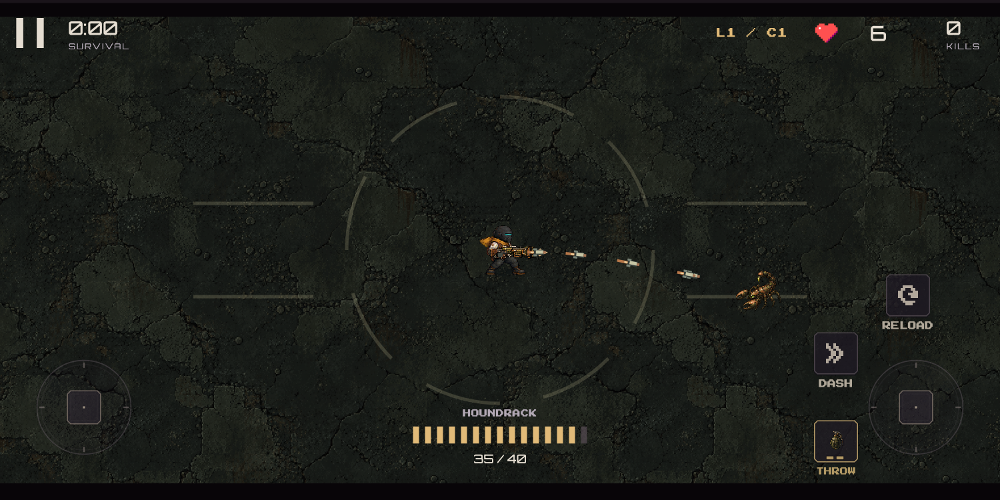
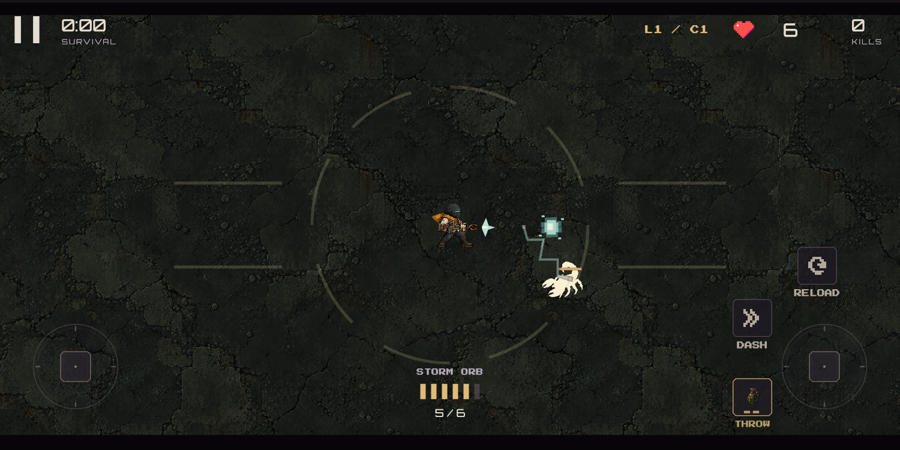
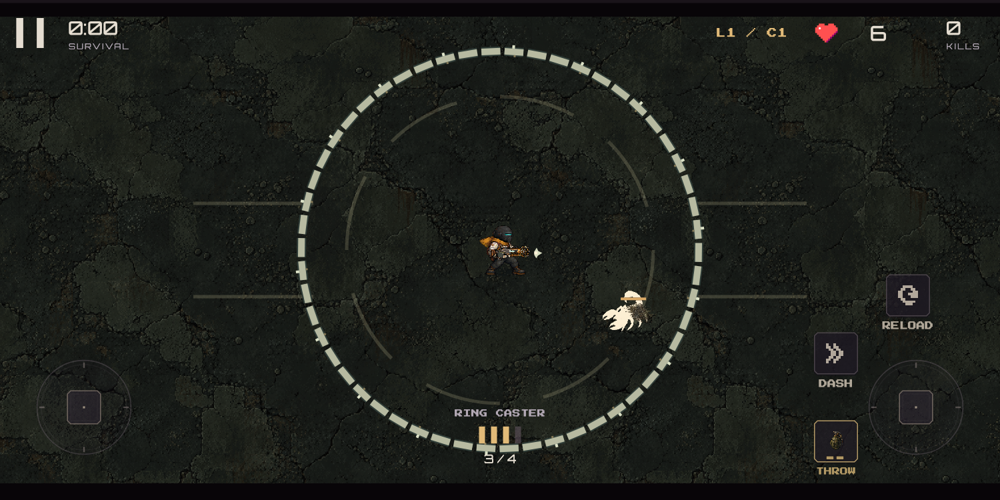

# Local validation — three selected weapons

24 October 2026. Commands run from the corresponding game/admin/server checkout.
These are local source/build checks, not installed-device or deployed-service proof.

| Check | Result | Evidence |
|---|---|---|
| Game `make verify` | Analyzer clean; 694 passed, five opt-in simulations skipped | [Full output](mobile-verify.txt) |
| Game `flutter test test/frontier_weapons_test.dart` | 11 passed, including additional live-value /zero-splash test | [Output](mobile-focused.txt) |
| Admin `make verify` | Analyzer clean; 44 passed | [Output](admin-verify.txt) |
| Admin final `flutter test test/frontier_test.dart` | Three passed; small/large rendered component panels | [Output](admin-focused.txt) |
| Server `npm run verify` | Typecheck, 148 tests and module build passed | [Output](server-verify.txt) |
| Gateway `npm run verify` in `identity` | Typecheck,22 tests,build and one compiled HTTP smoke passed | [Output](gateway-verify.txt) |
| Game `make buildIOS` | Release app built,175.3 MB | [Output](game-ios-build.txt) |
| Game `make buildAPK` | Release APK built,226.8 MB | [Output](game-android-build.txt) |
| Admin `make buildMac` | Release app built,46.1 MB | [Output](admin-macos-build.txt) |
| Admin `make buildIOS` | Release app built,18.5 MB | [Output](admin-ios-build.txt) |
| `python3 tool/preview_expansion_audio.py` | 144 cues verified; mix peak0.6483 | [Output](audio-preview.txt) |
| Rank component audit | 43 families,238560 component transitions,2040 shared samples | [Audit](../../RANK_COMPONENT_AUDIT.json) |

The focused game test was extended by one case after full-suite compilation;
the full suite contains the original ten new cases. Both use the final runtime
source. The final admin focused run refreshes only screenshot typography.

Catalog identity:
`3c9900a339bd4cf628beea55073d015afa719ca120e8c7a46c60a24beda51fc5`.
Admin/server catalog JSONs are equal, contain313 fields, and mobile/admin
component source files are byte-identical. Source and packaged weapon PNGs
match each other and all three generation SHA-256 hashes. Previous expansion
WAVs were checked against their pre-generation hashes and stayed identical.
`git diff --check` passed in all three checkouts.

## Actual renders inspected

Captured from the running game widget with loaded art and active effects, rather
than concept-only previews. The test body is deliberately stationary and durable.

The isolated admin component panel at320 logical pixels and increased text scale:

[Desktop component render](admin-components-1200.png).

No installation, live API rollout or balance publication occurred. Native
listening, performance, comfort and final balance remain for creator review.
